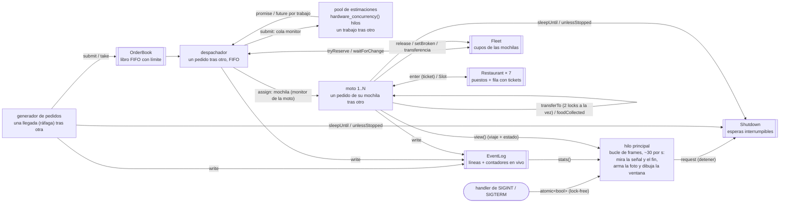

# Equipetrol Delivery

Simulación concurrente en C++17 de una empresa de delivery en la Zona Equipetrol (Santa Cruz de la Sierra),
dibujada en vivo sobre un mapa real de OpenStreetMap.

Datos del mapa © OpenStreetMap contributors, disponibles bajo la licencia ODbL
(<https://www.openstreetmap.org/copyright>).

## Compilar y ejecutar

```sh
mkdir build && cd build && cmake .. && make
./delivery_sim ../config/equipetrol.json            # el log va a events.log
./delivery_sim ../config/equipetrol.json --log otro.log

# ThreadSanitizer, en una carpeta aparte:
mkdir build-tsan && cd build-tsan && cmake -DENABLE_TSAN=ON .. && make
```

- La primera línea de stdout es `Simulation has started...`; la última, el resumen en JSON.
- Termina:
  - al cumplirse `durationS` (con 0, solo por señal);
  - con `SIGINT` o `SIGTERM`;
  - al cerrar la ventana.

  En todos los casos termina con salida 0, en menos de 5 s reales.
- Sin pantalla (`DISPLAY` y `WAYLAND_DISPLAY` vacías) avisa en stderr y simula igual, sin ventana.
- Una configuración inválida o un mal uso salen con un mensaje en stderr, sin simular: código 1 para configuración o
  log inválidos, 2 para argumentos mal usados.
- `ctest` corre las pruebas de cada pieza (`tests/`).

## Dependencias

| Dependencia | Versión usada | Mínimo | Cómo se obtiene |
|---|---|---|---|
| CMake | 4.2.3 (verificado también con 3.11.4) | 3.11 | Sistema |
| g++ / clang++ | 15.2 / 21.1 | g++ 7 | Sistema |
| OpenCV (`core imgproc imgcodecs highgui`) | 4.10.0 | 4.1 | Sistema (`libopencv-dev`) |
| nlohmann/json | 3.12.0 | — | **Lo descarga CMake** al configurar (`FetchContent`) |

**`cmake ..` necesita conexión a internet la primera vez:** descarga los headers de nlohmann/json
(`include.zip` del release oficial, ~300 KB) y verifica su SHA256. Queda en `build/_deps/`, así que las
siguientes configuraciones en la misma carpeta no vuelven a descargar.

OpenCV se usa **solo para la ventana**, y sin su paralelismo interno (`cv::setNumThreads(0)`): el OpenCV del sistema
paraleliza con TBB, que el proyecto no puede usar.

## Mapa

El fondo `data/equipetrol.png` es una composición de tiles estándar de OpenStreetMap (zoom 16, 933×1014 px)
que cubre la Zona Equipetrol del Segundo al Cuarto Anillo, con la Av. San Martín. Se regenera con:

```sh
tools/osm_map.py --north -17.7538 --south -17.7745 --west -63.2060 --east -63.1860 \
                 --zoom 16 --out data/equipetrol.png
```

El script recorta en bordes de píxel enteros e imprime los bounds exactos de la imagen:
north `-17.7537957`, south `-17.7745163`, west `-63.2060194`, east `-63.1859994`.
La imagen usa proyección Web Mercator: la longitud es lineal en x, la latitud no lo es en y. La ventana proyecta las
dos coordenadas linealmente ([src/projection.hpp](src/projection.hpp)). En los 0,02° de latitud que cubre la imagen,
la diferencia con Mercator es menor que 0,1 píxel.

## Configuración

`config/equipetrol.json` sigue el formato de la sección 5 del enunciado. **No se escribe a mano:** lo genera
`tools/osm_network.py` a partir de `tools/zona_equipetrol.json` (zona, restaurantes, punto de partida y
parámetros) y de las calles de OpenStreetMap (en caché en `~/.cache/osm_network.json`, así es reproducible):

```sh
tools/osm_network.py --zone tools/zona_equipetrol.json --image data/equipetrol.png \
                     --out config/equipetrol.json --preview-dir docs/red_vial
```

Contiene 154 nodos, 219 calles (151 de un solo sentido) y 7 restaurantes: Pizza Hut, Aviator, SantaMaria,
Pollos Santiago, Sicilia, Pollos Chuy y Pizza Bizarra, en orden del 4to al 2do Anillo.

## Esquema del programa

Cada caja es un hilo; cada flecha, un canal por el que dos hilos se comunican o se esperan.



| Hilo | Cuántos | Sobre qué itera | Termina cuando |
|---|---|---|---|
| Principal ([src/simulation.cpp:507](src/simulation.cpp#L507)) | 1 | Frames de 33 ms: el fin por tiempo, la bandera de la señal, la foto para la ventana, `running` | Fin, señal, ventana cerrada o todos los hilos terminaron; después hace `join` de todos |
| Generador ([src/simulation.cpp:78](src/simulation.cpp#L78)) | 1 | Llegadas de pedidos en ráfagas, durmiendo hasta cada una | El tope de pedidos o la detención; cierra el libro |
| Despachador ([src/simulation.cpp:230](src/simulation.cpp#L230)) | 1 | Pedidos del libro, de a uno, en orden | El libro cerrado y vacío, o la detención; cierra las mochilas |
| Pool de estimaciones ([src/thread_pool.cpp](src/thread_pool.cpp)) | `hardware_concurrency()` (2 si da 0) | Trabajos de la cola | El destructor del pool: cierra, descarta lo que no empezó y hace `join` |
| Moto ([src/courier.cpp:391](src/courier.cpp#L391)) | `fleet.couriers` | El primer pedido de su mochila: viajar, recoger y entregar | Mochila cerrada y vacía, o la detención; avisa a la flota (`retire`) |
| Alcanzabilidad ([src/road_graph.cpp:56](src/road_graph.cpp#L56)) | 1 por restaurante | Un Dijkstra | Antes de empezar la simulación (`std::async` + `get`) |

El handler de señales **solo** pone una bandera `std::atomic<bool>` lock-free
([src/stop_signal.cpp:9](src/stop_signal.cpp#L9)): no toma locks ni despierta a nadie, porque eso no es seguro dentro
de un handler. La lee el bucle de frames, que de todos modos se despierta cada 33 ms para dibujar. Esa pausa por frame
es la que permite el enunciado, así que no es espera activa. Al verla, ese bucle hace todo lo demás: registra
`simulationStopping` y aborta los monitores, lo que despierta a cada hilo que esté esperando.

## Mapa de conceptos

| Carpeta | Concepto | Dónde y por qué |
|---|---|---|
| `01` | Hilos creados explícitamente, con un destino deliberado | [src/simulation.cpp:475](src/simulation.cpp#L475), [489](src/simulation.cpp#L489), [502](src/simulation.cpp#L502) y [581–584](src/simulation.cpp#L581): las motos, el despachador y el generador son `std::thread`, y `runSimulation` hace `join` de todos antes de armar el resumen. El pool hace `join` de los suyos en su destructor ([src/thread_pool.cpp:27](src/thread_pool.cpp#L27)). Nada se abandona con `detach`: un hilo suelto podría seguir escribiendo en el log después del resumen, y destruir uno sin `join` llama a `std::terminate`. |
| `01` | Una decisión que depende del hardware | [src/thread_pool.cpp:5](src/thread_pool.cpp#L5): el pool de estimaciones tiene `hardware_concurrency()` hilos, o 2 si esa pista da 0. Con 64 motos cada pedido genera 64 estimaciones: las tareas crecen con la flota pero los hilos no, porque más hilos que núcleos solo agregarían cambios de contexto (lo mide el experimento del pool). |
| `02` | Datos pasados por valor, por referencia y por movimiento | Por valor: la tarea de cada estimación copia el plan de la moto y el `shared_ptr` al mapa ([src/simulation.cpp:251](src/simulation.cpp#L251)), porque puede terminar tarde, cuando el despachador ya siguió. Por referencia: la función de traspaso captura `couriers` y la flota ([src/simulation.cpp:466](src/simulation.cpp#L466)), que viven hasta después del `join`. Por movimiento: el pedido entra a la mochila con `std::move` ([src/courier.cpp:49](src/courier.cpp#L49)). |
| `02` | Pedidos que viajan por movimiento y están en un solo lugar | `Order` borra la copia y deja el movimiento ([src/order.hpp:27–29](src/order.hpp#L27)). Pasa del generador al libro, del libro al despachador, a la mochila y, en un traspaso, a la mochila de otra moto ([src/courier.cpp:133](src/courier.cpp#L133)), siempre por `std::move`. Si se pudiera copiar, un pedido podría quedar en dos mochilas, y el verificador del enunciado lo cuenta como error. |
| `03` | Funciones miembro de objetos compartidos en hilos; contenedores de hilos | Cada moto corre `Courier::run` en su hilo ([src/simulation.cpp:475](src/simulation.cpp#L475)), y los hilos se guardan en un `std::vector<std::thread>` con `emplace_back`. `std::thread` no se puede copiar, así que solo se puede mover dentro del vector. El pool hace lo mismo con `&ThreadPool::work` ([src/thread_pool.cpp:13](src/thread_pool.cpp#L13)). |
| `03` | Propiedad compartida que garantiza la vida; ningún puntero crudo dueño | Las motos son `shared_ptr<Courier>` ([src/simulation.cpp:458](src/simulation.cpp#L458)): las comparten su hilo (copia capturada por valor) y el despachador, y el objeto vive mientras alguno lo use. El mapa es `shared_ptr<const World>`; el pool, `unique_ptr` ([src/simulation.cpp:485](src/simulation.cpp#L485)). Los únicos punteros crudos (`Slot::_restaurant`, `Carried::foodWith`) no son dueños y apuntan a objetos que viven más que ellos. |
| `04` | Tareas con un future y política de lanzamiento explícita | [src/road_graph.cpp:56](src/road_graph.cpp#L56): `std::async(std::launch::async, …)`, un Dijkstra por restaurante, en paralelo, y después los `get()`. Ahí el future que bloquea al destruirse no molesta, porque se esperan todos. Sin la política explícita, la implementación podría diferirlos hasta el `get()` y correrían uno tras otro. |
| `04` | Un promise/future como canal de un solo uso | [src/thread_pool.hpp:50–58](src/thread_pool.hpp#L50): cada trabajo del pool tiene su `std::promise`, y el despachador espera el `std::future`. A diferencia del future de `std::async`, este **no bloquea al destruirse**: una estimación tardía termina en el pool y nadie la espera, así que no congela al despachador. |
| `04` | Una espera con límite de tiempo y una excepción que cruza de hilo | [src/simulation.cpp:258–263](src/simulation.cpp#L258): `wait_until` con `quoteTimeoutMs` en tiempo real; una estimación que falla lanza `EstimateError`, que viaja por `set_exception` y sale en `get()`. El despachador la reporta en stderr y sigue con los demás candidatos. |
| `05` | Un argumento por cada objeto compartido de por qué no hay data race | La sección [Sin condiciones de carrera](#sin-condiciones-de-carrera), objeto por objeto. |
| `05` | Un tipo seguro de mover porque sus funciones especiales son correctas | `Restaurant::Slot` ([src/restaurant.hpp:33](src/restaurant.hpp#L33)): el puesto se libera en el destructor; la copia está borrada, porque dos copias liberarían el puesto dos veces; y el constructor de movimiento deja el origen en `nullptr`, así que solo el destino lo libera. `Trip` sigue la regla de cero: solo tiene vectores y valores, así que las funciones especiales que genera el compilador copian bien. |
| `06` | Exclusión mutua solo con locks RAII; secciones críticas cortas | Todos los mutex se toman con `lock_guard`, `unique_lock` o `scoped_lock`, nunca con `lock()`/`unlock()` a mano. Las secciones críticas copian y salen: la moto entrega una copia de su plan y la estimación (los Dijkstra) corre fuera del lock; el log arma la línea antes de tomar el suyo. |
| `06` | Una operación con dos locks a la vez, sin deadlock | [src/courier.cpp:99](src/courier.cpp#L99): el traspaso por avería toma los mutex de las dos motos con `std::scoped_lock`. Si A le traspasa a B mientras B le traspasa a A, cada hilo pide los mismos dos locks al revés, la receta del deadlock; `scoped_lock` los toma con el algoritmo de `std::lock`, que lo evita. El resto sigue un orden global: motos → flota → `Shutdown` → log. |
| `07` | Monitores: datos que no se tocan sin su lock | `OrderBook`, `Fleet`, `Restaurant`, `Shutdown`, `EventLog`, la cola del `ThreadPool` y la mochila de cada `Courier`: los datos son privados, y solo los tocan sus métodos, con el mutex tomado. |
| `07` | Esperas con predicado, robustas a despertares espurios y al apagado | Cada `wait` lleva predicado: la moto sin pedidos ([src/courier.cpp:77](src/courier.cpp#L77)), la fila del restaurante por ticket ([src/restaurant.cpp:13](src/restaurant.cpp#L13)), el despachador esperando lugar ([src/fleet.cpp:62](src/fleet.cpp#L62)), los hilos del pool ([src/thread_pool.cpp:38](src/thread_pool.cpp#L38)) y las esperas de tiempo simulado ([src/shutdown.hpp:67](src/shutdown.hpp#L67)). Un despertar sin novedades vuelve a dormir. Para el apagado, cada monitor tiene su `abort()`/`close()` con `notify_all`, así nadie queda dormido. |

## Sin condiciones de carrera

Por cada objeto que comparten varios hilos, la razón por la que no puede haber una condición de carrera sobre él.

| Objeto | Quiénes lo usan | Por qué no hay data race |
|---|---|---|
| `OrderBook` (libro) | generador, despachador, principal (`abort`) | Monitor: la cola y las banderas son privadas y solo se tocan con su mutex. |
| `Fleet` (cupos) | despachador, motos, principal | Monitor. "Elegir una moto con lugar y reservarle el cupo" es una sola operación con el lock tomado, así que no hay check-then-act entre hilos. |
| Mochila, viaje y estado de cada `Courier` | su hilo, el despachador (`assign`, `plan`), otra moto (traspaso), la ventana (`view`) | Monitor de la moto: `_bag`, `_trip` y las banderas solo se tocan con su mutex. El traspaso toma los dos mutex juntos. Los demás leen copias. |
| `_at`, `_rng` y estadísticas de una moto | solo su hilo | No se comparten mientras corre. Las estadísticas se leen después del `join`, que sincroniza. |
| `Restaurant` (puestos y tickets) | las motos que llegan | Monitor; el ticket se toma con el lock, y eso fija el orden de llegada. |
| `EventLog` y sus contadores en vivo | todos los hilos, la ventana | Monitor: la línea y los contadores se escriben en la misma sección crítica; `stats()` copia con el lock. |
| `Shutdown` | todos | Monitor; pedir parar y registrar `simulationStopping` son una sola operación. |
| Cola del `ThreadPool` | despachador, hilos del pool | Monitor; cada trabajo corre fuera del lock. Su resultado viaja por su `promise`, que sincroniza. |
| `World` / `RoadGraph`, `SimClock`, `SimParams` | todos | Se arman antes de lanzar los hilos y después solo se leen (`const`): sin escrituras no hay carrera. |
| Bandera de la señal | handler, hilo principal | `std::atomic<bool>` lock-free. |
| `running` (hilos que siguen) | todos los hilos, el principal | `std::atomic<int>` con `fetch_sub`, una sola operación de lectura-modificación-escritura: dos hilos que terminan a la vez no pierden un descuento. |
| Resultados del generador y del despachador | un solo hilo cada uno | Los escribe un solo hilo y se leen después de su `join`. |
| La función de traspaso de cada moto | su hilo | Se fija antes de lanzar los hilos; después solo se lee. |

ThreadSanitizer no reporta nada en las pruebas ni en `delivery_sim`; la [sección de herramientas](#análisis-con-herramientas)
lo documenta. En el build de TSan, [src/tsan_suppressions.cpp](src/tsan_suppressions.cpp) suprime **solo** los
reportes cuya pila pasa por las bibliotecas gráficas que usa OpenCV (Qt, DBus, GTK). Son carreras dentro de esas
bibliotecas, en código no instrumentado; una carrera inyectada a propósito en nuestro código se sigue reportando.

## Decisiones sobre lo que el enunciado no fija

- **Destino de un pedido:** un nodo al azar de la red, sin contar los nodos de los restaurantes. Es `unreachable` si
  no hay camino dirigido desde el restaurante.
- **Ráfagas:** cada llegada trae entre 1 y `burstMax` pedidos, con un intervalo medio de
  `meanIntervalMs × (1 + burstMax) / 2`. Así el tiempo medio entre dos pedidos sigue siendo `meanIntervalMs`.
- **`maxPending`** cuenta los pedidos dentro del libro; `unreachable` tiene prioridad sobre `queueFull`.
- **"Reproducible"** = la secuencia de pedidos (instantes, ráfagas, restaurantes, destinos). Lo que depende del
  intercalado (asignaciones, `queueFull`, averías) puede variar entre corridas.
- **Preparación:** uniforme en el rango del restaurante; empieza al asignar el pedido.
- **Restaurante:** la entrega en el puesto tarda 30 s simulados, y la moto espera la comida con el puesto tomado.
- **Mochila:** `bagCapacity` cuenta los pedidos asignados. Una visita a un restaurante recoge todos los de ese
  restaurante, y se entrega en el orden de asignación.
- **Despachador:**
  - **candidatos:** todas las motos con lugar;
  - **ETA:** el recorrido completo, sin contar la fila;
  - **fallo de una estimación:** que no se pueda calcular (sin camino);
  - **`noCourier`:** cuando pasa `acceptTimeoutMs` desde la creación sin lograr asignar el pedido.
- **Averías:**
  - **viaje:** cada tramo; el instante es al azar dentro del tramo, y la moto queda en ese punto de la calle;
  - **traspaso:** siempre traspasa todo a un solo receptor, el que llega antes por calle, con prioridad sobre el
    despachador;
  - **rescate:** los pedidos ya recogidos se van a buscar al punto de la avería (15 s);
  - **reparación:** 5 min, desde que le retiraron la comida;
  - **sin otra moto que pueda trabajar:** se repara igual y sigue con sus pedidos.
- **Ventana:** cerrarla detiene la simulación; sin pantalla, se simula igual.
