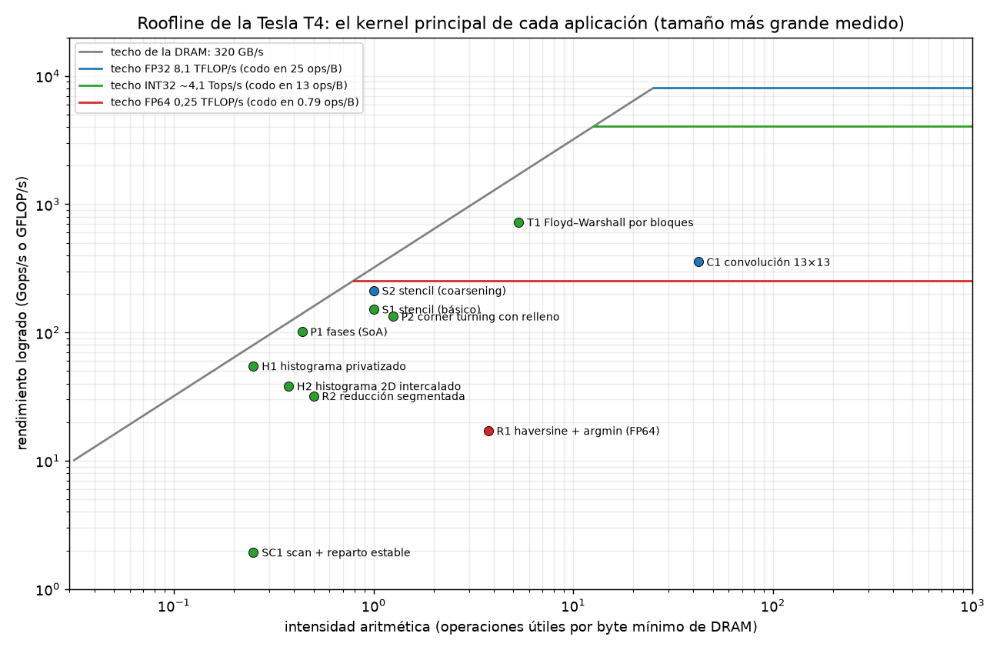

# EC2 · La GPU en Equipetrol Delivery: informe de rendimiento y análisis

Segunda evaluación del proyecto. Agrega 11 aplicaciones de GPU (CUDA) a la simulación de delivery, cada una con su
versión de CPU, una prueba de igualdad, cuatro versiones medidas y un veredicto. La pregunta de cada una es **¿vale
la pena la GPU para esta tarea?** Este informe junta las 11. El detalle de cada aplicación (diseño, corrección,
tablas, gráficos, perfiles y análisis) está en su carpeta, enlazada en la tabla.

## 1. Resumen

| aplicación | concepto (carpeta de `ec2/`) | n.º del concepto | tipo | cruce (GPU de punta a punta > mejor CPU de la laptop) | mejor speedup de punta a punta | veredicto |
|---|---|:---:|:---:|---|---:|---|
| [R1](r1_mas_cercanas/README.md) las motos más cercanas | 08 reducción | 1.ª | B | 1 000 motos | 3,95× (10⁵ motos) | **CPU** en la simulación: es ~1 % de la ronda del despachador (Amdahl) |
| [T1](t1_todos_contra_todos/README.md) todos contra todos | 03 tiling | 1.ª | B | ~500 nodos | 25,4× (4775 nodos) | **CPU** en la simulación: 37 Dijkstra (14 ms) le ganan a la tabla entera (0,75 s); **GPU** si hace falta la tabla |
| [H1](h1_tiempos_de_entrega/README.md) histograma de tiempos de entrega | 07 histograma | 1.ª | A | nunca | 0,97× (10⁷) | **CPU**: la copia es el 98 % |
| [SC1](sc1_agrupar_por_restaurante/README.md) pedidos agrupados por restaurante | 09 scan | 1.ª | A | 10⁵ pedidos | 1,43× (10⁶) | **CPU** al tamaño de la simulación; GPU apenas con volúmenes grandes |
| [R2](r2_por_restaurante/README.md) estadísticas por restaurante | 08 reducción | 2.ª | A | 10⁵ pedidos | 3,72× (10⁷) | **CPU** en la simulación; **GPU** desde 10⁵ pedidos |
| [H2](h2_franja_restaurante/README.md) pedidos por restaurante y franja | 07 histograma | 2.ª | A | nunca | 0,99× (10⁶) | **CPU**: dos arreglos por pedido por PCIe |
| [C1](c1_mapa_de_calor/README.md) mapa de calor de la demanda | 05 convolución | 1.ª | A | la grilla más chica (64²) | 50,9× (256²) | **GPU**, también con la grilla del reporte (23×) |
| [S1](s1_cobertura/README.md) mapa de cobertura | 06 stencil | 1.ª | A | 64² celdas | 13,7× (512²) | **GPU** (3,4× con la grilla del reporte) |
| [S2](s2_difusion/README.md) difusión de la demanda | 06 stencil | 2.ª | A | 64² celdas | 15,3× (2048²) | **GPU** (2,2× con la grilla del reporte) |
| [P1](p1_aos_soa/README.md) fases de los pedidos, AoS contra SoA | 04 performance | 1.ª | A | nunca | 0,63× (10⁵) | **CPU**: la copia es el 98 %; SoA 1,70× más rápido que AoS en el kernel |
| [P2](p2_sentidos_unicos/README.md) rodeo de los sentidos únicos | 04 performance | 2.ª | A | 256 nodos | 2,08× (1024 nodos) | **CPU** con Equipetrol; **GPU** con la ciudad (la tabla de T1); relleno 1,85× |

Tipo **A** = agregada: una sección nueva de `--report`, calculada al final, que no toca ninguna decisión. Tipo **B** =
acelerada idéntica: la GPU hace parte de un cálculo que la simulación ya hacía y el resultado es exactamente el de la
CPU. El cruce y el speedup comparan la GPU de la T4 (de punta a punta: copias incluidas) contra la mejor CPU de la
laptop (1, 2 o 4 hilos).

**Puntos.** En esta entrega se cuentan los conceptos **03 a 09**. Filter (10), merge (11) y sorting (12) no se
implementaron. Por concepto:

| concepto | 03 tiling | 04 performance | 05 convolución | 06 stencil | 07 histograma | 08 reducción | 09 scan | total |
|---|:---:|:---:|:---:|:---:|:---:|:---:|:---:|:---:|
| aplicaciones | T1 | P1, P2 | C1 | S1, S2 | H1, H2 | R1, R2 | SC1 | 11 |
| puntos (1 por aplicación, máx. 3) | 1 | 2 | 1 | 2 | 2 | 2 | 1 | **11 de 21** |

El documento define la nota sobre 10 conceptos (30 puntos). Cómo se traduce a 7 conceptos queda por confirmar con el
docente.

**La conclusión en una línea.** La GPU gana cuando cada byte copiado se usa muchas veces (convolución, stencils con
los datos quietos en la GPU, Floyd–Warshall). Pierde cuando cada dato se lee una sola vez (histogramas, fases, reducción
simple): ahí la copia por PCIe es el 96–98 % del tiempo. **En la simulación misma (R1 y T1, tipo B), no conviene:**
lo que la GPU acelera es una parte chica del trabajo, y lo caro sigue en la CPU. Ver la [sección 5](#5-efecto-en-la-simulación-completa).

## 2. Set-up

**Máquinas.** Cada número dice de qué máquina sale.

| | laptop (CPU de referencia, el veredicto) | Google Colab (GPU, y la tabla secundaria "misma máquina") |
|---|---|---|
| CPU | Intel Core i5-6300U, 2,4 GHz, **2 núcleos / 4 hilos**, sin núcleos de eficiencia | Intel Xeon 2,0 GHz, 2 vCPU (1 núcleo / 2 hilos) |
| memoria | 3,8 GB (WSL2) | la de la sesión de Colab (no se anotó) |
| GPU | ninguna | **Tesla T4** (Turing, CC 7.5, 40 SM, 16 GB, 320 GB/s), driver 580.82.07 |
| sistema | Windows 10 + WSL2, Ubuntu 26.04, kernel 6.18 | Ubuntu 24.04 |
| compilador | g++ 15.2.0, CMake 4.2.3 | g++ 13.3.0, nvcc 13.0.88, CMake 3.31.10 |
| build | Release (`-O3 -DNDEBUG`), sin ventana, 0 warnings | Release, `-DUSE_CUDA=ON` (`sm_75`), sin ventana |
| reglas | enchufada, modo "Mejor rendimiento", sin otras aplicaciones, versiones intercaladas | máquina compartida (amenaza a la validez) |

El código de cada aplicación se compiló en la laptop **sin CUDA**, con `cuda_compat.h` emulando la GPU, para
desarrollar y para correr las pruebas bajo TSan. **La emulación nunca se midió.**

**Configuraciones.**
- `config/equipetrol.json`, la del brief: 154 intersecciones, 219 calles, 7 restaurantes, 8 motos, un pedido cada
  20 s.
- `config/santa_cruz.json`, la **ciudad**, generada desde OpenStreetMap con `tools/osm_network.py`: **4775
  intersecciones**, 7263 calles, 37 restaurantes, **3000 motos**, un pedido cada 0,2 s en ráfagas de hasta 12, y
  hasta 500 pedidos pendientes.
- Las dos simulan 1 hora (`durationS = 3600`) en 60 s reales (`timeScale = 60`).

**Cómo se mide.** `delivery_sim <config> --headless --bench <csv> [--bench-app <app>]` mide cada aplicación con
datos sintéticos de semilla fija y escribe una fila por corrida: `aplicación, versión, hilos, tamaño, repetición, ms,
correcto, máquina`. El procedimiento:
- al menos 5 tamaños, cubriendo dos o más órdenes de magnitud;
- una corrida de calentamiento por versión;
- 15 repeticiones (10 en T1) **intercaladas** entre versiones;
- cada corrida se compara con la referencia de CPU: el CSV trae la columna `correcto`.

Las versiones medidas:
- `cpu_1` y `cpu_threads`, esta última con 1, 2 y 4 hilos en la laptop y 1 y 2 en Colab;
- `gpu_kernel`, medido con eventos de CUDA;
- `gpu_end_to_end`: copias, kernels y resultado, con un reloj del host después de sincronizar;
- `gpu_via_owner`: lo mismo, pero por el hilo dueño de la GPU.

Las tablas y los gráficos los genera `tools/informe_ec2.py` desde los CSV; no hay números escritos a mano. Por
aplicación hay un notebook, `colab/ec2_<app>.ipynb`, que compila, corre las pruebas en la T4, `compute-sanitizer`,
el bench, `nsys`, `ncu` y la simulación de la ciudad. El notebook ejecutado queda en la carpeta de la aplicación.

Para reproducir:

```sh
# laptop, por aplicación (desde un commit exacto; el hash de src/ queda anotado)
cmake -S . -B build -DCMAKE_BUILD_TYPE=Release -DDELIVERY_WINDOW=OFF && cmake --build build -j4 --target delivery_sim
./build/delivery_sim config/santa_cruz.json --headless --bench docs/ec2/<carpeta>/laptop.csv --bench-app <app>
# Colab: abrir colab/ec2_<app>.ipynb (T4) y "Run all"; produce colab.csv y el notebook ejecutado
python3 tools/informe_ec2.py <app> docs/ec2/<carpeta>/laptop.csv docs/ec2/<carpeta>/colab.csv docs/ec2/<carpeta>
# el roofline de la sección 4
python3 tools/roofline_ec2.py docs/ec2 docs/ec2/roofline.png
# la simulación completa de la sección 5: colab/ec2_simulacion.ipynb, y en la laptop
python3 tools/efecto_simulacion.py run build/delivery_sim config/santa_cruz.json cpu 3 resultados
```

**La arquitectura de la GPU dentro del programa** (igual para las 11):
- **Un solo hilo es dueño de la GPU** (`GpuOwner`, un `ThreadPool` de 1 hilo: la cola monitor de 07 y un `promise`
  por trabajo, de 04).
- Los demás hilos le mandan trabajos y reciben un `future`. El despachador espera ese future con plazo
  (`quoteTimeoutMs`, tiempo real). Si se vence o falla, escribe una línea en stderr y lo hace en la CPU. Nadie gira
  esperando.
- La memoria de la GPU se reserva una vez y se reusa.
- **Sin `-DUSE_CUDA=ON` el build por defecto no cambia.** Con la opción, `delivery_sim` usa la GPU para R1 y T1
  durante la simulación y para las aplicaciones de tipo A en `--report`.

## 3. Una sección por aplicación

Cada carpeta tiene su `README.md` con:
- la tarea y por qué es paralela de datos;
- el diseño: datos, grid y bloque, y qué hilo es dueño de qué;
- la evidencia de corrección: pruebas de igualdad en la T4, emuladas y bajo TSan, y `compute-sanitizer` con
  memcheck y racecheck;
- las tablas (laptop contra T4 y misma máquina) y el barrido de hilos;
- el gráfico log-log de tiempo contra tamaño, con el cruce marcado, y la parte de copias contra kernel;
- los perfiles de `nsys` y `ncu`;
- el análisis de la sección 2.5 del documento.

También tiene los CSV crudos (`laptop.csv`, `colab.csv`), el hardware de la laptop y el notebook ejecutado.

| aplicación | lo que más enseña |
|---|---|
| [R1](r1_mas_cercanas/README.md) | la GPU **no decide**: devuelve un superconjunto con margen y la CPU elige con el criterio de siempre, así que la decisión es idéntica aunque `sin`/`cos` difieran en el último bit; Amdahl: es el 1 % de la ronda |
| [T1](t1_todos_contra_todos/README.md) | tiling en 3 fases: 5,3 operaciones por byte contra 0,25 del clásico; 25× de punta a punta; pero la simulación solo necesita 37 filas de la tabla |
| [H1](h1_tiempos_de_entrega/README.md) | privatización: atómicos globales 33× más lentos que privatizados (contención en pocas cajas); el kernel al 80 % de la DRAM y aun así pierde por la copia |
| [SC1](sc1_agrupar_por_restaurante/README.md) | scan Kogge–Stone y reparto **estable**: la estabilidad cuesta ocupación (25 %) y coalescing |
| [R2](r2_por_restaurante/README.md) | reducción segmentada con lecturas indirectas: la GPU esconde la latencia del gather con miles de hilos y la CPU no |
| [H2](h2_franja_restaurante/README.md) | recorrido intercalado (coalescido) 1,44× más rápido que el contiguo |
| [C1](c1_mapa_de_calor/README.md) | 169 FMA por celda: mucho cálculo por byte copiado; el tiling a mano no ganó porque la L1 ya lo hace |
| [S1](s1_cobertura/README.md) | datos quietos en la GPU durante 100 barridos; el tiling con halo es 1,62× **más lento** que el básico |
| [S2](s2_difusion/README.md) | flotantes con tolerancia explicada (FMA); el coarsening en registros sí gana (1,15×) donde el tiling de S1 perdió |
| [P1](p1_aos_soa/README.md) | SoA 1,70× más rápido que AoS en el kernel, pero transponer en la CPU cuesta más que el cálculo |
| [P2](p2_sentidos_unicos/README.md) | corner turning: **sin relleno es más lento que el ingenuo** (conflictos de bancos de 32 vías); con relleno, 1,85× |

## 4. El roofline



Generado por `tools/roofline_ec2.py`.
- **Intensidad** = operaciones útiles / bytes mínimos de DRAM. Los dos se cuentan desde el código: una suma, un
  mínimo, una comparación o un incremento es 1 operación, una FMA son 2 FLOP, y el direccionamiento no cuenta.
- **Rendimiento** = esas operaciones / la mediana del tiempo de kernel en la T4, en el tamaño más grande medido. Los
  tiempos se leen de los CSV.
- **Techos de la T4:** DRAM 320 GB/s; FP32 8,1 TFLOP/s; enteros ~4,1 Tops/s (40 SM × 64 unidades INT32 ×
  1,59 GHz); FP64 0,25 TFLOP/s.

La tabla con la derivación de cada punto está en [`roofline_tabla.md`](roofline_tabla.md).

**Casi todo está limitado por la memoria.** Ocho de los once kernels están a la izquierda del codo, con 0,25 a
1,25 operaciones por byte: H1, P1, S2, S1, P2, H2, R2 y SC1.
- **Pegados al techo de la DRAM:** H1 (69 %), P1 (73 %) y S2 (67 %), contando solo los bytes mínimos. `ncu` los ve
  al 80–97 % de la DRAM porque mueven algo más que el mínimo. Más rápido no se puede sin **leer menos bytes**, y eso
  es lo que hacen las optimizaciones que sí ganaron: SoA en P1 (1,70×) y coarsening en S2 (1,15×).
- **Por debajo del techo:** P2 (33 %), H2 (32 %) y R2 (20 %). Ahí no falta ancho de banda, faltan **lecturas en
  vuelo**:
  - P2: la reducción final con barreras para solo 1024 pares por bloque;
  - H2: 8 warps por SM;
  - R2: la lectura indirecta y solo 37 bloques, uno por restaurante.
- **SC1 es el más lejano (2 %).** El reparto estable tiene 25 % de ocupación, escrituras dispersas y tres
  lanzamientos.

**Los tres que no están en la zona de memoria.**
- **T1** (5,3 ops/B por el tiling) logra 725 Gops/s. Es el kernel más rápido del proyecto. Según `ncu` lo frena la
  memoria compartida/L1 (89 %), un techo que este gráfico no dibuja, no la DRAM (20 %). Sin tiling estaría en
  0,25 ops/B, contra la diagonal.
- **C1** (42 FLOP/B) está a la derecha del codo de FP32, pero logra solo el 4 % del pico. Lo frena la unidad de
  carga: cada FMA necesita un operando de la memoria compartida.
- **R1** hace haversine en FP64, que la T4 corre a 1/32 de la velocidad de FP32. Su intensidad es una
  **estimación** (~60 FLOP por moto) y logra el 7 % del techo de FP64. Con 10⁵ motos son 3 lanzamientos y 9 rondas
  de argmin: domina la latencia, no el cálculo.

**El roofline que decide el veredicto es otro: el de PCIe.** El roofline mide el kernel, pero el veredicto se decide
de punta a punta, y ahí el techo de memoria es la copia por PCIe: **~4,5 GB/s** desde memoria paginable (medido con
`nsys` en H1, P1 y P2), 70 veces menos que la DRAM. Contando las operaciones por byte **copiado**, no por byte de
DRAM:
- Leer cada dato una vez da ~0,25–0,5 operaciones por byte copiado: H1, H2 y P1, que **pierden** de punta a punta
  (0,5–0,99×).
- Reusar en la GPU lo copiado gana:
  - S1 y S2 hacen 100 pasos con los datos quietos en la GPU, ~100 ops/B: ganan 13–15×;
  - C1 hace 338 FLOP por celda copiada, 42 FLOP/B: gana 51×;
  - T1 hace 2n³ operaciones sobre 4n² bytes, n/2 ≈ 2400 ops/B con la ciudad: gana 25×.

Es la regla de la sesión 13 aplicada al bus: **la GPU gana cuando cada byte que cruza PCIe se usa muchas veces.**

## 5. Efecto en la simulación completa

**Qué se compara.** El mismo `delivery_sim`, compilado **con CUDA y sin CUDA, en la misma T4 de Colab**, más la laptop
sin GPU. Las dos versiones de Colab se corrieron intercaladas, 3 corridas cada una, todas sin ventana y con `--frames`
(cada frame arma la foto que dibujaría la ventana, sin dibujarla).
- Notebook: `colab/ec2_simulacion.ipynb`, ejecutado en [`simulacion/colab_ejecutado.ipynb`](simulacion/colab_ejecutado.ipynb).
- Herramienta: `tools/efecto_simulacion.py`. Saca las métricas del log y del resumen, y comprueba que el resumen sea
  consistente con el log: 18 de 18 corridas lo son.
- Tablas completas: [`simulacion/tablas.md`](simulacion/tablas.md).

Durante la simulación solo corren en la GPU las aplicaciones de tipo B:
- **T1**, una vez al arrancar: la alcanzabilidad de cada destino.
- **R1**, en cada ronda del despachador: el prefiltro de las motos más cercanas.

Las 9 de tipo A corren en `--report`, después de que la simulación terminó: por construcción no pueden cambiar
ninguna de estas métricas.

**Ciudad** (4775 nodos, 3000 motos; mediana [mín–máx] de 3 corridas):

| | Colab con GPU | Colab sin GPU | laptop sin GPU |
|---|---:|---:|---:|
| arranque hasta `Simulation has started...` (ms reales) | 859 [852–889] | **150** [148–158] | 428 [316–928] |
| pedidos asignados por segundo real | 22,6 [21,7–24,8] | 20,9 [20,2–21,2] | 23,3 [20,3–24,3] |
| latencia de despacho p50 / p90 (s simulados, creado → asignado) | 521 / 597 | 523 / 598 | 528 / 598 |
| entregados por hora simulada | 1123 [1083–1225] | 1166 [1143–1186] | 1153 [948–1268] |
| frames por segundo (p99 del intervalo) | 29,4 (39 ms) | 29,0 (41 ms) | 29,4 (52 ms) |
| veces que el prefiltro de la GPU no respondió en `quoteTimeoutMs` | 0 | — | — |

**Equipetrol** (154 nodos, 8 motos): las tres columnas dan lo mismo.
- 127 entregados por hora, despacho p50 de 135–144 s simulados y 30,2 frames/s.
- La única diferencia es el **arranque**: 286 ms con GPU contra 4,3 ms sin GPU, que es lo que cuesta crear el
  contexto de CUDA.

**Lo que dicen los números.**
- **Despacho y throughput: sin efecto medible.**
  - Con GPU se asignaron algo más de pedidos por segundo (22,6 contra 20,9), pero se entregaron algo menos por hora
    (1123 contra 1166).
  - Los rangos de las corridas se superponen con los de la laptop sin GPU (20,3–24,3 asignados por segundo; de 948 a
    1268 entregados).
  - Con 3 corridas por versión, ninguna de las dos diferencias se distingue de la variación entre corridas, que viene
    del intercalado de 3000 hilos.
  - La latencia de despacho es la misma en las tres: la mitad de los pedidos espera ~8,7 minutos simulados y el p90
    toca el límite de `acceptTimeoutMs` (600 s).
- **Por qué no hay efecto (Amdahl).** Con la ciudad, la simulación está limitada por el **despachador**: de 18 215
  pedidos se asignan ~1 400, y el resto termina en `queueFull` (~14 700) o `noCourier` (~1 600). Cada ronda estima
  el ETA de 8 candidatas con Dijkstra sobre 4775 nodos, en la CPU. `nsys` sobre una corrida con GPU muestra 1372
  rondas de R1, con un promedio de 129 µs de kernels (`distancesAndBlockTop`, `mergeTop`, `collect`) y 48 KB de
  copia por ronda. Con ~23 asignaciones por segundo, cada asignación cuesta ~43 ms reales de despacho. Aunque la GPU
  hiciera el prefiltro en cero, eso bajaría ~1 % ([R1](r1_mas_cercanas/README.md)).
- **Lo que de verdad acelera el despacho no está en la GPU: el ETA.** Una tabla de todos contra todos (T1) haría
  cada ETA una consulta en lugar de un Dijkstra. Pero son 4775² × 4 B = 91 MB que habría que mantener y consultar
  desde la CPU. Además, cambiaría cómo se calcula el ETA, y en esta entrega la regla es no modificar la lógica de la
  simulación: por eso no se hizo.
- **Arranque: la GPU empeora.** T1 en la GPU tarda 437 ms (353 ms de kernels) más ~280 ms del contexto de CUDA,
  contra 150 ms de los 37 Dijkstra en la CPU (con `std::async`). Es lo que predijo [T1](t1_todos_contra_todos/README.md):
  la simulación solo necesita 37 filas de la tabla.
- **Frames: la GPU no los afecta.** El bucle de frames mantiene ~29–30 por segundo con GPU y sin ella, y con GPU el
  p99 es incluso un poco mejor. El diseño lo garantiza: el bucle corre en el hilo principal, nunca espera un
  `future` de la GPU, y el único que espera al hilo dueño es el despachador, con plazo (`quoteTimeoutMs`). Ninguna
  espera venció.
- **Con la ventana abierta (laptop, sin GPU):**
  - Equipetrol: 30,1 frames/s, con el máximo en 34 ms.
  - Ciudad: **11,6 frames/s**, con el intervalo mediano en 82 ms.
  - La ventana no mantiene sus frames con la ciudad: dibujar 3000 motos y 4775 nodos en un i5 de 2 núcleos que
    también corre la simulación no entra en 33 ms.
  - Es un límite del dibujo en la CPU, no de la GPU. No se pudo medir con ventana **y** GPU a la vez: la GPU está
    solo en Colab, que no tiene pantalla.

**Veredicto para la simulación.** **CPU.**
- Con Equipetrol la GPU no cambia nada y agrega 280 ms de arranque.
- Con la ciudad no mejora el despacho ni el throughput de forma medible, porque acelera menos del 1 % de la ronda, y
  empeora el arranque.
- Donde sí conviene es **fuera de la simulación**, en el reporte de la ciudad: C1, S1 y S2 ganan incluso con las
  grillas del reporte, y el rodeo de P2 solo es calculable con la tabla de T1 en la GPU (0,75 s contra ~19 s).

## 6. Conclusiones y amenazas a la validez

**Conclusiones.**
1. **La GPU gana cuando cada byte que cruza PCIe se usa muchas veces.**
   - Gana: C1 (169 FMA por celda, 51×), S1 y S2 (100 pasos con los datos en la GPU, 13–15×), T1 (n/2 operaciones
     por byte, 25×).
   - Pierde de punta a punta, aunque el kernel sea 16–48× más rápido: H1, H2 y P1, que leen cada dato una vez y
     pasan el 96–98 % del tiempo copiando.
   - Con memoria fijada (*pinned*), la copia iría a ~12 GB/s en lugar de ~4,5. Eso movería el cruce, pero no se
     midió.
2. **Optimizar el kernel importa solo si ataca lo que lo limita, y hay que medirlo.**
   - Ganaron: SoA (1,70×), coarsening en registros (1,15×), recorrido intercalado (1,44×), privatización (33×) y el
     relleno contra los conflictos de bancos (1,85×).
   - Perdieron: el tiling a mano en C1 (empate) y en S1 (1,62× más lento), porque la L1 de la T4 ya hacía ese
     trabajo. Y el corner turning **sin relleno** fue más lento que no hacer nada.
3. **En la simulación misma no conviene.** Lo que la GPU puede acelerar sin cambiar la lógica (R1, T1) es una parte
   chica del trabajo: Amdahl. Lo caro, los Dijkstra de cada ETA, sigue en la CPU. El arranque empeora (contexto de
   CUDA más la tabla entera).
4. **Las invariantes del brief se mantienen con GPU:**
   - un solo hilo dueño, con cola monitor y futures;
   - nadie espera girando;
   - `quoteTimeoutMs` vale también para la GPU (0 vencimientos en 1372 rondas);
   - lo que decide la GPU se revalida en la CPU (R1 devuelve un superconjunto y la CPU elige);
   - las 11 pruebas de igualdad dan exacto en enteros y dentro de la tolerancia explicada en flotantes (S2: FMA);
   - TSan sin reportes, sobre las pruebas emuladas y la simulación;
   - el build por defecto no cambia: sin CUDA, 58 pruebas en g++, clang y CMake 3.11.4 (en g++, `handover_check` falló una vez bajo `ctest -j`: ver amenazas).

**Amenazas a la validez.**
- **Dos máquinas distintas.** El veredicto compara la CPU de la laptop (i5-6300U, 4 hilos) con la GPU de Colab.
  Cada aplicación trae también la tabla "misma máquina" (GPU contra los 2 vCPU de Colab). Como la CPU de Colab es
  más lenta con hilos, ahí la GPU suele salir mejor (P2: 3,4× contra 1,8× con la laptop).
- **Colab es compartida.** Otros usuarios pueden afectar la CPU y la red. Por eso: corridas intercaladas, mediana con
  mínimo y máximo, y calentamiento. Algunas CPU de la laptop tienen mucha dispersión, por ejemplo S2 con 2048²: de
  495 a 933 ms con 1 hilo, probablemente por temperatura.
- **Reloj de la GPU.** `ncu` fija el SM en su reloj base, 585 MHz. Las duraciones de `ncu` sirven para comparar
  kernels entre sí, no como tiempos; los tiempos salen de los eventos de CUDA del bench.
- **Datos sintéticos.** Los benchs usan datos con semilla fija, con las proporciones de la simulación pero no sus
  valores. Los tamaños grandes (10⁷ pedidos) no existen en una corrida de 60 s: son el "a qué escala ganaría".
- **Intensidades contadas a mano.** Las del roofline cuentan operaciones del código y bytes mínimos. La de R1 es una
  estimación: los FLOP de las funciones trigonométricas de FP64 no se contaron. Los kernels mueven más bytes que el
  mínimo, y `ncu` lo muestra en cada informe.
- **Pocas corridas de la simulación completa.** Fueron 3 por versión, de 60 s, y la simulación no es determinista en
  lo que depende del intercalado de 3000 hilos. Diferencias menores al ~15 % en asignados o entregados no se pueden
  distinguir.
- **Ventana y GPU.** No se midieron juntas: Colab no tiene pantalla. Que la GPU no afecte los frames se argumenta
  con el diseño y con los frames sin ventana.
- **Emulación.** `cuda_compat.h` se usó para desarrollar y para correr las pruebas bajo TSan, nunca para medir.
- **Pruebas intermitentes de la primera evaluación.** `handover_check` y `dispatch_check` fallaron a veces bajo
  `ctest -j8` en la laptop, por un plazo de 5 ms reales con `timeScale` 1000. Pasa igual en `main`: no lo introdujo
  EC2. Solas y con carga: 0 fallas en 60 corridas.
