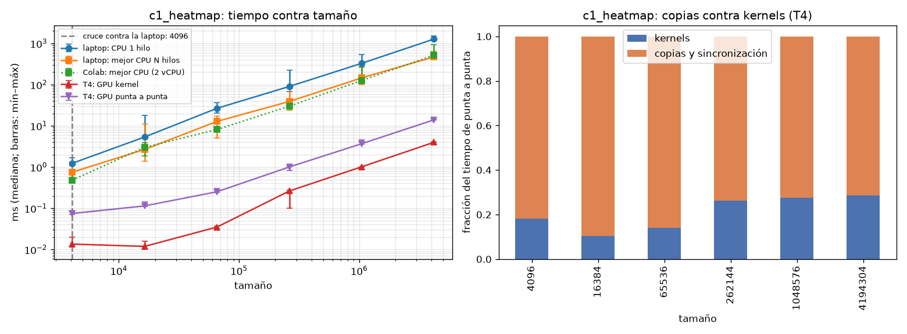

# C1 · El mapa de calor de la demanda, en la GPU

**Concepto:** convolución (`ec2/05_convolution`) · **primera aplicación** de ese concepto · **tipo A:** agregada (una
sección nueva de `--report`; no cambia ninguna decisión).

**Veredicto:** **GPU, en todos los tamaños.** Es la aplicación donde la GPU gana por más y la única que gana **con el
tamaño de la simulación**: con la grilla del reporte (128 × 128) la T4 tarda 0,11 ms de punta a punta contra 2,67 ms de
la mejor CPU de la laptop (**23×**); con grillas grandes, 34× a 51×. La convolución hace 169 multiplicaciones por
celda: mucho cálculo por byte copiado. Y una lección: **el tiling a mano no ganó nada** (la caché L1 de la T4 ya lo
hace). Ver [Análisis](#análisis-por-qué-la-gpu-conviene-o-no).

## La tarea y por qué es paralela de datos

Una grilla sobre la ciudad con los pedidos que salen de cada celda (el origen de un pedido es su restaurante),
suavizada con un **filtro gaussiano** de 13 × 13 (σ = 2 celdas): dónde se concentra la demanda, sin el ruido de
celdas sueltas. Cada celda de salida es la suma de 169 productos de sus vecinas por los coeficientes del filtro: todas
las celdas son independientes (un **map** con un stencil grande), el patrón de la carpeta 05. Fuera de la grilla
cuenta como 0.

**Flotantes:** la CPU y la GPU suman los mismos productos en el mismo orden, pero la GPU usa FMA (multiplicar y sumar
con un solo redondeo). La tolerancia es **1e-5 del valor máximo de la grilla**: con 169 sumandos de `float`
(epsilon 1,2e-7), el error acumulado está muy por debajo (medido: 0 de diferencia en la emulación; dentro de la
tolerancia en las 630 corridas de la T4).

## Diseño

**El filtro en memoria constante.** Los 169 coeficientes van en `__constant__ float cFilter[169]`: en cada paso todos
los hilos de un warp leen **el mismo** coeficiente, y la caché constante lo reparte en un solo acceso (broadcast).

**Dos kernels (carpeta 05).**
- `convolveBasic`: cada hilo (una celda de salida) lee sus 169 vecinas de la memoria global.
- `convolveTiled` (el que se usa): un bloque de 16 × 16 hilos carga **una vez** su bloque de entrada de 28 × 28 (los
  16 × 16 más un halo de 6 de cada lado) en memoria compartida (3,1 KB) y las 169 lecturas de cada celda salen de ahí.
  Cada valor de la entrada se lee de la memoria global una vez por bloque en vez de hasta 169 veces.

**Grid y bloques.** 16 × 16 = 256 hilos por bloque (8 warps; la salida en cuadrados de 16 para que el halo sea
proporcionalmente chico: 28² / 16² = 3,06 lecturas por celda útil). Grid = ⌈ancho/16⌉ × ⌈alto/16⌉ (128 × 128 =
16 384 bloques con 2048²). 34 registros por hilo; el límite es el de warps: ocupación teórica 100 %.

**CPU con N hilos.** Las filas de salida repartidas en tramos entre los trabajos del pool (strips por filas, carpeta
10); cada trabajo escribe solo sus filas.

**Hilos.** Por el hilo dueño de la GPU (`GpuOwner::heatmap`). En el reporte, después de la simulación, con la grilla de
128 × 128 sobre los límites de la red; informa las 5 celdas más calientes con sus coordenadas.

## Corrección

| Prueba | Dónde | Resultado |
|---|---|---|
| `heatmap_check`: el filtro suma 1 y es simétrico; un impulso lejos de los bordes conserva el total; N hilos (1–7) = 1 hilo bit a bit (1×1, 37×1, 50×33, 128×128) | laptop (g++, clang, CMake 3.11.4) y TSan | OK, 0 reportes |
| `gpu_heatmap_check`: básico y por bloques = CPU dentro de 1e-5 del máximo, con grillas que no son múltiplo de 16, una de una sola celda y una con todo en una esquina (el halo fuera de la grilla); por el hilo dueño, igual | T4 real, emulado y TSan | OK, 0 reportes |
| `report_check`: un pedido por pedido creado en la grilla; lo suavizado conserva el total salvo bordes; celdas calientes en orden y dentro del mapa; sin mapa no aparece | laptop y TSan | OK |
| `compute-sanitizer --tool memcheck` / `racecheck` (memoria compartida del bloque con halo) | T4 | 0 errors / 0 hazards |
| Las 630 corridas de Colab y las 360 de la laptop, comparadas con la referencia (tolerancia) | ambas | 0 incorrectas |
| La ciudad con `--report` en la T4: 18 215 pedidos, suavizado 18 215,000001 | T4 | salida 0 |

## Cómo se midió

```sh
./delivery_sim config/santa_cruz.json --headless --bench laptop.csv --bench-app c1_heatmap   # laptop
./delivery_sim config/santa_cruz.json --headless --bench colab.csv --bench-app c1_heatmap    # Colab (T4)
python3 tools/informe_ec2.py c1_heatmap laptop.csv colab.csv .
```

Tamaño = celdas: lados de 64 a 2048 (de 4096 a 4,2 millones de celdas, tres órdenes de magnitud; el reporte usa
128 × 128). Grilla dispersa como la de la ciudad: una celda de cada 50 con pedidos (de 1 a 20; semilla fija).
Calentamiento y 15 repeticiones intercaladas; mediana [mín–máx]. La laptop midió el commit de C1 y Colab la punta de
la rama (S1): `heatmap.*`, `heatmap_gpu.*`, `benchHeatmap` y `GpuOwner::heatmap` no cambian.

## Resultados



**Veredicto: GPU (Colab, T4) contra la CPU de la laptop**

| celdas | CPU 1 hilo (ms) | mejor CPU N hilos (ms) | GPU kernel (ms) | GPU punta a punta (ms) | speedup kernel | speedup punta a punta | ¿correcto? |
|---:|---:|---:|---:|---:|---:|---:|:---:|
| 64² | 1.234 [1.09–1.69] | 0.752 [0.518–1.33] (N=4) | 0.0135 [0.0119–0.0202] | 0.0748 [0.0695–0.081] | 55.56× | **10.05×** | sí |
| 128² | 5.352 [4.87–17.8] | 2.671 [1.40–11.2] (N=4) | 0.0119 [0.0106–0.016] | 0.1142 [0.11–0.145] | 224.39× | **23.39×** | sí |
| 256² | 26.58 [20.1–36.5] | 12.80 [5.11–17.4] (N=4) | 0.0351 [0.0329–0.0364] | 0.2517 [0.244–0.298] | 364.91× | 50.85× | sí |
| 512² | 90.1 [66.8–221] | 38.96 [23.8–78.3] (N=4) | 0.2625 [0.101–0.27] | 1.004 [0.837–1.05] | 148.41× | 38.78× | sí |
| 1024² | 327.7 [266–537] | 145.4 [99.3–267] (N=4) | 1.014 [1.01–1.02] | 3.684 [3.58–4.56] | 143.41× | 39.46× | sí |
| 2048² | 1272 [1160–1520] | 471.7 [416–628] (N=4) | 3.987 [3.98–3.99] | 13.97 [13.6–14.2] | 118.29× | **33.76×** | sí |

**Por bloques contra básico** (Colab, kernel, mediana en ms): 64², 0,0135 contra 0,0118; 256², 0,0351 contra 0,0339;
1024², 1,014 contra 1,020; 2048², **3,987 contra 4,030** (el tiling gana 1 %). Por el hilo dueño (`gpu_via_owner`):
0,115 ms con 64² y 17,1 ms con 2048². La misma máquina (la GPU gana 6,4× a 37×) y el barrido de hilos (4 hilos
dan 2,3–2,7× sobre 1 en la laptop): [`tablas.md`](tablas.md).

## Perfiles

`nsys`: `convolveTiled` y `convolveBasic` 12 lanzamientos cada uno, 10,6 y 10,7 ms en total (mitad y mitad); copias de
ida y de vuelta, 89 MB en cada sentido (16,8 MB con 2048²: ~3,4–3,6 ms cada una).

`ncu` con 2048² celdas:

| | por bloques (`convolveTiled`) | básico (`convolveBasic`) |
|---|---:|---:|
| grid × bloque | 128 × 128 × (16 × 16) | 128 × 128 × (16 × 16) |
| registros / memoria compartida | 34 / 3,1 KB | 31 / 0 |
| ocupación teórica / lograda | 100 % / **98,3 %** | 100 % / 96,0 % |
| cómputo (SM) | 50 % | 48 % |
| DRAM | **3,7 %** (12 GB/s) | 3,8 % |
| acierto L1 / L2 | 15 % / 86 % | **98 %** / 84 % |
| duración | 3,98 ms | 4,02 ms |

## Análisis: por qué la GPU conviene o no

**Paralelismo disponible.** Una celda por hilo: con 128² son 16 384 hilos (64 bloques), con 2048², 4,2 millones. Lo
que hace ganar a la GPU desde la grilla más chica es la **intensidad aritmética**: 169 multiplicaciones-sumas por
celda, por cada 8 bytes que viajan (4 de ida, 4 de vuelta).

**Overheads.** Con 64² el kernel tarda 13 µs y el punta a punta 75 µs (copias y sincronización), y aun así la CPU tarda
0,75 ms. Con 2048², de 14 ms de punta a punta, ~7 ms son copias (16,8 MB de ida y de vuelta) y 4 ms el kernel.

**Cómputo o memoria.** **No** está limitado por la DRAM (3,7 %): cada valor se trae una vez y se reusa desde la memoria
compartida o la L1. Tampoco por las FMA: 4,2 M celdas × 169 FMA en 4 ms son ~0,36 TFLOP/s, el 5 % de los 8 TFLOP/s de
la T4 en `float`. El techo es el de las **instrucciones de carga**: cada FMA necesita su operando de la memoria
compartida (o de la L1 en el básico), y la unidad de carga del SM (LSU) es la que se satura (cómputo del SM al 50 %,
memoria al 50 %: `ncu` los marca balanceados). En el roofline, C1 queda muy a la derecha del codo de la DRAM, pegado
al techo de la memoria compartida/L1.

**Por qué el tiling no ganó.** En la carpeta 05 el tiling gana porque el básico va a la DRAM por cada vecina. En la T4
el básico tiene **98 % de acierto en L1**: los 16 × 16 hilos de un bloque piden casi las mismas 28 × 28 celdas, y la
caché las retiene sola. Los dos kernels hacen 169 lecturas por celda (de la L1 o de la memoria compartida) y por eso
tardan lo mismo. El tiling a mano se paga con la carga del halo y un `__syncthreads`, y se cobra solo en la DRAM
ahorrada, que ya era poca. Para ganar de verdad habría que leer menos por FMA: registros con varias salidas por hilo
(coarsening) o el filtro separable (gaussiano = 13 + 13 multiplicaciones en vez de 169, en dos pasadas). No se hizo:
el veredicto ya es GPU por amplio margen.

**Eficiencia de ejecución.** Ocupación lograda 98 %. Divergencia: en el kernel por bloques, el borde (vecinas fuera
de la grilla = 0) se resuelve al cargar el halo (~3 valores por hilo) y el bucle de las 169 no tiene condiciones; en
el básico, la condición está dentro del bucle (169 veces por celda, una selección sin saltos); además, en los bloques
del borde derecho/inferior, si el lado no es múltiplo de 16, los hilos de afuera terminan antes. Bancos: `tile[y + dy][x + dx]` con x consecutivo en el warp: 32 floats seguidos, sin conflictos.

**Contención y sincronización.** Sin atómicos: cada celda la escribe un solo hilo. Un `__syncthreads` entre cargar el
bloque con halo y calcular.

**Corrección bajo paralelismo.** Mismo orden de suma que la CPU; la única diferencia es el redondeo de FMA, acotado por
la tolerancia (1e-5 del máximo) y comprobado en cada corrida.

**Veredicto.**
- *Simulación* (la grilla del reporte, 128²): **GPU**, 23× contra la mejor CPU de la laptop (0,11 ms contra 2,67 ms).
  Es una vez al final: ahorra ~2,5 ms de una corrida de 60 s (Amdahl: el reporte no es parte de la simulación). Si el
  mapa de calor se recalculara en vivo (por ejemplo, para dibujarlo en la ventana cada segundo), la GPU sí importaría.
- *Grillas grandes*: **GPU**, 34× a 51×.
- *Lo que demuestra:* memoria constante para el filtro (broadcast) y que en una GPU con L1 el tiling a mano no siempre
  paga: hay que medirlo.

**Amenazas a la validez.** Dos máquinas distintas (en la misma máquina la GPU gana 6,4× a 37×). La CPU de la laptop
tiene mucha dispersión (128², 4 hilos: de 1,4 a 11,2 ms). La grilla sintética es dispersa como la real; la cantidad
de trabajo por celda no depende de los valores. `handover_check` (primera evaluación) falla a veces bajo `ctest -j8`,
igual en `main` (ver T1). Nunca se midió la emulación de `cuda_compat.h`.
