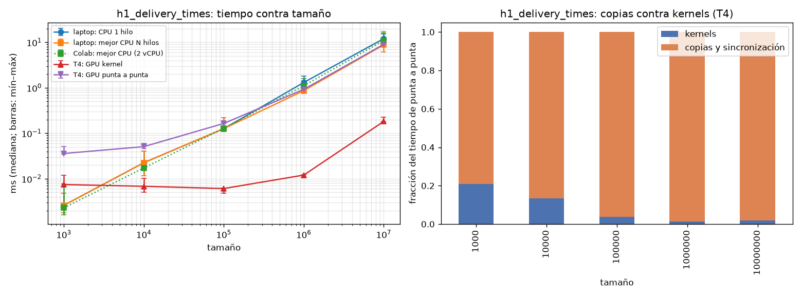

# H1 · El histograma de los tiempos de entrega, en la GPU

**Concepto:** histograma (`ec2/07_histogram`) · **primera aplicación** de ese concepto · **tipo A:** agregada (un
reporte nuevo con `--report`; no cambia ninguna decisión de la simulación).

**Veredicto:** **CPU.** El kernel privatizado le gana a la mejor CPU de la laptop por 48× con 10⁷ entregas (0,18 ms
contra 8,8 ms), pero **de punta a punta la GPU nunca gana** (0,97× con 10⁷): copiar los tiempos a la GPU cuesta el
98 % del total, y un histograma lee cada dato una sola vez, así que no hay trabajo que amortice esa copia. Con el
tamaño de la simulación (1121 entregas en la ciudad) la CPU tarda 3 µs. Ver
[Análisis](#análisis-por-qué-la-gpu-conviene-o-no).

## La tarea y por qué es paralela de datos

Al terminar la simulación, `delivery_sim --report` relee su log y, por cada pedido entregado, calcula cuánto tardó
(`t(orderDelivered) − t(orderCreated)`). El reporte cuenta esos tiempos en **cajas de 1 minuto** (256 cajas; la última
junta todo lo de 255 minutos o más) y da los percentiles 50, 90 y 99 con resolución de un minuto. Cada entrega se
clasifica sola (un **map**: su caja) y después se cuenta (una **reducción por clave**): es el patrón de la carpeta 07.
El problema es la escritura: muchas entregas caen en la misma caja (los tiempos más comunes), así que los hilos
compiten por las mismas posiciones.

**Enteros:** la CPU de 1 hilo, la de N hilos y la GPU dan **exactamente** los mismos conteos (y la suma de las cajas
es el número de entregas).

## Diseño

**Dos kernels para comparar (carpeta 07).**
- `histogramGlobal` (ingenuo): cada hilo hace `atomicAdd` en el histograma de la memoria global. Todos los hilos
  de la GPU compiten por 256 cajas: los atómicos sobre la misma dirección se serializan.
- `histogramPrivatized` (el que se usa): cada bloque cuenta en **su** histograma en memoria compartida (256 cajas de
  4 B = 1 KB; atómicos de memoria compartida, solo entre los 256 hilos del bloque) y al final lo suma **una vez** al
  global: 256 atómicos globales por bloque en lugar de uno por entrega.

**Datos.** Los tiempos viajan como `uint32_t` (4 B por entrega, contiguos: cada warp lee 128 B seguidos, coalescido).
Vuelve el histograma (256 × 8 B). La memoria se reserva en la GPU una vez (o si llegan más entregas).

**Grid y bloques.** 256 hilos por bloque (una caja por hilo al vaciar el histograma privado en el global);
`min(ceil(n/256), 160)` bloques: 160 = 4 bloques por SM en la T4 (40 SM), una sola "wave". Con más entregas, cada hilo
recorre varias con paso de grid (coarsening intercalado: en cada vuelta el warp lee 32 tiempos seguidos). 16 registros
por hilo y 1 KB de memoria compartida: el límite es el de warps (4 bloques de 8 warps por SM); ocupación teórica 100 %.

**CPU con N hilos.** La misma idea: cada trabajo del pool cuenta su tramo en su propio histograma (combiners, carpeta
10: sin locks ni atómicos) y al final se suman una vez.

**Hilos.** Toda llamada a CUDA la hace el hilo dueño de la GPU (`GpuOwner::histogram`, el `ThreadPool` de 1 hilo de
R1). El reporte se escribe después de la simulación y del resumen (que sigue siendo la última línea de stdout): no
compite con ningún hilo de la simulación. Solo con `-DUSE_CUDA=ON`; sin CUDA, el reporte se calcula en la CPU y dice
dónde se calculó (`computedOn`).

## Corrección

| Prueba | Dónde | Resultado |
|---|---|---|
| `histogram_check`: N hilos (1, 2, 3, 4 y 7) = 1 hilo caja por caja; la suma = las entregas; p50/p90/p99 = los del ordenamiento; bordes de las cajas (59 999 ms en la 0, 60 000 en la 1, 10 h en la última) | laptop (g++, clang, CMake 3.11.4) y TSan | OK, 0 reportes |
| `gpu_histogram_check`: privatizado y atómicos globales = CPU caja por caja (0, 1, 255, 257 y 3000 entregas); todas en la misma caja (contención máxima): total exacto; por el hilo dueño, igual | T4 real, emulado y TSan | OK, 0 reportes |
| `report_check`: una simulación real, su log releído: un tiempo por entrega (= `delivered` del resumen = líneas `orderDelivered`); promedio y máximo desde el log = `avgDeliveryMs` y `maxDeliveryMs` del resumen; una línea que no es JSON se informa con su número | laptop y TSan | OK |
| `compute-sanitizer --tool memcheck` / `racecheck` sobre `gpu_histogram_check` | T4 | 0 errors / 0 hazards |
| Cada una de las 525 corridas de Colab y de las 300 de la laptop se compara con la referencia | ambas | 0 incorrectas |
| La simulación de la ciudad con `--report` en la T4 (1121 entregas: p50 30 min, p90 43, p99 49) | T4 | salida 0 |

## Cómo se midió

```sh
# laptop (Release -O3, sin ventana; enchufada, modo Mejor rendimiento): ver laptop_hardware.txt
./delivery_sim config/santa_cruz.json --headless --bench laptop.csv --bench-app h1_delivery_times
# Colab (T4): colab/ec2_h1_delivery_times.ipynb, ejecutado en colab_ejecutado.ipynb (todas las salidas)
./delivery_sim config/santa_cruz.json --headless --bench colab.csv --bench-app h1_delivery_times
# tablas y gráfico, desde los dos CSV
python3 tools/informe_ec2.py h1_delivery_times laptop.csv colab.csv .
```

Tamaño = entregas: 10³, 10⁴, 10⁵, 10⁶ y 10⁷ (cuatro órdenes de magnitud; la ciudad da ~1100 en 60 s reales, y 10⁷
equivale a releer muchos logs largos). Tiempos sintéticos con forma parecida a los de la ciudad: la suma de tres
sorteos uniformes de 5 a 60 minutos (semilla fija, los mismos datos para todas las versiones). Una corrida de
calentamiento y 15 repeticiones con las versiones intercaladas. GPU kernel = eventos de CUDA alrededor del kernel;
GPU de punta a punta = `steady_clock` desde la copia de ida hasta la vuelta del histograma. Tabla: mediana [mín–máx].
La laptop y Colab midieron el mismo código (`src/` = `a8c5cc30…`, el de este commit).

## Resultados



Laptop: Intel Core i5-6300U, 2 núcleos / 4 hilos, WSL2 (Ubuntu 26.04), g++ 15.2 `-O3` · Colab: Tesla T4 (CUDA
13.0, driver 580), Xeon 2,0 GHz con 2 vCPU (1 núcleo con hyperthreading).

**Veredicto: GPU (Colab, T4) contra la CPU de la laptop**

| tamaño | CPU 1 hilo (ms) | mejor CPU N hilos (ms) | GPU kernel (ms) | GPU punta a punta (ms) | speedup kernel | speedup punta a punta | ¿correcto? |
|---:|---:|---:|---:|---:|---:|---:|:---:|
| 10³ | 0.0026 [0.0018–0.0048] | 0.0026 (1 hilo) | 0.0075 [0.0065–0.0121] | 0.0359 [0.0346–0.0511] | 0.35× | 0.07× | sí |
| 10⁴ | 0.0225 [0.0115–0.0405] | 0.0225 (1 hilo) | 0.0068 [0.0051–0.0102] | 0.0508 [0.0463–0.0604] | 3.30× | 0.44× | sí |
| 10⁵ | 0.1264 [0.110–0.218] | 0.1264 (1 hilo) | 0.0061 [0.0048–0.0062] | 0.1644 [0.163–0.181] | 20.79× | 0.77× | sí |
| 10⁶ | 1.308 [1.13–1.80] | 0.8658 [0.745–1.42] (N=4) | 0.0120 [0.0107–0.0123] | 0.9244 [0.883–1.10] | 71.96× | 0.94× | sí |
| 10⁷ | 12.05 [11.4–15.2] | 8.797 [6.12–17.2] (N=4) | 0.1823 [0.178–0.225] | 9.036 [8.82–9.40] | 48.25× | **0.97×** | sí |

**Los dos kernels de GPU y el paso por el hilo dueño** (Colab, mediana [mín–máx] en ms):

| tamaño | privatizado (`gpu_kernel`) | atómicos globales (`gpu_kernel_global`) | global / privatizado | por el hilo dueño (`gpu_via_owner`) |
|---:|---:|---:|---:|---:|
| 10³ | 0.0075 | 0.0072 | 1.0× | 0.053 |
| 10⁴ | 0.0068 | 0.0083 | 1.2× | 0.080 |
| 10⁵ | 0.0061 | 0.0372 | 6.1× | 0.229 |
| 10⁶ | 0.0120 | 0.3467 | **28.8×** | 1.363 |
| 10⁷ | 0.1823 | 5.994 | **32.9×** | 32.76 |

La misma máquina (CPU de Colab: ahí la GPU sí gana de punta a punta, 1,20× con 10⁶ y 1,22× con 10⁷, porque la CPU de
Colab es más lenta), el barrido de hilos y las tablas completas: [`tablas.md`](tablas.md). En la laptop, 4 hilos dan
1,84× sobre 1 hilo con 10⁶ y 1,44× con 10⁷.

## Perfiles

`nsys` (`--bench-once`: calentamiento + 1 medición en cada tamaño, los dos kernels):

| | total | por lanzamiento (mediana) |
|---|---:|---:|
| `histogramGlobal` | 13,3 ms (96,6 % del tiempo de kernels) | 62 µs (con 10⁷: 6,0 ms) |
| `histogramPrivatized` | 0,48 ms (3,4 %) | 7,4 µs (con 10⁷: 0,21 ms) |
| copias de ida (178 MB en 20) | 37,6 ms | 40 MB con 10⁷: 8,8 ms (~4,5 GB/s) |
| copias de vuelta (2 KB cada una) | 0,04 ms | 2 µs |

`ncu` con 10⁷ entregas (`ncu` fija el reloj del SM, así que sus duraciones no son las del bench):

| | privatizado | atómicos globales |
|---|---:|---:|
| grid × bloque | 160 × 256 | 160 × 256 |
| memoria compartida por bloque | 1 KB | 0 |
| ocupación teórica / lograda | 100 % / **98 %** | 100 % / — |
| DRAM | **80 %** (253 GB/s) | 3 % (10 GB/s) |
| cómputo (SM) | 31 % | 2 % |
| duración | 0,23 ms | 6,0 ms |

## Análisis: por qué la GPU conviene o no

**Paralelismo disponible.** Una entrega por elemento: con 10⁷ sobran hilos (160 bloques × 256 = 40 960 hilos, cada
uno con ~244 entregas). Con 10³ a 10⁵ el kernel tarda siempre ~6–7 µs: es la latencia del lanzamiento, no trabajo.

**Overheads.** **Es lo que decide esta aplicación.** Un histograma lee cada entrega **una vez** y hace una suma: 4 B
leídos por operación, la intensidad aritmética más baja posible. La CPU lo hace mientras lee los datos de su memoria;
la GPU primero tiene que **copiarlos por PCIe** (40 MB con 10⁷: 8,8 ms a ~4,5 GB/s, desde memoria paginable). Con
10⁷, de los 9,04 ms de punta a punta, 8,85 son la copia y 0,18 el kernel: **la copia sola ya tarda lo mismo que
todo el histograma en la CPU de la laptop con 4 hilos (8,8 ms)**. Aunque el kernel fuera gratis, la GPU empataría.
Memoria fijada (`cudaHostAlloc`) subiría la copia a ~12 GB/s y daría ~2,5× de punta a punta con 10⁷, pero solo si
los tiempos ya nacieran en esa memoria; y la simulación genera ~1100 entregas, no 10⁷.

**Paso por el hilo dueño.** `gpu_via_owner` (32,8 ms con 10⁷) es mucho más que el punta a punta (9,0 ms): el trabajo
viaja **por valor** a la cola del hilo dueño (para que pueda terminar aunque quien lo pidió deje de esperar), y copiar
40 MB a un vector nuevo en la CPU de Colab, tocando páginas nuevas, cuesta más que la copia por PCIe. Con los tamaños
de la simulación (unos KB) ese costo no se ve (53 µs con 10³, casi todo latencia de la cola y del future).

**Cómputo o memoria.** El privatizado está **limitado por la DRAM**: 80 % del ancho de banda de la T4 (253 GB/s de
320), cómputo al 31 %. Está sobre el techo de memoria del roofline (intensidad ≈ 0,25 operaciones por byte): no se
puede hacer más rápido sin leer menos bytes. El de atómicos globales no está limitado por nada de eso (3 % de DRAM,
2 % de cómputo): lo frena la **contención**.

**Contención (la lección de la carpeta 07).** Con atómicos globales, todos los hilos de la GPU compiten por 256
cajas, y como los tiempos se concentran alrededor de la media (la suma de tres uniformes), unas pocas cajas reciben
casi todo. Los atómicos sobre una misma dirección se serializan en la L2: con 10⁶ y 10⁷ entregas el kernel ingenuo es
**29–33× más lento** que el privatizado. Privatizar cambia 10⁷ atómicos globales por 160 × 256 = 40 960 (uno por caja
por bloque) más atómicos de memoria compartida, que se resuelven dentro de cada SM. Con pocas entregas (10³) no hay
contención que evitar y los dos tardan lo mismo.

**Eficiencia de ejecución.** Ocupación lograda 98 %. Divergencia: el cálculo de la caja (`min(ms / 60000, 255)`) no
tiene ramas; los atómicos de memoria compartida de un warp que caen en la misma caja se serializan (es el mismo
problema de contención, en chico, y dentro del SM). Al vaciar el histograma privado, el hilo t suma la caja t:
256 hilos, 256 cajas, sin ramas ni conflictos de bancos (32 hilos de un warp tocan 32 cajas seguidas).

**Corrección bajo paralelismo.** Enteros y atómicos: el orden de las sumas no cambia el resultado. El histograma
privado de cada bloque se vacía al global después de `__syncthreads()` (todas las sumas del bloque terminaron).

**Veredicto.**
- *Simulación* (1121 entregas en la ciudad, ~120 en Equipetrol): **CPU**. Con 10³ la CPU tarda 2,6 µs y la GPU 36 µs
  de punta a punta (más el paso por el hilo dueño). El reporte se calcula una vez al final: no importa para el
  rendimiento de la simulación (Amdahl: 0 % del tiempo de la simulación). En `--report` con `USE_CUDA` se calcula en
  la GPU para demostrar la integración (`computedOn` lo dice); el resultado es idéntico.
- *Volumen grande* (10⁶ a 10⁷, releer muchos logs): **CPU de la laptop, por poco** (0,97×): la copia por PCIe se come
  la ventaja del kernel. La GPU convendría solo si los datos ya estuvieran en la GPU (porque otro kernel los produjo):
  ahí el kernel es 48–72× más rápido.
- *Lo que sí demuestra el patrón:* privatizar es imprescindible en la GPU: el kernel ingenuo con 10⁷ (6,0 ms) sería
  peor que la CPU incluso sin contar la copia.

**Amenazas a la validez.** Dos máquinas distintas (por eso también la tabla en la misma máquina, donde la GPU gana
1,2×: el veredicto contra la laptop depende de que su memoria sea rápida). Datos sintéticos con una distribución
parecida a la real; con tiempos más concentrados, la contención del kernel ingenuo sería aún peor. La T4 de Colab es
compartida. Las copias se midieron desde memoria paginable (`std::vector`). `handover_check` (prueba de la primera
evaluación) falla a veces bajo `ctest -j8` en la laptop, igual en `main` (ver T1): no es de EC2. Nunca se midió la
emulación de `cuda_compat.h`.
