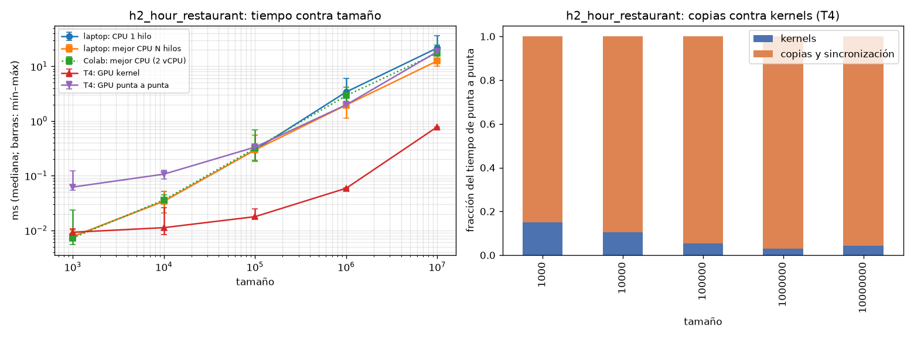

# H2 · Pedidos por restaurante y franja de 10 minutos, en la GPU

**Concepto:** histograma (`ec2/07_histogram`), 2D, con coarsening y acceso coalescido · **segunda aplicación** de ese
concepto (la primera es H1) · **tipo A:** agregada (una sección nueva de `--report`; no cambia ninguna decisión).

**Veredicto:** **CPU.** El kernel le gana a la mejor CPU de la laptop entre 16× y 33×, pero de punta a punta la GPU
**nunca gana** (0,99× con 10⁶ pedidos, 0,68× con 10⁷): son dos arreglos por pedido (restaurante y hora de creación),
80 MB por PCIe con 10⁷, para un recorrido que lee cada dato una vez. Lo que sí demuestra: el recorrido **intercalado
(coalescido) es 1,44× más rápido** que el contiguo. Ver [Análisis](#análisis-por-qué-la-gpu-conviene-o-no).

## La tarea y por qué es paralela de datos

Las horas pico de cada restaurante: los pedidos creados contados por (restaurante, franja de 10 minutos simulados), 144
franjas por día (la última junta todo lo de 23 h 50 min en adelante). Es un histograma de dos dimensiones: cada pedido
cae en la caja `restaurante × 144 + franja`. El reporte da, por restaurante, los conteos de las franjas hasta la
última con pedidos y su franja pico. Conteos enteros: CPU y GPU dan **exactamente** lo mismo.

## Diseño

**Privatizado (carpeta 07), como H1, pero en 2D.** Cada bloque cuenta en su histograma de memoria compartida
(`unsigned own[64 × 144]`: 9216 cajas, 36,9 KB, el máximo de 64 restaurantes) con atómicos de memoria compartida, y al
final suma cada caja una vez al global (atómicos de 64 bits).

**Dos recorridos para comparar (coarsening, carpeta 07; acceso a memoria, carpeta 04).** Con más pedidos que hilos,
cada hilo cuenta varios:
- **intercalado** (el que se usa): el hilo `me` recorre `me, me + G, me + 2G…` (G = hilos de toda la grilla): en cada
  vuelta, los 32 hilos de un warp leen 32 pedidos **seguidos** (128 B, una transacción coalescida);
- **contiguo** (`gpu_kernel_contiguous`): cada hilo recorre su propio tramo; en cada vuelta los hilos de un warp leen
  posiciones separadas por el largo del tramo (32 transacciones distintas).

**Grid y bloques.** 256 hilos; `min(ceil(n/256), 160)` bloques (4 por SM en la T4). Con 36,9 KB de memoria
compartida por bloque entra **un solo bloque por SM**: 8 warps de 32 (ocupación teórica 25 %).

**CPU con N hilos.** Histogramas privados por tramo, sumados una vez al final (combiners, carpeta 10).

**Hilos.** Por el hilo dueño de la GPU (`GpuOwner::slotHistogram`). En el reporte, después de la simulación; más de 64
restaurantes, en la CPU.

## Corrección

| Prueba | Dónde | Resultado |
|---|---|---|
| `slot_histogram_check`: N hilos = 1 hilo caja por caja; bordes de las franjas (la última junta todo); la suma = los pedidos | laptop (g++, clang, CMake 3.11.4) y TSan | OK, 0 reportes |
| `gpu_slot_histogram_check`: intercalado y contiguo = CPU caja por caja con 1, 37 y 64 restaurantes; todos en la misma caja (contención máxima): total exacto; por el hilo dueño, igual | T4 real, emulado y TSan | OK, 0 reportes |
| `report_check`: las franjas de cada restaurante suman sus pedidos (= SC1); cada pedido en la franja de su `t`, recontado desde el log; el pico es el máximo de su fila | laptop y TSan | OK |
| `compute-sanitizer --tool memcheck` / `racecheck` | T4 | 0 errors / 0 hazards |
| Las 525 corridas de Colab y las 300 de la laptop, comparadas con la referencia | ambas | 0 incorrectas |
| La ciudad con `--report` en la T4 (37 restaurantes × 6 franjas, en la GPU) | T4 | salida 0 |

## Cómo se midió

```sh
./delivery_sim config/santa_cruz.json --headless --bench laptop.csv --bench-app h2_hour_restaurant   # laptop
./delivery_sim config/santa_cruz.json --headless --bench colab.csv --bench-app h2_hour_restaurant    # Colab (T4)
python3 tools/informe_ec2.py h2_hour_restaurant laptop.csv colab.csv .
```

Tamaño = pedidos, 10³ a 10⁷; restaurante al azar entre 37 y hora uniforme en 24 h (semilla fija). Calentamiento y 15
repeticiones intercaladas; mediana [mín–máx]. La laptop midió el commit de H2 y Colab la punta de la rama (S1):
`slot_histogram.*`, `slot_histogram_gpu.*`, `benchSlotHistogram` y `GpuOwner::slotHistogram` no cambian.

## Resultados



**Veredicto: GPU (Colab, T4) contra la CPU de la laptop**

| tamaño | CPU 1 hilo (ms) | mejor CPU N hilos (ms) | GPU kernel (ms) | GPU punta a punta (ms) | speedup kernel | speedup punta a punta | ¿correcto? |
|---:|---:|---:|---:|---:|---:|---:|:---:|
| 10³ | 0.0077 [0.0065–0.0102] | 0.0077 (1 hilo) | 0.0092 [0.0082–0.0106] | 0.0620 [0.0548–0.122] | 0.84× | 0.12× | sí |
| 10⁴ | 0.0342 [0.0207–0.0511] | 0.0342 (1 hilo) | 0.0112 [0.0084–0.0261] | 0.1067 [0.0858–0.125] | 3.05× | 0.32× | sí |
| 10⁵ | 0.2961 [0.183–0.549] | 0.2961 (1 hilo) | 0.0178 [0.0165–0.0246] | 0.3327 [0.304–0.379] | 16.64× | 0.89× | sí |
| 10⁶ | 3.40 [1.93–6.04] | 1.959 [1.12–3.30] (N=4) | 0.0589 [0.0575–0.0594] | 1.978 [1.86–2.31] | 33.27× | 0.99× | sí |
| 10⁷ | 21.64 [17.7–35.9] | 12.55 [10.1–17.9] (N=4) | 0.7841 [0.690–0.786] | 18.54 [18.1–21.1] | 16.01× | **0.68×** | sí |

**Intercalado contra contiguo** (Colab, kernel, mediana en ms):

| tamaño | intercalado (`gpu_kernel`) | contiguo (`gpu_kernel_contiguous`) | contiguo / intercalado |
|---:|---:|---:|---:|
| 10³ | 0.0092 | 0.0099 | 1.07× |
| 10⁵ | 0.0178 | 0.0186 | 1.04× |
| 10⁶ | 0.0589 | 0.0636 | 1.08× |
| 10⁷ | 0.7841 | 1.129 | **1.44×** |

Por el hilo dueño (`gpu_via_owner`): 0,076 ms con 10³ y 68,3 ms con 10⁷ (80 MB por valor). La misma máquina (en Colab
la GPU gana 1,47× con 10⁶ pero pierde con 10⁷) y el barrido de hilos: [`tablas.md`](tablas.md).

## Perfiles

`nsys`: 20 lanzamientos de `slotHistogram` (mediana 25 µs; con 10⁷, 0,85 ms); copias de ida 356 MB en 40 (con 10⁷:
dos de 40 MB, ~8,7 ms cada una); de vuelta 43 KB cada una (las 9216 cajas de 8 B).

`ncu` con 10⁷ pedidos:

| | intercalado | contiguo |
|---|---:|---:|
| grid × bloque | 160 × 256 | 160 × 256 |
| memoria compartida / registros | 36,9 KB / 24 | 36,9 KB / 24 |
| ocupación teórica / lograda | **25 % / 25,0 %** | 25 % / — |
| DRAM | 46 % (146 GB/s) | 51 % (163 GB/s) |
| acierto L1 / L2 | 0 % / 8 % | 59 % / 83 % |
| duración | 0,79 ms | 1,13 ms |

## Análisis: por qué la GPU conviene o no

**Paralelismo disponible.** Un pedido por elemento; con 10⁷ sobran. Pero solo **1 bloque por SM**: la memoria
compartida (36,9 KB) es el límite (`Block Limit Shared Mem = 1`).

**Overheads.** Lo que decide: con 10⁷, de 18,5 ms de punta a punta, ~17,4 ms son copiar los dos arreglos de 40 MB
(restaurante y hora) por PCIe desde memoria paginable y 0,78 ms el kernel. Como en H1, cada dato se lee una vez: la
copia sola tarda más que todo el histograma en la CPU con 4 hilos (12,6 ms).

**Cómputo o memoria.** Limitado por la **memoria**: cómputo 11 %, DRAM 46 % con el intercalado. No llega al techo de la
DRAM por la baja ocupación: 8 warps por SM no alcanzan para tener suficientes lecturas en vuelo (`ncu` estima 54 % de
mejora).

**Acceso coalescido (carpeta 04).** El intercalado lee **exactamente** los bytes que usa: cada transacción de 128 B la
consumen los 32 hilos del warp en la misma vuelta, sin reuso (L1 0 %, porque no hace falta). El contiguo trae
transacciones que cada hilo usa de a 4 B por vuelta: la L1 lo salva a medias (59 % de acierto: el hilo vuelve a la
misma línea en las vueltas siguientes), pero mueve más bytes (DRAM 51 % y aun así 1,44× más lento). Con pocos pedidos
por hilo (10⁶: ~24) la diferencia es chica (1,08×); con muchos (10⁷: ~244), grande.

**Eficiencia de ejecución.** Ocupación 25 % por la memoria compartida. **Mejora posible:** reservar solo las cajas que
se usan (37 × 144 × 4 B = 21 KB con memoria compartida dinámica) dejaría 2 bloques por SM. No se hizo: no cambia el
veredicto (la copia es el 94 %). Divergencia: ninguna en el cálculo de la caja; los atómicos de memoria compartida de un
warp sobre la misma caja se serializan (contención, menor que en H1 porque hay 37 × 144 cajas en vez de 256).

**Contención y sincronización.** Atómicos de memoria compartida dentro del bloque; un atómico global por caja por bloque
al final (160 × 5328 con la ciudad). `__syncthreads` antes y después de contar.

**Corrección bajo paralelismo.** Enteros y atómicos: el orden no cambia el resultado.

**Veredicto.**
- *Simulación* (~18 000 pedidos): **CPU** (decenas de µs). Una vez al final: 0 % del tiempo de la simulación.
- *Volumen grande*: **CPU de la laptop** (la GPU pierde 0,68× con 10⁷ por la copia de 80 MB). Solo convendría con los
  datos ya en la GPU (el kernel es 16–33× más rápido).
- *Lo que demuestra:* recorrer intercalado (coalescido) es 1,44× más rápido que contiguo con 10⁷.

**Amenazas a la validez.** Dos máquinas distintas. La dispersión de la CPU de la laptop es grande (10⁷, 1 hilo: de 17,7
a 35,9 ms). Horas uniformes en 24 h: la simulación real usa pocas franjas (6 en 60 s reales), lo que concentra la
contención. `handover_check` (primera evaluación) falla a veces bajo `ctest -j8`, igual en `main` (ver T1). Nunca se
midió la emulación de `cuda_compat.h`.
