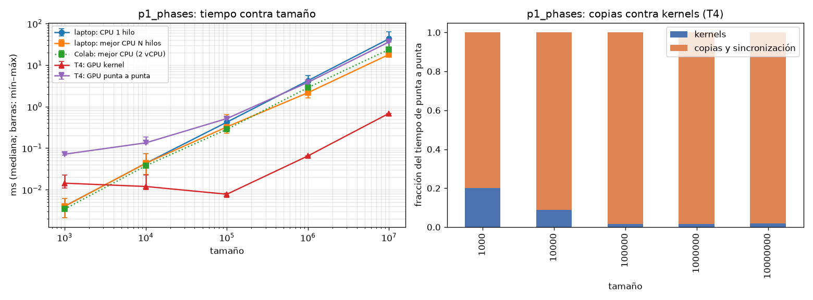

# P1 · Las fases de los pedidos, en la GPU: AoS contra SoA

**Concepto:** consideraciones de rendimiento: acceso coalescido y disposición de los datos, AoS contra SoA
(`ec2/04_performance`, `01_coalescing_segments` y `09_aos_vs_soa`) · **primera aplicación** de ese concepto · **tipo
A:** agregada (una sección nueva de `--report`; no cambia ninguna decisión).

**Veredicto:** **CPU.** El kernel SoA es **1,70× más rápido que el AoS** con 10⁷ pedidos (0,69 ms contra 1,17 ms),
como predice el curso, y 26× más rápido que la mejor CPU de la laptop. Pero de punta a punta la GPU pierde en todos los
tamaños (0,50× con 10⁷): cada dato se lee una vez y copiarlo por PCIe es el **98 %** del tiempo. Además, para que la GPU
lea SoA hay que transponer los registros en la CPU, y eso cuesta como mínimo lo mismo que hacer el cálculo entero en la
CPU (en este código, 10 veces más). Ver
[Análisis](#análisis-por-qué-la-gpu-conviene-o-no).

## La tarea y por qué es paralela de datos

En qué se va el tiempo de un pedido entregado. Para cada pedido, tres fases:

- **esperar**: de creado a asignado (el despachador);
- **recoger**: de asignado a recogido (la cocina, la fila del restaurante y la entrega en el puesto);
- **llevar**: de recogido a entregado (la moto en la calle).

Se suman las tres fases de todos los pedidos entregados (en 64 bits) y se cuentan; el reporte da los totales y los
promedios. En la ciudad (T4): de 964 entregados, en promedio 7,4 min esperando, 13,3 recogiendo y 8,6 llevando. La
fase que más pesa es la del restaurante, no la de la calle.

Cada pedido es independiente y el resultado es una **reducción** (sumas). Lo que estudia esta aplicación es **cómo
están guardados los datos**: los pedidos vienen como **registros** (AoS, *array of structures*) de 32 bytes, como los
arma quien relee el log: 8 campos, de los que el cálculo usa 4 (16 bytes). La versión **SoA** (*structure of arrays*)
tiene un arreglo por campo y lee solo los 4 que usa.

**Enteros:** sumas de 64 bits, sin redondeo: la CPU y la GPU (AoS y SoA) dan **exactamente** lo mismo.

## Diseño

**Dos kernels (carpeta `04_performance`).**
- `phasesAoS`: cada hilo lee un `OrderRecord` de 32 bytes. Un warp lee 32 registros seguidos (1 KB), pero solo usa la
  mitad de cada uno.
- `phasesSoA` (el que usa el reporte): cada hilo lee el `i`-ésimo elemento de 4 arreglos. Un warp lee 128 B seguidos
  de cada arreglo: cada byte que trae la DRAM se usa.

**Reducción.** Cada hilo acumula en registros (bucle *grid-stride*); al final, una reducción en árbol en memoria
compartida por bloque (4 sumas a la vez, `ec2/08_reduction`) y el hilo 0 suma 4 atómicos de 64 bits al total: 4
atómicos por bloque, 640 en total.

**Grid y bloques.** 256 hilos por bloque y **160 bloques** como máximo (4 por SM en los 40 SM de la T4: el límite de
memoria compartida, 4 × 256 × 8 B = 8 KB por bloque, deja 4 bloques = 32 warps = ocupación teórica 100 %). Con más
pedidos que hilos, cada hilo suma varios (*grid-stride*), así los atómicos no crecen con los datos.

**CPU.** 1 hilo sobre los registros (AoS), como los arma el reporte. N hilos sobre las columnas (SoA, armadas una vez
fuera de la medición): tramos con sumas privadas combinadas al final (combiners, carpeta 10).

**Hilos.** Por el hilo dueño de la GPU (`GpuOwner::phases`): recibe los registros y, para la versión SoA, los
transpone a columnas (`columnsOf`) dentro del hilo dueño.

## Corrección

| Prueba | Dónde | Resultado |
|---|---|---|
| `phases_check`: una cuenta a mano (1 entregado: 30 s, 120 s, 300 s); los no entregados no cuentan; `columnsOf` copia los 4 campos en orden; N hilos sobre SoA (1, 2, 3, 4 y 7) = 1 hilo sobre AoS | laptop (g++, clang, CMake 3.11.4) y TSan | OK, 0 reportes |
| `gpu_phases_check`: AoS y SoA en la GPU = CPU **exacto** (entregados y las tres sumas), con pedidos sin entregar, sin pedidos y con más pedidos que hilos de la grid (hasta 10⁶); por el hilo dueño, igual | T4 real, emulado y TSan | OK, 0 reportes |
| `report_check`: los entregados son los del resumen; esperar + recoger + llevar = la suma de los tiempos de entrega, recalculada desde el log sin la GPU | laptop y TSan | OK |
| `compute-sanitizer --tool memcheck` / `racecheck` (la reducción en memoria compartida) | T4 | 0 errors / 0 hazards |
| Las 525 corridas de Colab y las 300 de la laptop, comparadas con la referencia | ambas | 0 incorrectas |
| `ctest` completo con CUDA real | T4 | 55/55 |
| La ciudad con `--report` en la T4 | T4 | salida 0 |

## Cómo se midió

```sh
./delivery_sim config/santa_cruz.json --headless --bench laptop.csv --bench-app p1_phases   # laptop
./delivery_sim config/santa_cruz.json --headless --bench colab.csv --bench-app p1_phases    # Colab (T4)
python3 tools/informe_ec2.py p1_phases laptop.csv colab.csv .
```

Tamaño = pedidos, de 10³ a 10⁷ (cuatro órdenes de magnitud; la ciudad tiene ~1000 entregados en una corrida).
Registros sintéticos con tiempos parecidos a los de la ciudad (esperar hasta 10 min, recoger de 1 a 15, llevar de 2 a
30; uno de cada diez sin entregar; semilla fija). Calentamiento y 15 repeticiones intercaladas; mediana [mín–máx].
La laptop y Colab midieron el mismo código (`src/` = `fcedcdc0…`, el de este commit).

Versiones: `gpu_kernel` y `gpu_end_to_end` son la SoA (columnas ya armadas: copia de los 4 arreglos, kernel y vuelta
de los totales); `gpu_kernel_aos`, el kernel AoS; `gpu_via_owner`, la llamada completa por el hilo dueño, que incluye
pasar los registros por valor y transponerlos.

## Resultados



**Veredicto: GPU (Colab, T4) contra la CPU de la laptop**

| pedidos | CPU 1 hilo (ms) | mejor CPU N hilos (ms) | GPU kernel (ms) | GPU punta a punta (ms) | speedup kernel | speedup punta a punta | ¿correcto? |
|---:|---:|---:|---:|---:|---:|---:|:---:|
| 10³ | 0.004 [0.0021–0.0061] | 0.004 (1 hilo) | 0.01434 [0.011–0.0224] | 0.07162 [0.0677–0.0809] | 0.28× | 0.06× | sí |
| 10⁴ | 0.0433 [0.0234–0.0741] | 0.0433 (1 hilo) | 0.01194 [0.0102–0.0226] | 0.1342 [0.126–0.187] | 3.63× | 0.32× | sí |
| 10⁵ | 0.4232 [0.35–0.572] | 0.3253 [0.23–0.649] (N=4) | 0.007776 [0.00659–0.00819] | 0.5162 [0.504–0.562] | 41.83× | 0.63× | sí |
| 10⁶ | 4.226 [3.42–5.61] | 2.166 [1.64–2.81] (N=4) | 0.06506 [0.0639–0.0655] | 3.839 [3.71–4] | 33.29× | 0.56× | sí |
| 10⁷ | 43.01 [38.1–62.6] | 18.04 [15.7–21.8] (N=4) | 0.6881 [0.684–0.691] | 36.13 [35.7–41.1] | 26.21× | **0.50×** | sí |

**AoS contra SoA en la GPU** (Colab, kernel, mediana en ms):

| pedidos | SoA (`gpu_kernel`) | AoS (`gpu_kernel_aos`) | AoS / SoA |
|---:|---:|---:|---:|
| 10³ | 0.0143 | 0.0102 | 0.71× |
| 10⁴ | 0.0119 | 0.0059 | 0.49× |
| 10⁵ | 0.0078 | 0.0102 | 1.32× |
| 10⁶ | 0.0651 | 0.1213 | 1.86× |
| 10⁷ | 0.688 | 1.171 | **1.70×** |

**AoS contra SoA en la CPU** (1 hilo; la SoA pasa por el pool con 1 trabajo, mediana en ms):

| pedidos | laptop AoS | laptop SoA | AoS / SoA | Colab AoS | Colab SoA | AoS / SoA |
|---:|---:|---:|---:|---:|---:|---:|
| 10⁵ | 0.423 | 0.437 | 0.97× | 0.283 | 0.374 | 0.76× |
| 10⁶ | 4.23 | 3.20 | 1.32× | 4.29 | 3.14 | 1.37× |
| 10⁷ | 43.0 | 33.3 | **1.29×** | 47.3 | 27.9 | **1.70×** |

Por el hilo dueño (`gpu_via_owner`): 0,13 ms con 10³, 17,4 ms con 10⁶ y **454 ms con 10⁷** (ver Análisis). La misma
máquina (también 0,66× de punta a punta con 10⁷) y el barrido de hilos (1,84× con 4 hilos en la laptop):
[`tablas.md`](tablas.md).

## Perfiles

`nsys` (`--bench-once`, los 5 tamaños dos veces): `phasesAoS` 2,66 ms (62,9 % del tiempo de kernels), `phasesSoA`
1,57 ms (37,1 %). Copias: **1067 MB de ida en 235 ms** (~4,5 GB/s, memoria paginable) y 20 copias de vuelta de 32
bytes (los totales). Las copias son 55 veces el tiempo de los kernels.

`ncu` con 10⁷ pedidos:

| | SoA (`phasesSoA`) | AoS (`phasesAoS`) |
|---|---:|---:|
| grid × bloque | 160 × 256 | 160 × 256 |
| registros / memoria compartida | 22 / 8,2 KB | 20 / 8,2 KB |
| ocupación teórica / lograda | 100 % / 99 % | 100 % / 99 % |
| DRAM | **96 % (305 GB/s)** | **97 % (306 GB/s)** |
| cómputo (SM) | 16 % | 9 % |
| acierto L1 / L2 | 0 % / 0 % | 62 % / 29 % |
| duración | **690 µs** | 1180 µs |

## Análisis: por qué la GPU conviene o no

**Paralelismo disponible.** 160 bloques de 256 hilos llenan los 40 SM (99 % de ocupación lograda) desde 10⁵ pedidos;
por debajo, el kernel es un solo lanzamiento de ~6–14 µs y no hay nada que paralelizar que valga la pena.

**Cómputo o memoria (roofline).** Por pedido entregado: 3 restas y 3 sumas de 64 bits y una comparación contra 16
bytes (SoA): ~0,4 operaciones por byte. El codo del roofline de la T4 está en ~25: **muy limitado por la memoria**.
Los dos kernels están **sobre el techo de memoria**: 96–97 % de la DRAM de la T4 (`ncu`: "más del 80 % del rendimiento
de memoria del dispositivo"). Como los dos van a la misma velocidad de DRAM, **el tiempo lo deciden los bytes que
mueve cada uno**.

**Por qué SoA es 1,7× más rápido: coalescing.** La DRAM entrega sectores de 32 bytes. En AoS cada registro ocupa un
sector entero y el kernel usa 16 de sus 32 bytes: con 10⁷ pedidos la GPU trae 320 MB para usar 160 MB. En SoA un warp
lee 128 B seguidos de cada arreglo y usa todo: 160 MB. Esa es la diferencia de 2× del curso (`09_aos_vs_soa`); se mide
1,7× porque el SoA mueve algo más que el mínimo (`ncu`: 305 GB/s × 0,69 ms ≈ 210 MB, contra 160 MB). El 62 % de
acierto en L1 del AoS no lo salva: la segunda mitad de cada registro ya se trajo en el mismo sector y se tira. Con
10³–10⁴ pedidos el AoS parece más rápido, pero los dos son un lanzamiento de pocos µs; el SoA se mide siempre primero en
cada repetición (después de la CPU) y no separé ese efecto del orden: con esos tamaños la diferencia no es
significativa para el veredicto.

**La CPU también lo nota.** Con 10⁷ pedidos, SoA en 1 hilo es 1,29× más rápido en la laptop y 1,70× en la CPU de Colab
(líneas de caché de 64 B: AoS usa la mitad de cada una). Con tamaños chicos manda el costo del pool (la SoA pasa por él
aunque sea con 1 trabajo).

**Overheads: por qué igual pierde la GPU.** Cada dato se lee **una vez**. Con 10⁷ pedidos el kernel tarda 0,69 ms y
copiar los 160 MB de columnas, ~35 ms: el **98 %** del punta a punta. Para ganarle a la laptop (18 ms con 4 hilos) la
copia tendría que ir a más de ~9 GB/s; con memoria paginable va a ~4,5. Con memoria fijada (*pinned*) se llegaría a
~12 GB/s en la T4 (estimación, no medida): ~14 ms de punta a punta, ganaría por poco (~1,3×). Es lo mismo que en H1 y
H2.

**El costo de transponer (`gpu_via_owner`, 454 ms con 10⁷).** El reporte arma registros (AoS) desde el log; para que
la GPU lea SoA, el hilo dueño los transpone con `columnsOf`, que además crece los vectores con `push_back` sin
`reserve`. Pero aunque se hiciera bien, transponer obliga a **leer todos los registros en la CPU**, que es justo lo
que hace la CPU para calcular la respuesta (43 ms con 1 hilo). Por eso **SoA solo paga si los datos nacen en SoA**: si
`replayLog` llenara las columnas directamente al leer el log, se ahorraría la transposición. No lo cambié porque el
reporte es de ~1000 pedidos: no vale la pena.

**Eficiencia de ejecución.** Ocupación lograda 99 %. Divergencia: el `if` de "entregado" (1 de cada 10 pedidos no
entra) diverge dentro de un warp, pero solo saltea 6 operaciones; el árbol de la reducción diverge en sus últimos
niveles (menos de 32 hilos activos), lo normal en una reducción.

**Contención y sincronización.** 4 atómicos de 64 bits por bloque (640 en total, contra 10⁷ datos): sin contención
medible. Un `__syncthreads` después de llenar la memoria compartida y uno por nivel del árbol (8 niveles).

**Corrección bajo paralelismo.** Sumas de enteros: asociativas y conmutativas, así que el orden de los atómicos y de
los bloques no cambia el resultado; 64 bits alcanzan (10⁷ pedidos × 30 min = 1,8·10¹³ ms, lejos de 1,8·10¹⁹).

**Veredicto.**
- *Simulación* (~1000 entregados): **CPU**. La CPU tarda unos µs; la GPU, solo en lanzar y copiar, 0,07 ms.
- *Grandes volúmenes*: **CPU**, 0,50× con 10⁷. La GPU solo ganaría si los datos ya estuvieran en ella (el kernel es
  26× más rápido).
- *Lo que demuestra:* la disposición de los datos importa en la GPU (**SoA 1,7×**, el kernel sobre el techo de memoria)
  y también en la CPU (1,3–1,7×). Pero el layout no salva a un cálculo que lee cada dato una sola vez: manda la copia.

**Amenazas a la validez.** Dos máquinas distintas (en la misma máquina la GPU también pierde: 0,66× con 10⁷). Datos
sintéticos (los tiempos se parecen a los de la ciudad, pero las proporciones no cambian el acceso a memoria). Con
10³–10⁴ los tiempos de kernel son de pocos µs y dependen del orden de medición. Memoria paginable en las copias (con
*pinned* el punta a punta mejoraría unas 2,5×, estimado). `handover_check` y `dispatch_check` (primera evaluación) fallan a
veces bajo `ctest -j8`, igual en `main` (ver T1). Nunca se midió la emulación de `cuda_compat.h`.
