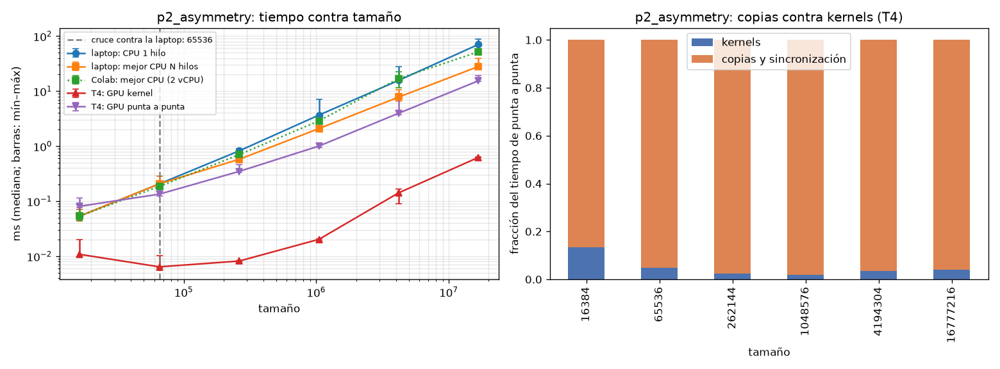

# P2 · El rodeo de los sentidos únicos, en la GPU

**Concepto:** performance (`ec2/04_performance`): coalescing con **corner turning** y **conflictos de bancos** de la
memoria compartida (`05_bank_conflicts_padding`) · **segunda aplicación** del concepto (la primera es
[P1](../p1_aos_soa/README.md), AoS contra SoA) · **tipo A:** agregada (una sección nueva de `--report`,
`p2_oneWayDetours`; no cambia ninguna decisión).

**Veredicto:** como cálculo, gana la **GPU** de punta a punta desde 256 nodos: entre 1,5× y **2,1×** contra la mejor
CPU de la laptop (4 hilos). Con 128 nodos gana la CPU (0,66×). La copia de la tabla es el 96 % del tiempo. La
optimización del concepto **sí rinde**: el kernel con corner turning y relleno es **1,74× más rápido** que el ingenuo
y **1,85×** más rápido que el mismo corner turning sin relleno. Sin relleno, los conflictos de bancos lo dejan
incluso **por debajo del ingenuo**. En la simulación, P2 corre una vez al final. Con la ciudad, la GPU es la que
hace posible el reporte: la tabla de todos contra todos tarda 0,75 s en la GPU (T1) contra 19 s en la CPU. Ver
[Análisis](#análisis-por-qué-la-gpu-conviene-o-no).

## La tarea y por qué es paralela de datos

Con la tabla de distancias de todos contra todos de la red (`d[i][j]`, en metros enteros, la misma de T1), P2 compara
para cada par `i < j` **la ida contra la vuelta**: `d[i][j]` contra `d[j][i]`. En una red sin calles de sentido único
las dos serían iguales. La diferencia es el **rodeo que obligan los sentidos únicos**. El reporte da:
- cuántos pares tienen camino en los dos sentidos, cuántos en uno solo y cuántos son asimétricos;
- la suma y la media del rodeo;
- **el peor par**, con sus coordenadas y los dos largos;
- por restaurante, la ida media a todos los nodos contra la vuelta media.

Para una empresa de delivery es un dato real: dice cuánto cuesta volver y dónde la red castiga más.

Los n(n−1)/2 pares son independientes. El resultado se junta con cinco reducciones: cuatro sumas y un máximo. El
máximo es una **clave de 64 bits**, `(rodeo << 32) | (0xffffffff − (i << 16 | j))`: a igual rodeo gana el menor `i`
y después el menor `j`. Así el peor par no depende del orden en que terminan los hilos, y todo es entero, con
**igualdad exacta** entre CPU y GPU.

**Por qué es del concepto 04.** Leer `d[i][j]` por filas es coalescido, pero `d[j][i]` es **la columna**, el patrón
de la transpuesta: cada hilo del warp lee una fila distinta. Es el caso que resuelve el **corner turning**
(`04_performance/03`): copiar el bloque espejo a memoria compartida con lecturas por filas y leerlo transpuesto desde
ahí. Leerlo transpuesto choca con los **bancos** de la memoria compartida, y eso se arregla con **relleno**
(`05_bank_conflicts_padding`).

## Diseño

**Bloques de la tabla.** La tabla se divide en bloques de 32 × 32. El bloque (I, J) con I ≤ J compara su mitad
superior con el bloque espejo (J, I). Los bloques con I > J salen de inmediato. Lo hace el bloque entero, así que
ningún hilo queda esperando en una barrera.

**Tres kernels** (con nombres distintos para que `nsys` y `ncu` los separen):
- `compareNaive`: lee la vuelta `d[j][i]` directo de la memoria global. Los 32 hilos de un warp tienen 32 `j`
  distintos: 32 filas distintas, 32 sectores por cada lectura de warp.
- `compareTiled`: corner turning. El bloque copia el espejo (J, I) a `__shared__ unsigned mirror[32][32]`, fila por
  fila (coalescido), pone una barrera y lee `mirror[threadIdx.x][r]` (transpuesto). En `[32][32]` toda una columna
  cae en **el mismo banco**: un conflicto de 32 vías, 32 accesos en serie.
- `comparePadded` (el que usa el reporte): igual, con `mirror[32][33]`. La columna de 33 en 33 palabras cae en 32
  bancos distintos y no hay conflicto.

**Grid y bloques.** Bloques de 32 × 8 = 256 hilos y grid de (n/32) × (n/32), con n = la tabla rellenada a múltiplo
de 32. Con 4096 nodos son 128 × 128 = 16 384 bloques, de los que 8 256 trabajan. Cada hilo hace 4 filas del bloque
(`r = threadIdx.y, +8, +16, +24`). Al final, una **reducción en memoria compartida** (`s[5][256]`, árbol de 8 pasos)
y un `atomicAdd` por suma y un `atomicMax` de 64 bits por bloque: **privatización**, un atómico por bloque y no uno
por par. Según `ncu`: 26 registros y 14,5 KB de memoria compartida por bloque (10,2 KB el ingenuo, que solo tiene la
reducción). Caben 4 bloques por SM por la memoria compartida y también 4 por warps, así que la ocupación teórica es
del 100 %.

**CPU.** Hay dos versiones de un hilo. La ingenua (`asymmetryNaive`, la referencia) recorre `i < j` y lee la columna.
La de **bloques** (`asymmetryBlocked`, `cpu_1`) recorre por bloques de 32 × 32: el bloque espejo, 4 KB, queda en la
L1, que es el mismo corner turning hecho por la caché. **N hilos**: un trabajo por fila de bloques en el pool;
cada trabajo acumula en privado y se combinan al final (combiners, carpeta 10).

**Hilos.** Por el hilo dueño de la GPU (`GpuOwner::asymmetry`). En el reporte, con GPU, la tabla la resuelve la GPU
(Floyd–Warshall por bloques de T1) y después se compara con `comparePadded`. Sin GPU, la CPU (por bloques, N hilos)
solo si la red tiene hasta 2000 nodos (`kAsymmetryCpuNodes`). Con la ciudad, la tabla sola tarda ~19 s en la laptop,
así que el reporte lo omite y dice por qué (`computedOn: "no"`, `reason`).

## Corrección

| Prueba | Dónde | Resultado |
|---|---|---|
| `asymmetry_check`: tabla de 4 nodos hecha a mano (un par asimétrico, uno simétrico, uno de un solo sentido y uno sin camino); desempate del peor par; ingenua = por bloques = N hilos (1, 2, 3, 4 y 7) con 0 a 257 nodos y muchos empates | laptop (g++, clang, CMake 3.11.4) y TSan | OK, 0 reportes |
| `gpu_asymmetry_check`: los tres kernels = CPU **exacto** (pares, sumas de 64 bits y el peor par con su desempate), con 0, 1, 33, 70 y 2048 nodos (96 en la emulación), con muchos empates; por el hilo dueño, igual | T4 real, emulado y TSan | OK, 0 reportes |
| `report_check`: la sección P2 contra un cálculo independiente (Floyd–Warshall clásico + ingenua): pares, asimétricos, un solo sentido, suma, peor par y restaurantes | laptop y TSan | OK |
| `compute-sanitizer --tool memcheck` / `racecheck` | T4 | 0 errors / 0 hazards |
| Las 810 corridas de Colab y las 450 de la laptop, comparadas con la ingenua | ambas | 0 incorrectas |
| `ctest` completo con CUDA real | T4 | 57/57 |
| La ciudad con `--report` en la T4 (4775 nodos): 11 397 925 pares, 11 359 624 asimétricos (99,7 %), rodeo medio 239 m; peor par n4102 → n4085: 107 m de ida y 3005 m de vuelta | T4 | salida 0 |

## Cómo se midió

```sh
./delivery_sim config/santa_cruz.json --headless --bench laptop.csv --bench-app p2_asymmetry   # laptop
./delivery_sim config/santa_cruz.json --headless --bench colab.csv --bench-app p2_asymmetry    # Colab (T4)
python3 tools/informe_ec2.py p2_asymmetry laptop.csv colab.csv .
```

Tamaño = celdas de la tabla (n²): de 128 a 4096 nodos, es decir de 16 384 a 16,8 millones de celdas, tres órdenes de
magnitud. Las tablas son sintéticas con semilla fija (`syntheticTable`):
- el 0,5 % de los pares, sin camino;
- el 1 %, con un solo sentido;
- el 35 %, con un sentido más largo que el otro.

Calentamiento y 15 repeticiones intercaladas; mediana [mín–máx]. Las dos máquinas midieron el mismo `src/`
(`a00bf60e…`, anotado en `colab_src_tree.txt` y `laptop_hardware.txt`).

## Resultados



**Veredicto: GPU (Colab, T4) contra la CPU de la laptop**

| nodos (celdas) | CPU 1 hilo (ms) | mejor CPU N hilos (ms) | GPU kernel (ms) | GPU punta a punta (ms) | speedup kernel | speedup punta a punta | ¿correcto? |
|---:|---:|---:|---:|---:|---:|---:|:---:|
| 128 (16 384) | 0.0537 [0.0441–0.0709] | 0.0537 (1 hilo) | 0.01085 [0.00979–0.0198] | 0.08092 [0.0776–0.116] | 4.95× | 0.66× | sí |
| 256 (65 536) | 0.2072 [0.193–0.288] | 0.2072 (1 hilo) | 0.006432 [0.00614–0.0102] | 0.1347 [0.125–0.186] | 32.21× | **1.54×** | sí |
| 512 (262 144) | 0.823 [0.802–0.899] | 0.579 [0.506–0.653] (N=4) | 0.008192 [0.00797–0.00832] | 0.3484 [0.337–0.46] | 70.68× | 1.66× | sí |
| 1024 (1,05 M) | 3.679 [3.56–7.03] | 2.089 [2.03–2.9] (N=4) | 0.02032 [0.0189–0.0205] | 1.006 [0.949–1.08] | 102.81× | **2.08×** | sí |
| 2048 (4,19 M) | 15.72 [15.1–28.2] | 7.815 [6.49–10.5] (N=4) | 0.1424 [0.0909–0.168] | 3.979 [3.73–7.24] | 54.89× | 1.96× | sí |
| 4096 (16,8 M) | 70.73 [69.2–87.3] | 28.1 [26.7–39.7] (N=4) | 0.6275 [0.623–0.631] | 15.45 [15.1–19] | 44.79× | 1.82× | sí |

**Los tres kernels** (Colab, kernel, mediana en ms):

| nodos | ingenuo | corner turning sin relleno | con relleno (`gpu_kernel`) | relleno / ingenuo | relleno / sin relleno |
|---:|---:|---:|---:|---:|---:|
| 128 | 0.0076 | 0.0062 | 0.0109 | (latencia de lanzamiento) | |
| 256 | 0.0076 | 0.0077 | 0.0064 | 1.18× | 1.20× |
| 512 | 0.0119 | 0.0126 | 0.0082 | 1.45× | 1.54× |
| 1024 | 0.0323 | 0.0339 | 0.0203 | 1.59× | 1.67× |
| 2048 | 0.2243 | 0.2371 | 0.1424 | 1.58× | 1.67× |
| 4096 | 1.093 | 1.164 | 0.6275 | **1.74×** | **1.85×** |

**El mismo concepto en la CPU** (1 hilo, mediana en ms): recorrer por bloques también le gana a leer la columna, y
la diferencia crece cuando la tabla deja de entrar en la caché.

| nodos | laptop: ingenua | laptop: por bloques | ingenua / bloques | Colab: ingenua | Colab: por bloques | ingenua / bloques |
|---:|---:|---:|---:|---:|---:|---:|
| 128 | 0.046 | 0.054 | 0.85× | 0.042 | 0.062 | 0.68× |
| 512 | 0.924 | 0.823 | 1.12× | 0.860 | 0.887 | 0.97× |
| 1024 | 6.10 | 3.68 | 1.66× | 4.11 | 3.54 | 1.16× |
| 2048 | 33.3 | 15.7 | 2.12× | 30.0 | 17.9 | 1.68× |
| 4096 | 206.5 | 70.7 | **2.92×** | 157.9 | 78.6 | 2.01× |

Por el hilo dueño (`gpu_via_owner`): 0,13 ms con 128 nodos y 56,8 ms con 4096. Son 41 ms más que el punta a punta:
el bench le pasa la tabla **por valor**, una copia de 67 MB en un vector nuevo. La causa probable de esos 41 ms es
que el sistema operativo entrega esa memoria página por página al escribirla por primera vez; no la perfilé.
La misma máquina (la GPU gana 3,4× con 4096 contra los 2 vCPU de Colab) y el barrido de hilos están en
[`tablas.md`](tablas.md). En la laptop, 4 hilos dan 2,5× sobre la versión de 1 hilo por bloques con 4096.

## Perfiles

`nsys` (`--bench-once`, los 6 tamaños dos veces y cada uno con los 3 kernels):
- Tiempo de kernels: `compareTiled` 3,04 ms (39,9 %), `compareNaive` 2,88 ms (37,7 %) y `comparePadded` 1,71 ms
  (22,4 %).
- Copias: **537 MB de ida** en 36 copias (122,4 ms, ~4,4 GB/s). La vuelta son 40 bytes por corrida (los 5 totales).
  Las copias son el 99,9 % del tiempo de copias y el ~94 % del tiempo de GPU.

`ncu` con la tabla de 4096 × 4096, un lanzamiento de cada kernel:

| | con relleno (`comparePadded`) | sin relleno (`compareTiled`) | ingenuo (`compareNaive`) |
|---|---:|---:|---:|
| grid × bloque | (128 × 128) × (32 × 8) | igual | igual |
| registros / memoria compartida por bloque | 26 / 14,5 KB | 26 / 14,3 KB | 26 / 10,2 KB |
| ocupación teórica / lograda | 100 % / 93,7 % | 100 % | 100 % / 94,6 % |
| duración | **622 µs** | 1 160 µs | 1 090 µs |
| ciclos | 363 709 | 680 649 | 638 249 |
| DRAM | **49 % (159 GB/s)** | 27 % (87 GB/s) | 33 % (107 GB/s) |
| L1/TEX (uso del pipe) | 71 % | **98 %** | 96 % |
| acierto L1 / L2 | 0,4 % / 2,2 % | 0,4 % / 2,3 % | **77 %** / 27 % |
| ciclos entre instrucciones de un warp | 16,9 | 31,9 | 35,7 |
| motivo principal según `ncu` | — | 13 ciclos esperando en la barrera (40,8 % del total) | 12,7 ciclos esperando datos (scoreboard) |

(`ncu` fija el reloj del SM en el base, 585 MHz. Como el kernel está limitado por la memoria, las duraciones
coinciden con las del bench: 0,63 ms contra 0,62 ms.)

## Análisis: por qué la GPU conviene o no

**Paralelismo disponible.** Hay n(n−1)/2 pares: 8 128 con 128 nodos y 8,4 millones con 4096. Con 128 nodos son
4 × 4 = 16 bloques, de los que trabajan 10, para 40 SM: la GPU está casi vacía y el kernel (~7–11 µs) es latencia de
lanzamiento. Con 4096 son 8 256 bloques que trabajan, 102 "olas" por SM: la GPU está llena.

**Overheads.** La tabla viaja entera a la GPU (4 bytes por celda: 67 MB con 4096) para hacer muy poco con cada celda
(una comparación). Con 4096 nodos el kernel tarda 0,63 ms y la copia ~14,5 ms: **la copia es el 96 % del punta a
punta**. Por eso el speedup de punta a punta queda en ~2×, aunque el kernel es 45–100× más rápido que la CPU. En el
reporte esa copia **no existe**: la tabla ya está en la GPU porque la acaba de calcular el Floyd–Warshall de T1. En
este commit se vuelve a subir (`apsp` devuelve la tabla a la CPU y `asymmetry` la sube de nuevo). Dejarla en la GPU
entre las dos llamadas ahorraría esa copia; no lo hice para no acoplar dos aplicaciones. Con la ciudad son ~23
millones de celdas, ~90 MB, unos 20 ms en una corrida que termina igual.

**Cómputo o memoria (roofline).** Por par `i < j` hay unas 10 operaciones enteras (dos comparaciones contra
"sin camino", la resta, 3 sumas de 64 bits, armar la clave y el máximo) contra 8 bytes de DRAM (las dos celdas del
par, cada una leída una vez): **~1,2 operaciones por byte**. El codo de la T4 está en ~25: **limitado por la
memoria**. El tráfico mínimo con 4096 es la tabla una vez, 67 MB, que en 0,62 ms son 108 GB/s útiles. `ncu` mide
159 GB/s de DRAM (49 % del pico); la diferencia no la expliqué. El kernel no llega al techo de memoria. La causa
probable es la reducción final: un árbol de 8 pasos con barrera sobre 5 arreglos, para solo 1 024 pares por bloque.
Esto no lo perfilé por separado.

**Coalescing y bancos: lo que mide `ncu`.**
- *Sin relleno, el corner turning empeora las cosas.* La lectura transpuesta `mirror[threadIdx.x][r]` de un warp
  pega 32 veces en el mismo banco y se sirve en 32 turnos. El pipe de la L1/memoria compartida queda saturado (98 %)
  y los warps llegan desparejos a la barrera de la reducción: 13 ciclos de espera en la barrera, el 41 % del tiempo.
  Resultado: 1,16 ms, más lento que el ingenuo.
- *Con relleno* (`[32][33]`), la misma lectura toca 32 bancos distintos y se sirve en un turno. El pipe baja al 71 %,
  la DRAM sube del 27 % al 49 % y el kernel **tarda la mitad: 1,85×**. El relleno solo agrega 128 bytes por bloque.
- *El ingenuo no es tan malo como dice la teoría:* acierta el **77 % en la L1**. Cada warp lee 32 sectores de 32 B,
  uno por fila, y cada sector trae 8 columnas seguidas (`i … i+7`). Los otros 7 warps del bloque (`threadIdx.y`
  distinto) leen justo esas columnas, así que la L1 hace sola buena parte del corner turning (el máximo sería 7/8 =
  87,5 %). Aun así, el pipe de la L1 queda al 96 % y los warps esperan datos. El corner turning con relleno sigue
  ganando 1,74×, porque cada celda pasa una sola vez por la L1, en una lectura coalescida.
- *En la CPU* es el mismo concepto con otra memoria: leer la columna de una tabla de 64 MB trae una línea de 64 B
  por cada celda útil. Por bloques, el bloque espejo queda en la L1 y la ingenua es 2,9× más lenta con 4096 en la
  laptop. Con tablas chicas (≤ 512 nodos, 1 MB) todo entra en la caché y el orden da igual.

**Eficiencia de ejecución.** La ocupación lograda es del 94 % en los tres kernels; la limitan por igual la memoria
compartida y los warps (4 bloques por SM). Divergencia:
- La mitad de los bloques (I > J) sale enteros, así que no hay divergencia dentro de un warp.
- En los 128 bloques de la diagonal, el `i < j` deja hilos sin trabajo.
- En la reducción, en los últimos 5 pasos trabajan menos de 32 hilos por warp. Por eso `ncu` ve 27 hilos activos de
  32 en promedio. Su estimación es que eso cuesta ~7 %.

**Contención y sincronización.** Un atómico por bloque y por total (4 `atomicAdd` y un `atomicMax`): 8 256 bloques
contra 5 direcciones. Es poca contención, gracias a la privatización (la reducción en memoria compartida primero).
Hay dos barreras por bloque en los kernels con memoria compartida: después de cargar el espejo y en cada paso de la
reducción.

**Corrección bajo paralelismo.** Todo es entero. Las sumas son de 64 bits: con la ciudad, la suma de rodeos ya es
2,7·10⁹ m, el 63 % del límite de 32 bits (4,3·10⁹), y una red un poco más grande se pasaría. El máximo es una clave total, así que el resultado no depende del orden de los
atómicos: **igualdad exacta** con la CPU en todas las corridas. No hay nada que revalidar en la CPU: es un reporte
final, no una decisión.

**Veredicto.**
- *Simulación con Equipetrol* (154 nodos, una vez al final): **CPU**. La tabla tiene 160² celdas y la GPU solo
  sumaría el costo de lanzar y copiar. El resultado: 11 427 de 11 781 pares son asimétricos (97 %), con un rodeo
  medio de 168 m y uno máximo de 1 195 m.
- *Ciudad* (4775 nodos): **GPU**, y no por la comparación, que es barata en las dos. El rodeo necesita la tabla de
  todos contra todos, que en la CPU tarda ~19 s y en la GPU 0,75 s (T1). Sin GPU el reporte de la ciudad se omite.
  Con GPU, en la T4: el 99,7 % de los pares son asimétricos, el rodeo medio es de 239 m, y el peor caso son dos nodos
  a 107 m que obligan a 3 km de vuelta.
- *Tablas sueltas de más de 256 nodos:* GPU, ~2× de punta a punta, limitada por la copia.
- *Lo que demuestra:* el corner turning es la optimización correcta para leer una transpuesta, **pero solo con el
  relleno**. Sin él, los conflictos de bancos lo dejan peor que no optimizar. Y la L1 de la T4 ya recupera buena
  parte del coalescing perdido, así que el beneficio medido (1,74×) es menor que el teórico (32 sectores contra uno).

**Amenazas a la validez.**
- Dos máquinas distintas. En la misma máquina, la GPU gana 3,4× con 4096 nodos.
- Las tablas del bench son sintéticas. La proporción de pares asimétricos no cambia el acceso a la memoria, pero sí
  las ramas.
- La diferencia entre los 159 GB/s de `ncu` y los 108 GB/s útiles queda sin explicar.
- Los 41 ms de la copia por valor del hilo dueño no están perfilados.
- `handover_check` y `dispatch_check` (primera evaluación) fallan a veces bajo `ctest -j8`, igual en `main` (ver T1).
- Nunca se midió la emulación de `cuda_compat.h`.
