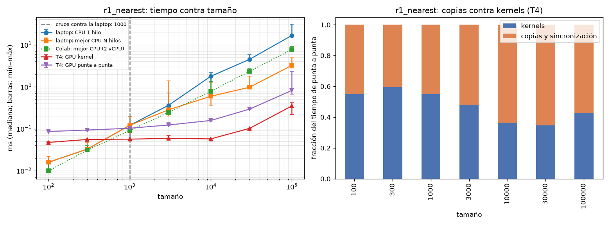

# R1 · Las motos más cercanas al restaurante, en la GPU

**Concepto:** reducción (`ec2/08_reduction`, sesión 18) · **primera aplicación** de ese concepto · **tipo B:**
acelerada idéntica (la decisión es exactamente la de la CPU).

**Veredicto:** el kernel le gana a la mejor CPU de la laptop desde ~1000 motos y por 2,3× (de punta a punta) en la
ciudad (3000 motos), pero **en la simulación no conviene usar la GPU para esto**. Esta selección es ~1 % de cada
ronda del despachador: la ronda la domina el ETA (los Dijkstra). Por la ley de Amdahl, aunque la GPU hiciera esta
parte en cero, la ronda bajaría ~1 %. Ver [Análisis](#análisis-por-qué-la-gpu-conviene-o-no).

## La tarea y por qué es paralela de datos

Para cada pedido, el despachador estima el ETA solo con las **k = 8 motos con lugar más cercanas en línea recta**
al restaurante (`nearest()` en `src/simulation.cpp`, decidido en DP.10). Con 3000 motos son 3000 distancias
haversine independientes (un **map**) y después elegir las 8 menores (una **reducción** con clave
(distancia, índice)). Es el patrón de la carpeta 08: cada elemento se reduce con una operación asociativa y
conmutativa (el mínimo de pares), en árbol por bloque y después entre bloques.

## Diseño

**Que la decisión sea la misma que la de la CPU.** `sin`, `cos` y `asin` de CUDA pueden diferir de los de la CPU
en el último bit: con dos motos casi a la misma distancia, la GPU podría ordenarlas distinto. Por eso la GPU **no
decide**: devuelve un **subconjunto** que seguro contiene a las 8 mejores y la CPU elige dentro con el criterio de
siempre (`nearestWithin`, mismas claves que `nearest()`):

1. `distancesAndBlockTop`: un hilo por moto calcula su distancia (bucle de paso de grid si hay más motos que
   hilos) y cada bloque hace **9 reducciones argmin seguidas** en memoria compartida: en la ronda r, la menor
   clave estrictamente mayor que la de la ronda r−1. Cada bloque deja sus 9 mejores.
2. `mergeTop`: un bloque repite lo mismo sobre las mejores de todos los bloques y deja el **umbral** = la 9.ª
   distancia + 2·10⁻⁶ m.
3. `collect`: cada moto con distancia ≤ umbral se anota con `atomicAdd` (el host ordena: el orden de los
   atómicos no es determinista).

Por qué alcanza el margen: si GPU y CPU difieren en menos de d por moto, la 8.ª de la CPU es ≤ g + d (g = la 9.ª
de la GPU), así que toda moto entre las 8 mejores de la CPU tiene en la GPU ≤ g + 2d. Con d de unos pocos ulp
(< 10⁻¹¹ m en pocos km), 10⁻⁶ m deja cinco órdenes de margen y solo agrega motos que difieren en 2 µm. Pedir la
9.ª (k + 1) y no la 8.ª garantiza más de 8 motos en el subconjunto, así `nearestWithin` ordena igual que
`nearest()`.

**Datos.** Las posiciones viajan como arreglo de `Coordinates` (16 B por moto, dos `double` contiguos: un warp
lee 512 B seguidos, coalescido). La memoria de la GPU se reserva **una vez** (al crear el hilo dueño); por llamada
solo viajan las posiciones (48 KB con 3000 motos) y vuelven unos pocos índices.

**Hilos.** Toda llamada a CUDA la hace **un solo hilo, el dueño de la GPU** (`src/gpu/gpu_owner.*`: un
`ThreadPool` de 1 hilo, la cola monitor de 07 + un promise por trabajo de 04). El despachador le manda el trabajo
y espera el future con `wait_for(quoteTimeoutMs)`: si la GPU no responde a tiempo o falla, una línea en stderr y
la misma selección en la CPU (sobre la misma lectura de posiciones). Las motos y el bucle de frames no esperan a
la GPU. Solo con `-DUSE_CUDA=ON`: sin CUDA, el código que se compila es el de siempre.

**Grid y bloques.** 256 hilos por bloque (8 warps, potencia de 2 para el árbol de la reducción);
`min(ceil(n/256), 160)` bloques: 160 = 4 bloques por SM en la T4 (40 SM) = una sola "wave" de 40 960 hilos;
con más motos, cada hilo procesa varias (coarsening). 44 registros por hilo y 3 KB de memoria compartida por
bloque (`ncu`): el límite de bloques por SM es el de warps (4), no registros (5) ni memoria compartida (9).

## Corrección

| Prueba | Dónde | Resultado |
|---|---|---|
| `nearest_check`: N hilos = 1 hilo (1–7 hilos, con muchos empates); subconjunto + `nearestWithin` = todas | laptop (g++, clang, CMake 3.11.4) y TSan ×5 | OK, 0 reportes |
| `gpu_nearest_check`: el subconjunto tiene > 8 motos, contiene a las 8 de la CPU y la decisión es idéntica (60 nodos posibles: empates reales); por el hilo dueño, igual; un error llega por el future y el hilo sigue | T4 real y emulado (cuda_compat.h), TSan | OK, 0 reportes |
| `compute-sanitizer --tool memcheck` sobre la prueba y sobre `delivery_sim --bench-once` | T4 | 0 errors |
| `compute-sanitizer --tool racecheck` (memoria compartida de las reducciones) | T4 | 0 hazards |
| Cada una de las 630 corridas del bench en Colab y de las 420 en la laptop se compara con la referencia | ambas | 0 incorrectas |
| `ctest` completo | T4 (36/36) y laptop (36/36) | OK |

## Cómo se midió

```sh
# laptop (Release -O3, sin ventana; enchufada, modo Mejor rendimiento, navegador cerrado): ver laptop_hardware.txt
./delivery_sim config/santa_cruz.json --headless --bench laptop.csv
# Colab (T4): colab/ec2_gpu.ipynb, ejecutado en colab_ejecutado.ipynb (todas las salidas)
./delivery_sim config/santa_cruz.json --headless --bench colab.csv
# tablas y gráfico, desde los dos CSV
python3 tools/informe_ec2.py r1_nearest laptop.csv colab.csv .
```

Tamaño = motos candidatas, de 100 a 100 000 (tres órdenes de magnitud; la ciudad tiene 3000). Cada moto está en un
nodo al azar de la ciudad real (semilla fija, mismos datos para todas las versiones). Una corrida de calentamiento
y 15 repeticiones con las versiones intercaladas. GPU kernel = eventos de CUDA alrededor de los tres kernels; GPU
de punta a punta = `steady_clock` desde la copia de ida hasta la vuelta, después de sincronizar (sin reservas: se
hacen una vez). Tabla: mediana [mín–máx].

## Resultados



Laptop: Intel Core i5-6300U, 2 núcleos / 4 hilos, WSL2 (Ubuntu 26.04), g++ 15.2 `-O3` · Colab: Tesla T4 (CUDA
13.0, driver 580), Xeon 2,0 GHz con 2 vCPU (1 núcleo con hyperthreading).

**Veredicto: GPU (Colab, T4) contra la CPU de la laptop**

| tamaño | CPU 1 hilo (ms) | mejor CPU N hilos (ms) | GPU kernel (ms) | GPU punta a punta (ms) | speedup kernel | speedup punta a punta | ¿correcto? |
|---:|---:|---:|---:|---:|---:|---:|:---:|
| 100 | 0.0159 [0.0098–0.0222] | 0.0159 [0.0098–0.0222] (1 hilo) | 0.04726 [0.047–0.0494] | 0.08588 [0.0828–0.0971] | 0.34× | 0.19× | sí |
| 300 | 0.0327 [0.03–0.0474] | 0.0327 [0.03–0.0474] (1 hilo) | 0.05552 [0.0546–0.0567] | 0.09311 [0.0913–0.0988] | 0.59× | 0.35× | sí |
| 1000 | 0.1205 [0.107–0.191] | 0.1205 [0.107–0.191] (1 hilo) | 0.05651 [0.0556–0.0824] | 0.1028 [0.0982–0.129] | 2.13× | 1.17× | sí |
| 3000 | 0.3601 [0.339–0.707] | 0.2817 [0.2–1.38] (N=4) | 0.05888 [0.056–0.0685] | 0.1227 [0.118–0.14] | 4.78× | 2.30× | sí |
| 10000 | 1.776 [1.33–2.17] | 0.5937 [0.349–1.23] (N=2) | 0.05734 [0.0573–0.0594] | 0.1574 [0.152–0.176] | 10.35× | 3.77× | sí |
| 30000 | 4.494 [4.36–5.76] | 0.9737 [0.889–1.77] (N=2) | 0.1018 [0.101–0.102] | 0.2929 [0.288–0.317] | 9.57× | 3.32× | sí |
| 100000 | 16.71 [15.6–30.6] | 3.232 [2.79–4.88] (N=4) | 0.3491 [0.219–0.419] | 0.8188 [0.664–2.29] | 9.26× | 3.95× | sí |

La misma máquina (CPU de Colab), el barrido de hilos y las tablas completas: [`tablas.md`](tablas.md) (generado
por `tools/informe_ec2.py`). En Colab la GPU gana desde 3000 (2,0×) hasta 9,4× con 100 000; la CPU de Colab no
mejora con 2 hilos (1 núcleo físico). En la laptop, 4 hilos dan 2,0× sobre 1 hilo con 100 000 motos y casi nada
por debajo de 10 000: repartir el trabajo en el pool cuesta ~0,15 ms (despertar los hilos), lo mismo que
calcular 1000 distancias.

**Nota sobre "1 hilo" y "N hilos":** no son el mismo algoritmo. "1 hilo" es `nearest()` tal cual (ordena todas las
distancias, O(n log n)); "N hilos" se queda con las 8 mejores de cada tramo (`partial_sort`, O(n log 8)) y las
combina. Por eso en Colab "N hilos" con N = 1 ya le gana a "1 hilo". El barrido de hilos compara "N hilos" contra
sí mismo con 1 hilo.

## Perfiles

`nsys` (`--bench-once`, 14 llamadas):

| | total | por llamada (mediana) |
|---|---:|---:|
| `distancesAndBlockTop` | 1,51 ms (70,8 % del tiempo de kernels) | 61 µs |
| `mergeTop` | 0,58 ms (27,1 %) | 32 µs |
| `collect` | 0,04 ms (2,1 %) | 2,8 µs |
| copias de ida (4,6 MB en total) | 0,51 ms | 7,5 µs (1,6 MB con 100 000 motos: 199 µs) |
| copias de vuelta | 0,05 ms | 1,7 µs |

`ncu` (`distancesAndBlockTop`; `ncu` fija el reloj en 585 MHz, así que sus duraciones son más largas que las del
bench, que corre a hasta 1590 MHz):

| | 3000 motos (la ciudad) | 100 000 motos |
|---|---:|---:|
| grid × bloque | 12 × 256 | 160 × 256 |
| waves por SM | 0,07 | 1 |
| ocupación teórica / lograda | 100 % / **25 %** | 100 % / **93 %** |
| cómputo (SM) / memoria | 15 % / 1,4 % | **80 %** / 4,3 % (DRAM 1,3 %) |

## Análisis: por qué la GPU conviene o no

**Paralelismo disponible.** Hay una unidad de trabajo por moto. La T4 tiene 40 SM × 1024 hilos residentes =
40 960. Con 3000 motos (la ciudad) son 12 bloques para 40 SM: `ncu` mide 0,07 waves y 25 % de ocupación, y
estima que se podría ganar un 70–75 % llenando la GPU. Con el tamaño del brief (8 motos) la GPU ni se usa: con
8 o menos candidatas no hay nada que elegir. Recién con ~40 000 motos la GPU está llena.

**Overheads.** Hasta 10 000 motos el kernel tarda siempre ~57 µs: no es trabajo, es latencia. Son 3 lanzamientos y,
sobre todo, `mergeTop`: un solo bloque que hace 9 rondas de reducción una detrás de la otra, cada una con 8 niveles
de árbol y sus `__syncthreads` (~32 µs fijos). De punta a punta se suma la copia de ida y la sincronización: con
3000 motos, el 52 % del tiempo de punta a punta no es kernel. Los datos no pueden quedarse en la GPU entre rondas:
las motos se mueven, cada ronda hay que leer y subir sus posiciones.

**Cómputo o memoria.** Con 100 000 motos el kernel está **limitado por el cálculo** (80 % del SM, 1,3 % de DRAM):
cada moto lee 16 B y hace un haversine en `double` (seno, coseno, arcoseno y raíz). La T4 hace `double` a 1/32 de
la velocidad de `float`. Es el precio de pedir la misma decisión que la CPU: en `float` sería mucho más rápido,
pero el margen de error dejaría de ser de micrómetros. El acceso es coalescido (posiciones contiguas) y la
reducción usa memoria compartida (3 KB por bloque).

**Eficiencia de ejecución.** Ocupación: ver la tabla de `ncu`; el límite teórico es de warps (4 bloques de 8 warps),
y con 100 000 motos se logra el 93 %. Divergencia: el cálculo de la distancia no tiene ramas; en la reducción, en
cada nivel del árbol trabajan `s` hilos (`if (threadIdx.x < s)`), así que en los últimos 5 niveles (s < 32) solo un
warp hace algo, y la condición de "mejor que el anterior" diverge dentro del warp, pero solo para una asignación.
Una reducción final con `__shfl_down_sync` (warp a warp, sin memoria compartida ni barreras) bajaría el costo fijo
de `mergeTop`; no se hizo porque no cambia el veredicto (ver Amdahl).

**Contención y sincronización.** Sin atómicos en la reducción (cada bloque escribe sus 9 en su propio lugar); un
`atomicAdd` por moto elegida en `collect` (unas 9 a 35 por llamada: contención despreciable). Con el resto del
programa: el despachador espera un future con plazo (`quoteTimeoutMs`), nadie gira esperando, y TSan no reporta
nada sobre la cola del hilo dueño.

**Corrección bajo paralelismo.** Empates: la clave (distancia, índice) es única, así que el resultado de la
reducción no depende del orden de combinación; la GPU solo elige el umbral, y la decisión la toma la CPU con
`nearestWithin`. Punto flotante: el margen de 2·10⁻⁶ m cubre la diferencia entre las funciones matemáticas de
CUDA y las de la CPU. Check-then-act: la GPU elige candidatas, no asigna; el despachador sigue estimando y
reservando el cupo con `tryReserve` como antes (si la moto se llenó entre medio, prueba la siguiente).

**Veredicto.**
- *Escala del brief* (8 motos en Equipetrol): **CPU**. Con 8 o menos candidatas no hay nada que prefiltrar.
- *Ciudad* (3000 motos): la GPU gana de punta a punta 2,3× contra la mejor CPU de la laptop (0,123 ms contra
  0,282 ms; el cruce está entre 1000 y 3000 motos, en 1000 las dispersiones se superponen). Pero esta selección es
  ~0,3 ms de una ronda de ~35 ms del despachador (medido en la laptop con la ciudad: 1730 pedidos asignados en 60 s
  reales, el resto los ETA con Dijkstra sobre 4775 nodos). **Por Amdahl, la GPU acá no mejora la simulación:**
  ahorra ~0,16 ms de 35 ms. **Se deja en la CPU**; la versión de GPU queda detrás de `USE_CUDA` y demuestra el
  patrón. Para acelerar el despacho hay que atacar el ETA (ver T1: la tabla de todos contra todos).

**Amenazas a la validez.** Dos máquinas distintas (CPU de la laptop contra GPU de Colab; por eso también la tabla
en la misma máquina). WSL2 en la laptop: la dispersión de la CPU es grande (en 3000, de 0,20 a 1,38 ms), aunque la
mediana de 15 repeticiones es estable. La T4 de Colab es compartida y su reloj varía (de ahí el 3,45× máx/mín de
punta a punta en 100 000). Tamaños por encima de 3000 son mayores que la ciudad: se miden para encontrar el cruce,
no porque la simulación los tenga. Nunca se midió la emulación de `cuda_compat.h`.
