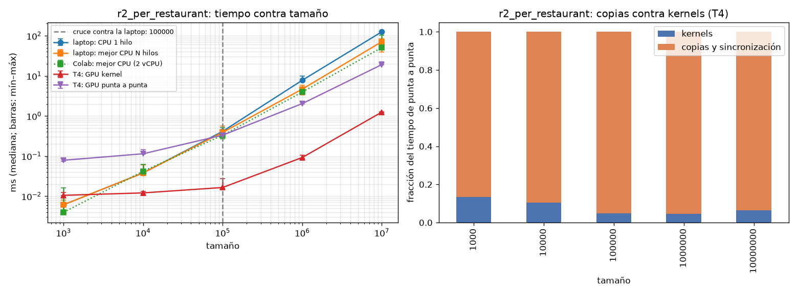

# R2 · Estadísticas por restaurante, en la GPU

**Concepto:** reducción (`ec2/08_reduction`), segmentada · **segunda aplicación** de ese concepto (la primera es R1) ·
**tipo A:** agregada (una sección nueva de `--report`; no cambia ninguna decisión de la simulación).

**Veredicto:** **CPU para la simulación; GPU con volúmenes grandes.** Es la aplicación de tipo A donde la GPU más le
gana a la laptop de punta a punta: desde 10⁵ pedidos (1,17×) hasta **3,72× con 10⁷**. La CPU recorre los pedidos a
través del índice de los grupos (lecturas salteadas, sin caché) y la GPU esconde esa latencia con miles de hilos.
Pero la simulación tiene ~18 000 pedidos: la CPU tarda microsegundos. Ver
[Análisis](#análisis-por-qué-la-gpu-conviene-o-no).

## La tarea y por qué es paralela de datos

Por restaurante: cuántos de sus pedidos se entregaron, la suma de sus tiempos de entrega (para el promedio) y el
máximo. Los segmentos son los grupos de SC1: el restaurante r son los pedidos `order[offsets[r] .. offsets[r+1])`.
Cada segmento es una **reducción** independiente con tres operaciones asociativas y conmutativas (contar, sumar en 64
bits, máximo): el patrón de la carpeta 08, una vez por segmento. Enteros: la CPU y la GPU dan **exactamente** lo mismo.

## Diseño

**Un bloque por restaurante.** Los hilos del bloque recorren su grupo con paso de bloque (`k += blockDim.x`: en cada
vuelta, 256 posiciones seguidas del grupo, coalescido sobre `order`), acumulan cantidad, suma y máximo **en
registros**, y después el bloque reduce los tres valores en árbol en memoria compartida (`for s = 128; s > 0; s /= 2`
con `__syncthreads`). Sin atómicos: cada bloque escribe solo su restaurante.

**El acceso que importa.** `order[k]` es contiguo, pero `deliveryMs[order[k]]` es un **gather**: dentro de un grupo,
los pedidos de un restaurante están desparramados por todo el arreglo (uno de cada 37). Ese acceso es el mismo en la
CPU y en la GPU; la diferencia es quién tolera mejor la latencia.

**Grid y bloques.** 256 hilos (8 warps, potencia de 2 para el árbol); grid = restaurantes (37 en la ciudad). 18
registros por hilo y 4 KB de memoria compartida (cuenta, suma de 64 bits y máximo por hilo).

**CPU con N hilos.** Los restaurantes (segmentos independientes) se reparten entre los trabajos del pool; cada uno
escribe solo los suyos (sin locks).

**Hilos.** Por el hilo dueño de la GPU (`GpuOwner::segmentStats`). En el reporte, después de la simulación.

## Corrección

| Prueba | Dónde | Resultado |
|---|---|---|
| `segment_stats_check`: 1 hilo = la cuenta directa pedido por pedido (sin agrupar); N hilos (1–7) = 1 hilo; los no entregados no cuentan; un restaurante sin pedidos da todo 0 | laptop (g++, clang, CMake 3.11.4) y TSan | OK, 0 reportes |
| `gpu_segment_stats_check`: GPU = CPU con 1, 37 y 64 restaurantes, 0, 3, 300 y 10⁶ pedidos (grupos más chicos y más grandes que un bloque), uno de cada cuatro sin entregar; por el hilo dueño, igual | T4 real, emulado y TSan | OK, 0 reportes |
| `report_check`: por restaurante, creados y entregas suman los del resumen; el máximo y el promedio = `maxDeliveryMs` y `avgDeliveryMs` | laptop y TSan | OK |
| `compute-sanitizer --tool memcheck` / `racecheck` | T4 | 0 errors / 0 hazards |
| Las 450 corridas de Colab y las 300 de la laptop, comparadas con la referencia | ambas | 0 incorrectas |
| La ciudad con `--report` en la T4 (37 restaurantes, en la GPU) | T4 | salida 0 |

## Cómo se midió

```sh
./delivery_sim config/santa_cruz.json --headless --bench laptop.csv --bench-app r2_per_restaurant   # laptop
./delivery_sim config/santa_cruz.json --headless --bench colab.csv --bench-app r2_per_restaurant    # Colab (T4)
python3 tools/informe_ec2.py r2_per_restaurant laptop.csv colab.csv .
```

Tamaño = pedidos, 10³ a 10⁷. Restaurante al azar entre 37, uno de cada cuatro sin entregar y los demás con un tiempo
de 1 a 121 minutos (semilla fija). El agrupamiento (SC1) se hace una vez, fuera de la medición: se mide solo la
reducción. Calentamiento y 15 repeticiones intercaladas; mediana [mín–máx]. La laptop midió el commit de R2 y Colab la
punta de la rama (S1): `segment_stats.*`, `segment_stats_gpu.*`, `benchSegmentStats` y `GpuOwner::segmentStats` no
cambian entre los dos.

## Resultados



**Veredicto: GPU (Colab, T4) contra la CPU de la laptop**

| tamaño | CPU 1 hilo (ms) | mejor CPU N hilos (ms) | GPU kernel (ms) | GPU punta a punta (ms) | speedup kernel | speedup punta a punta | ¿correcto? |
|---:|---:|---:|---:|---:|---:|---:|:---:|
| 10³ | 0.0061 [0.0045–0.0079] | 0.0061 (1 hilo) | 0.0105 [0.0102–0.0123] | 0.0786 [0.074–0.0847] | 0.58× | 0.08× | sí |
| 10⁴ | 0.038 [0.0324–0.0601] | 0.038 (1 hilo) | 0.0121 [0.0105–0.0131] | 0.1141 [0.11–0.147] | 3.15× | 0.33× | sí |
| 10⁵ | 0.4139 [0.412–0.454] | 0.3903 [0.339–0.554] (N=2) | 0.0165 [0.0158–0.0271] | 0.3324 [0.31–0.383] | 23.73× | **1.17×** | sí |
| 10⁶ | 7.77 [7.41–9.76] | 4.677 [3.35–5.77] (N=4) | 0.0922 [0.089–0.104] | 2.035 [1.97–2.32] | 50.75× | **2.30×** | sí |
| 10⁷ | 125.7 [123–129] | 71.17 [39.7–83.2] (N=4) | 1.248 [1.24–1.26] | 19.11 [18.9–22.2] | 57.03× | **3.72×** | sí |

Por el hilo dueño (`gpu_via_owner`): 0,11 ms con 10³, 5,9 ms con 10⁶ y 67,2 ms con 10⁷ (los grupos y los tiempos, 80
MB, viajan por valor a la cola del hilo dueño). La misma máquina (en Colab la GPU gana 2,66× con 10⁷) y el barrido de
hilos: [`tablas.md`](tablas.md).

## Perfiles

`nsys`: `segmentStats`, 10 lanzamientos, mediana 11,6 µs (con 10⁷: 1,0 ms). Copias de ida: 178 MB en 30 (por llamada
viajan `order`, los tiempos y los offsets: 80 MB con 10⁷, ~8,9 ms); de vuelta, 37 × 16 B.

`ncu` con 10⁷ pedidos:

| | `segmentStats` |
|---|---:|
| grid × bloque | 37 × 256 |
| waves por SM | **0,2** (37 bloques para 40 SM) |
| registros por hilo / memoria compartida | 18 / 4 KB |
| DRAM | 31 % (98 GB/s) |
| acierto L1 / L2 | **2,5 %** / 83 % |
| cómputo (SM) | 4,9 % |
| duración | 1,23 ms |

## Análisis: por qué la GPU conviene o no

**Paralelismo disponible.** Un bloque por restaurante: con 37 restaurantes son 37 bloques para 40 SM (`ncu`: 0,2
waves; "el grid es demasiado chico"), 9472 hilos de 40 960 posibles. El paralelismo está limitado por la cantidad de
**segmentos**, no de pedidos. Aun así el kernel tarda 1,25 ms con 10⁷ (57× la CPU de 1 hilo).

**Overheads.** Con 10⁷, de 19,1 ms de punta a punta, ~17,9 ms son la copia de ida (80 MB: el orden y los tiempos) y
1,25 ms el kernel. Con menos de 10⁵ pedidos manda la latencia (~80 µs fijos).

**Cómputo o memoria.** Limitado por la **latencia de memoria**: cómputo al 5 %, DRAM al 31 %. El gather
`deliveryMs[order[k]]` no reusa nada en L1 (2,5 %), pero la L2 de la T4 (4 MB) atrapa el 83 %. La CPU sufre el mismo
gather sin poder esconderlo: con 10⁷, 126 ms con 1 hilo (≈ 12 ns por pedido, una falla de caché cada vez). La GPU
tiene 8 warps por SM esperando a la vez: mientras unos esperan su dato, otros avanzan.

**Eficiencia de ejecución.** Ocupación baja por la forma del problema (37 bloques). Con más bloques por restaurante
(partir cada grupo en tramos y combinar después, como el árbol de bloques de R1) se llenaría la GPU; no se hizo porque
el punta a punta lo domina la copia (93 %). Divergencia: el bucle no diverge salvo en la última vuelta de cada grupo;
en el árbol, en los últimos 5 niveles trabaja un solo warp.

**Contención y sincronización.** Sin atómicos: cada bloque escribe solo su restaurante. `__syncthreads` en cada nivel
del árbol.

**Corrección bajo paralelismo.** Enteros: la suma en 64 bits no desborda (10⁷ × 2,1 · 10⁹ < 2⁶⁴) y no depende del
orden; el máximo y la cuenta tampoco.

**Veredicto.**
- *Simulación* (~18 000 pedidos, 37 restaurantes): **CPU**. Con 10⁴ la CPU tarda 38 µs y la GPU 114 µs de punta a
  punta. Una vez al final: 0 % del tiempo de la simulación.
- *Volumen grande* (10⁵ a 10⁷, releer muchos logs): **GPU**, 1,2× a 3,7× contra la mejor CPU de la laptop. El gather
  es lo que hace ganar a la GPU: la CPU no puede esconder las fallas de caché y la GPU sí.

**Amenazas a la validez.** Dos máquinas distintas (en la misma máquina la GPU gana 2,66× con 10⁷). La dispersión de la
CPU de la laptop con 10⁷ y 4 hilos es grande (de 39,7 a 83,2 ms). Restaurantes uniformes: con uno dominante, su
bloque haría casi todo el trabajo (desbalance). `handover_check` (primera evaluación) falla a veces bajo `ctest -j8`,
igual en `main` (ver T1). Nunca se midió la emulación de `cuda_compat.h`.
