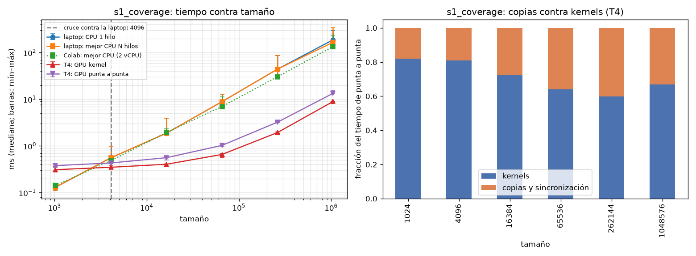

# S1 · El mapa de cobertura, en la GPU

**Concepto:** stencil (`ec2/06_stencil`) · **primera aplicación** de ese concepto · **tipo A:** agregada (una sección
nueva de `--report`; no cambia ninguna decisión).

**Veredicto:** **GPU** desde la grilla de 64 × 64 (1,29× de punta a punta contra la mejor CPU de la laptop) hasta
**13,7×** con 512² y 12,4× con 1024²; con la grilla del reporte (128²) gana 3,4×. Muchos barridos sobre datos que se
quedan en la GPU: una copia de ida y una de vuelta para 100 barridos. Y un hallazgo: **el kernel por bloques con halo
es 1,62× más lento que el básico**, que ya usa el 85 % de la DRAM. Ver
[Análisis](#análisis-por-qué-la-gpu-conviene-o-no).

## La tarea y por qué es paralela de datos

Sobre una grilla de la ciudad, cuánto cuesta llegar desde cada celda al **restaurante más cercano**: las celdas de los
restaurantes valen 0; pasar por una celda con calles cuesta 1 y por una sin calles 3 (un rodeo). Cada **barrido de
Jacobi** hace, para cada celda interior,

    d'[c] = min(d[c], min(d de sus 4 vecinas) + costo[c])

con dos buffers (se lee uno, se escribe el otro) y los bordes fijos. Todas las celdas de un barrido son independientes
(un stencil de 5 puntos, la carpeta 06); entre barridos hay que esperar a todos. Después de suficientes barridos el
campo ya no cambia: la distancia por la grilla al restaurante más cercano. El reporte da, sobre las celdas con calles,
el costo mediano, el p90, el máximo y la celda peor cubierta (en la ciudad: celdas de 47 m, costo p50 10 = ~470 m).

**Enteros:** con el mismo número de barridos, la CPU y la GPU dan **exactamente** el mismo campo.

## Diseño

**Un lanzamiento por barrido.** El fin de cada lanzamiento es la barrera entre barridos (ningún bloque lee lo que otro
está escribiendo); los dos buffers se alternan y **los datos se quedan en la GPU**: una copia de ida (costos y campo
inicial) y una de vuelta para todos los barridos.

**Dos kernels (carpeta 06).**
- `sweepBasic`: cada hilo (una celda) lee sus 4 vecinas de la memoria global.
- `sweepTiled` (el que usa el reporte): un bloque de 32 × 8 hilos carga su bloque con un halo de 1 celda (34 × 10) en
  memoria compartida; cada valor se lee de la memoria global una vez y lo usan hasta 5 celdas.

**Grid y bloques.** 32 × 8 = 256 hilos: un warp por fila del bloque, así cada warp lee 32 celdas seguidas de una fila
(128 B, coalescido). Grid = ⌈ancho/32⌉ × ⌈alto/8⌉ (32 × 128 con 1024²). 20 a 30 registros por hilo; ocupación
teórica 100 %.

**CPU con N hilos.** Cada barrido reparte las filas en tramos entre los trabajos del pool y espera a todos antes del
siguiente (strips por filas, carpeta 10).

**Hilos.** Por el hilo dueño de la GPU (`GpuOwner::coverage`). En el reporte: grilla de 128 × 128, calles
rasterizadas desde el grafo, los 37 restaurantes en 0, 4 · 128 = 512 barridos, y se comprueba que un barrido más no
cambia el campo (`converged`).

## Corrección

| Prueba | Dónde | Resultado |
|---|---|---|
| `coverage_check`: sin rodeos y con suficientes barridos = distancia de Manhattan al restaurante más cercano; los restaurantes en 0; N hilos (1–7) = 1 hilo con rodeos después de 0, 1, 7 y 150 barridos | laptop (g++, clang, CMake 3.11.4) y TSan | OK, 0 reportes |
| `gpu_coverage_check`: básico y por bloques = CPU celda por celda con el mismo número de barridos (0, 1, impar y hasta converger), grillas que no son múltiplo del bloque; por el hilo dueño, igual | T4 real, emulado y TSan | OK, 0 reportes |
| `report_check`: el campo convergió; toda celda con calles llega a un restaurante; p50 ≤ p90 ≤ máximo | laptop y TSan | OK |
| `compute-sanitizer --tool memcheck` / `racecheck` (el halo en memoria compartida) | T4 | 0 errors / 0 hazards |
| Las 630 corridas de Colab y las 360 de la laptop, comparadas con la referencia | ambas | 0 incorrectas |
| La ciudad con `--report` en la T4: 8469 celdas con calles, convergió, ninguna sin llegar | T4 | salida 0 |

## Cómo se midió

```sh
./delivery_sim config/santa_cruz.json --headless --bench laptop.csv --bench-app s1_coverage   # laptop
./delivery_sim config/santa_cruz.json --headless --bench colab.csv --bench-app s1_coverage    # Colab (T4)
python3 tools/informe_ec2.py s1_coverage laptop.csv colab.csv .
```

Tamaño = celdas: lados de 32 a 1024 (de 1024 a 1 millón de celdas, tres órdenes de magnitud; el reporte usa 128²),
con **100 barridos por corrida** en todos los tamaños y versiones (el trabajo crece solo con las celdas). Dos de cada
tres celdas con calles y 37 restaurantes en celdas al azar (semilla fija). Calentamiento y 15 repeticiones
intercaladas; mediana [mín–máx]. La laptop y Colab midieron el mismo código (`src/` = `e9e7d51a…`, el de este commit).

## Resultados



**Veredicto: GPU (Colab, T4) contra la CPU de la laptop** (100 barridos)

| celdas | CPU 1 hilo (ms) | mejor CPU N hilos (ms) | GPU kernel (ms) | GPU punta a punta (ms) | speedup kernel | speedup punta a punta | ¿correcto? |
|---:|---:|---:|---:|---:|---:|---:|:---:|
| 32² | 0.1301 [0.111–0.146] | 0.1301 (1 hilo) | 0.3105 [0.285–0.362] | 0.3792 [0.342–0.422] | 0.42× | 0.34× | sí |
| 64² | 0.5585 [0.432–0.982] | 0.5585 (1 hilo) | 0.3501 [0.346–0.375] | 0.4326 [0.424–0.454] | 1.60× | **1.29×** | sí |
| 128² | 1.882 [1.71–3.92] | 1.882 (1 hilo) | 0.4055 [0.356–0.412] | 0.5606 [0.502–0.589] | 4.64× | **3.36×** | sí |
| 256² | 8.884 [6.85–12.8] | 8.884 (1 hilo) | 0.658 [0.573–0.697] | 1.029 [0.959–1.07] | 13.50× | 8.63× | sí |
| 512² | 44.22 [31.6–86.9] | 44.22 (1 hilo) | 1.938 [1.86–1.97] | 3.238 [3.17–3.36] | 22.82× | **13.66×** | sí |
| 1024² | 187.8 [157–292] | 165.8 [155–344] (N=4) | 8.953 [8.95–8.96] | 13.41 [13.3–15.4] | 18.52× | **12.37×** | sí |

**Por bloques contra básico** (Colab, kernel, mediana en ms, 100 barridos):

| celdas | por bloques (`gpu_kernel`) | básico (`gpu_kernel_basic`) | por bloques / básico |
|---:|---:|---:|---:|
| 32² | 0.311 | 0.287 | 1.08× |
| 128² | 0.406 | 0.325 | 1.25× |
| 512² | 1.938 | 1.205 | 1.61× |
| 1024² | 8.953 | 5.530 | **1.62× más lento** |

Por el hilo dueño (`gpu_via_owner`): 0,41 ms con 32² y 16,9 ms con 1024². La misma máquina (la GPU gana 10× con 1024²)
y el barrido de hilos: [`tablas.md`](tablas.md). En la CPU, los hilos casi no ayudan (1,19× con 4 hilos en 1024²):
cada barrido espera a todos los trabajos y lee y escribe la grilla entera: limitado por la memoria.

## Perfiles

`nsys`: 1200 barridos de cada kernel; `sweepTiled` 26,9 ms (61,5 % del tiempo de kernels; mediana 5,9 µs por barrido),
`sweepBasic` 16,8 ms (38,5 %; 4,3 µs). Copias: 67 MB de ida en 72 y 22 MB de vuelta en 24 (con 1024²: 4,2 MB cada
una, ~0,7 ms).

`ncu` con 1024² celdas, un barrido:

| | por bloques (`sweepTiled`) | básico (`sweepBasic`) |
|---|---:|---:|
| grid × bloque | (32 × 128) × (32 × 8) | (32 × 128) × (32 × 8) |
| registros / memoria compartida | 30 / 1,4 KB | 20 / 0 |
| ocupación teórica / lograda | 100 % / 89 % | 100 % / — |
| DRAM | 56 % (173 GB/s) | **85 % (255 GB/s)** |
| cómputo (SM) | 37 % | 47 % |
| acierto L1 / L2 | 8 % / 54 % | 50 % / 50 % |
| duración | 88,7 µs | **55,8 µs** |

## Análisis: por qué la GPU conviene o no

**Paralelismo disponible.** Una celda por hilo en cada barrido: con 1024² son 4096 bloques (más de 100 por SM). Con
32² son 4 bloques: la GPU casi vacía, y cada barrido cuesta lo que cuesta lanzar un kernel (~3 µs × 100 = 0,3 ms),
más que toda la CPU (0,13 ms).

**Overheads.** Lo que hace ganar a S1, a diferencia de H1 o H2: los datos **se quedan en la GPU** entre los 100
barridos. Con 1024², 8,4 MB de copias (~0,7 ms de ida y ~0,6 de vuelta) para 9 ms de kernel; el punta a punta es 1,5×
el kernel, no 50× como en H1. Con grillas chicas manda el costo de 100 lanzamientos.

**Cómputo o memoria.** Un stencil de 5 puntos con enteros hace 5 lecturas, 4 sumas y 5 mínimos por celda: la
intensidad es baja (~1 operación por byte de DRAM). El básico está **sobre el techo de memoria del roofline**: 85 % de
la DRAM de la T4 (255 GB/s de 320; `ncu`: "más del 80 % del rendimiento de memoria del dispositivo").

**Por qué el tiling perdió (1,62×).** En la carpeta 06 el tiling evita leer cada valor 5 veces de la DRAM. En la T4 el
básico ya tiene 50 % de acierto en L1 y 50 % en L2: las vecinas de arriba y abajo las trajo otro warp del mismo bloque
o del bloque vecino. El por bloques paga: (1) el halo, 34 × 10 = 340 cargas para 256 celdas (1,33 por celda), con
cargas sueltas para las columnas del borde que no son coalescidas; (2) un `__syncthreads` por barrido; (3) 30
registros en vez de 20. El resultado: 56 % de DRAM en lugar de 85 %, con menos bytes útiles por segundo. El tiling
paga cuando cada valor se reusa muchas veces (C1: 169) y la caché no alcanza; con 5 reusos y una L1 de 64 KB por SM,
la caché gana. **El reporte debería usar el básico**; queda el por bloques porque así se hizo y se midió, y el
resultado (enteros) es idéntico.

**Eficiencia de ejecución.** Ocupación lograda 89 % (por bloques). Divergencia: solo en el borde (las celdas del borde
no se actualizan: un `if` que en un warp de interior no diverge) y al cargar el halo (los hilos del borde del bloque
cargan una celda más). Bancos: filas de 34 enteros en la memoria compartida, un warp por fila: sin conflictos.

**Contención y sincronización.** Sin atómicos: cada celda la escribe un solo hilo. La sincronización entre barridos es
el fin del lanzamiento (no hace falta una barrera de toda la grilla).

**Corrección bajo paralelismo.** Jacobi con dos buffers: cada barrido lee solo el estado anterior, así que el
resultado no depende del orden de ejecución (con Gauss–Seidel, leyendo lo que otros hilos ya escribieron, sí
dependería). Enteros: idéntico en las 990 corridas.

**Veredicto.**
- *Simulación* (la grilla del reporte, 128², 512 barridos): **GPU**, ~3,4× con 100 barridos y más con 512. Es una vez
  al final: ahorra unos ms de una corrida de 60 s (Amdahl: el reporte no es parte de la simulación).
- *Grillas grandes*: **GPU**, 8,6× a 13,7×.
- *Lo que demuestra:* mantener los datos en la GPU entre iteraciones es lo que hace rendir a un stencil; y en la T4
  el tiling con halo de un stencil de 5 puntos **pierde** contra la caché: hay que medirlo, no suponerlo.

**Amenazas a la validez.** Dos máquinas distintas (en la misma máquina la GPU gana 10× con 1024²). 100 barridos fijos
en el bench (no hasta converger; el reporte sí converge). La CPU de la laptop tiene mucha dispersión (512²: de 31,6 a
86,9 ms). `handover_check` (primera evaluación) falla a veces bajo `ctest -j8`, igual en `main` (ver T1). Nunca se midió
la emulación de `cuda_compat.h`.
