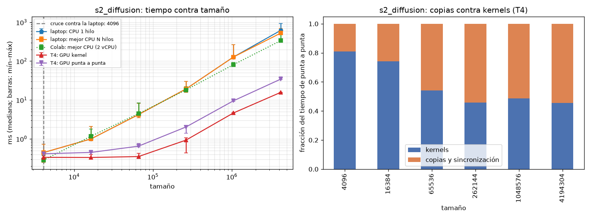

# S2 · La difusión de la demanda, en la GPU

**Concepto:** stencil (`ec2/06_stencil`), en flotantes y con coarsening · **segunda aplicación** del concepto (la
primera es [S1](../s1_cobertura/README.md)) · **tipo A:** agregada (una sección nueva de `--report`; no cambia ninguna
decisión).

**Veredicto:** **GPU** en todos los tamaños medidos: desde 1,07× de punta a punta con 64² (empate práctico) hasta
**15,3×** con 2048² contra la mejor CPU de la laptop; con la grilla del reporte (128²) gana 2,2×. Como en S1, los datos
se quedan en la GPU durante los 100 pasos. A diferencia de S1, la optimización de esta aplicación (**coarsening**:
8 celdas por hilo) **sí gana** con grillas grandes (1,15× con 2048²) y pierde con las chicas. Ver
[Análisis](#análisis-por-qué-la-gpu-conviene-o-no).

## La tarea y por qué es paralela de datos

Parte de la grilla de pedidos de C1 (128 × 128 celdas sobre la ciudad, un pedido creado suma 1 en la celda de su
restaurante) y la deja evolucionar en el tiempo: cada **paso de Jacobi** hace, para cada celda interior,

    u'[c] = kKeep · ( u[c] + kSpread · (u[norte] + u[sur] + u[este] + u[oeste] − 4·u[c]) )

con `kSpread = 0,2` (la demanda se reparte hacia las vecinas; estable con `kSpread < 1/4`) y `kKeep = 0,98` (lo que se
pidió hace rato pesa menos). Dos buffers y bordes fijos en 0 (no entra demanda de afuera de la ciudad). El reporte da,
después de 50 pasos, el total, el pico y las 5 celdas más calientes: **dónde queda la demanda "residual"** cuando se
difunde, es decir, las zonas que tienen demanda cerca aunque no tengan un restaurante encima.

Todas las celdas de un paso son independientes (un stencil de 5 puntos, la carpeta 06); entre pasos hay que esperar a
todos. Es la misma forma que S1, pero con **flotantes** (con S1 eran enteros y mínimos) y con una optimización
distinta (coarsening en vez de tiling).

**Flotantes, tolerancia:** la CPU y la GPU hacen las mismas operaciones en el mismo orden (`around` se suma igual en
las dos), pero `nvcc` contrae `a + b·c` en una **FMA** (un solo redondeo en lugar de dos), así que los resultados
difieren en el último bit. El error de cada paso es del orden de ε = 6·10⁻⁸ relativo y el esquema es estable (con
`kSpread < 1/4` cada paso es una combinación convexa por `kKeep < 1`: no amplifica errores), así que después de 100
pasos la diferencia queda acotada por ~100·ε del máximo. La tolerancia es **1e-5 del mayor valor de la grilla
inicial**; en la T4 la mayor diferencia medida fue **9,78·10⁻⁸** (100 veces por debajo).

## Diseño

**Un lanzamiento por paso**, con los dos buffers alternados y **los datos quietos en la GPU** (como S1): el fin de cada
lanzamiento es la barrera entre pasos.

**Dos kernels (carpetas 06 y `04_performance/06_thread_coarsening`).**
- `stepBasic`: un hilo por celda; lee sus 4 vecinas de la memoria global (5 cargas por celda).
- `stepCoarsened` (el que usa el reporte): cada hilo hace **8 celdas seguidas de su columna**. Lleva arriba, centro y
  abajo en registros: al bajar una fila, el centro pasa a ser el de arriba y el de abajo pasa a ser el centro, así que
  por celda solo carga 3 valores (abajo, este y oeste; este y oeste son de la misma fila que leen los vecinos del warp,
  así que vienen de la L1). Es el reuso que en S1 se intentó con memoria compartida, pero en registros, sin halo y
  sin `__syncthreads`.

**Grid y bloques.** 32 × 8 = 256 hilos: un warp recorre 32 columnas seguidas de una fila (128 B, coalescido).
Básico: grid = ⌈ancho/32⌉ × ⌈alto/8⌉ (64 × 256 con 2048²). Con coarsening: ⌈ancho/32⌉ × ⌈alto/64⌉ (64 × 32): 8 veces
menos bloques. 18 y 20 registros por hilo, sin memoria compartida; ocupación teórica 100 % en los dos.

**CPU con N hilos.** Cada paso reparte las filas en tramos entre los trabajos del pool y espera a todos antes del
siguiente (strips por filas, carpeta 10). Mismo orden de operaciones que 1 hilo: N hilos = 1 hilo bit a bit.

**Hilos.** Por el hilo dueño de la GPU (`GpuOwner::diffusion`). En el reporte: grilla de 128 × 128, 50 pasos, kernel
con coarsening.

## Corrección

| Prueba | Dónde | Resultado |
|---|---|---|
| `diffusion_check`: una grilla en 0 sigue en 0; los bordes quedan en 0; lejos de los bordes un paso conserva la demanda × `kKeep`; N hilos (1, 2, 3, 4 y 7) = 1 hilo bit a bit después de 0, 1, 9 y 60 pasos | laptop (g++, clang, CMake 3.11.4) y TSan | OK, 0 reportes |
| `gpu_diffusion_check`: básico y con coarsening = CPU dentro de 1e-5 del mayor valor inicial después de 0, 1, un número impar de pasos y 100; grillas que no son múltiplo del bloque ni de las 8 filas por hilo; por el hilo dueño, igual | T4 real (mayor diferencia 9,78·10⁻⁸), emulado y TSan | OK, 0 reportes |
| `report_check`: parte de la demanda de C1 (un pedido por pedido creado); al final queda a lo sumo `kKeep^pasos` del total, y algo queda; el pico baja; las celdas calientes van de mayor a menor | laptop y TSan | OK |
| `compute-sanitizer --tool memcheck` / `racecheck` | T4 | 0 errors / 0 hazards |
| Las 630 corridas de Colab y las 360 de la laptop, comparadas con la referencia (misma tolerancia) | ambas | 0 incorrectas |
| `ctest` completo con CUDA real | T4 | 55/55 |
| La ciudad con `--report` en la T4: total 18 215 → 6 614,8 en 50 pasos (`0,98⁵⁰` daría 6 633,4: el 0,3 % restante salió por los bordes); pico 524 → 1,51 | T4 | salida 0 |

## Cómo se midió

```sh
./delivery_sim config/santa_cruz.json --headless --bench laptop.csv --bench-app s2_diffusion   # laptop
./delivery_sim config/santa_cruz.json --headless --bench colab.csv --bench-app s2_diffusion    # Colab (T4)
python3 tools/informe_ec2.py s2_diffusion laptop.csv colab.csv .
```

Tamaño = celdas: lados de 64 a 2048 (de 4096 a 4,2 millones de celdas, tres órdenes de magnitud; el reporte usa
128²), con **100 pasos por corrida** en todos los tamaños y versiones. Demanda inicial al azar (semilla fija).
Calentamiento y 15 repeticiones intercaladas; mediana [mín–máx]. Colab midió `src/` = `fcedcdc0…` (el de la punta de
la rama); la laptop, `de2ef580…` (este commit antes de agregar P1): entre los dos árboles solo cambian los archivos de
P1 (`git diff --stat`), el código de S2 es el mismo.

## Resultados



**Veredicto: GPU (Colab, T4) contra la CPU de la laptop** (100 pasos)

| celdas | CPU 1 hilo (ms) | mejor CPU N hilos (ms) | GPU kernel (ms) | GPU punta a punta (ms) | speedup kernel | speedup punta a punta | ¿correcto? |
|---:|---:|---:|---:|---:|---:|---:|:---:|
| 64² | 0.4432 [0.251–0.725] | 0.4432 (1 hilo) | 0.3338 [0.325–0.362] | 0.4126 [0.387–0.442] | 1.33× | 1.07× | sí |
| 128² | 0.995 [0.936–2.1] | 0.995 (1 hilo) | 0.3316 [0.33–0.395] | 0.447 [0.441–0.514] | 3.00× | **2.23×** | sí |
| 256² | 4.205 [3.49–8.19] | 4.205 (1 hilo) | 0.3498 [0.348–0.421] | 0.6475 [0.62–0.757] | 12.02× | 6.49× | sí |
| 512² | 19.21 [15.9–30] | 19.21 (1 hilo) | 0.9258 [0.432–1.07] | 2.016 [1.4–2.19] | 20.74× | 9.52× | sí |
| 1024² | 127.4 [119–266] | 127.4 (1 hilo) | 4.635 [4.63–4.64] | 9.52 [9.24–9.79] | 27.49× | 13.38× | sí |
| 2048² | 621.5 [495–933] | 528.4 [472–699] (N=2) | 15.77 [15.8–15.8] | 34.57 [33.8–39.7] | 33.51× | **15.29×** | sí |

**Coarsening contra básico** (Colab, kernel, mediana en ms, 100 pasos):

| celdas | con coarsening (`gpu_kernel`) | básico (`gpu_kernel_basic`) | coarsening / básico |
|---:|---:|---:|---:|
| 64² | 0.334 | 0.282 | 1.18× más lento |
| 128² | 0.332 | 0.259 | 1.28× más lento |
| 256² | 0.350 | 0.255 | 1.37× más lento |
| 512² | 0.926 | 1.034 | 1.12× más rápido |
| 1024² | 4.635 | 4.924 | 1.06× más rápido |
| 2048² | 15.77 | 18.14 | **1.15× más rápido** |

Por el hilo dueño (`gpu_via_owner`): 0,45 ms con 64² y 52,0 ms con 2048² (17 ms más que el punta a punta: el hilo
dueño recibe la grilla por valor y devuelve otra, 16 MB cada una). La misma máquina (la GPU gana 9,8× con 2048²) y el
barrido de hilos: [`tablas.md`](tablas.md). En la CPU de la laptop los hilos casi no ayudan (1,06–1,09× con 2048²).

## Perfiles

`nsys` (`--bench-once`, los 6 tamaños dos veces): 1200 pasos de cada kernel; `stepBasic` 54,6 ms (54,2 % del tiempo
de kernels), `stepCoarsened` 46,2 ms (45,8 %). Copias: 179 MB de ida en 48 (33,1 ms, ~5,4 GB/s) y 89 MB de vuelta en
24 (15,0 ms, ~6 GB/s). La ida es el doble que la vuelta porque **se copian los dos buffers** (ver Análisis).

`ncu` con 2048² celdas, un paso:

| | con coarsening (`stepCoarsened`) | básico (`stepBasic`) |
|---|---:|---:|
| grid × bloque | (64 × 32) × (32 × 8) | (64 × 256) × (32 × 8) |
| registros / memoria compartida | 20 / 0 | 18 / 0 |
| ocupación teórica / lograda | 100 % / 93 % | 100 % / 79 % |
| DRAM | **82 % (256 GB/s)** | 68 % (213 GB/s) |
| cómputo (SM) | 33 % | 50 % |
| acierto L1 / L2 | 41 % / 64 % | 58 % / 70 % |
| duración | **155,7 µs** | 180,6 µs |

## Análisis: por qué la GPU conviene o no

**Paralelismo disponible.** Con 2048² hay 4,2 millones de celdas por paso: 2048 bloques con coarsening (51 por SM),
16 384 sin él. Con 64² el básico tiene 16 bloques y el de coarsening 2 (para 40 SM): la GPU está casi vacía y cada
paso cuesta lo que cuesta lanzar un kernel (~3 µs; 100 pasos = 0,3 ms, que es lo que miden los dos kernels hasta
256²). Por eso el cruce con la CPU está en la grilla más chica.

**Overheads.** Los datos se quedan en la GPU los 100 pasos: con 2048², 50 MB de copias (dos de ida de 16,8 MB y una
de vuelta) para 15,8 ms de kernel, y el punta a punta (34,6 ms) es 2,2× el kernel, no 50× como en H1. Dentro del punta
a punta también está crear el vector de salida de 16 MB. **Mejora no aplicada:** la copia del segundo buffer es
innecesaria (su interior lo escribe el primer paso antes de que nadie lo lea; solo hacen falta sus bordes en 0, un
`cudaMemset`): ahorraría un tercio de las copias (~3 ms con 2048²). No la cambié para no medir un código distinto del
de este commit; cambia el número, no el veredicto.

**Cómputo o memoria (roofline).** Por celda: 8 operaciones de punto flotante (3 sumas de vecinas, `4·u`, la resta, dos
productos y una suma; con FMA, menos instrucciones) contra 8 bytes de DRAM (leer y escribir un `float`), ~1 FLOP/byte; el codo del roofline de la T4 está en ~25 FLOP/byte (8,1 TFLOPS / 320 GB/s): **muy
limitado por la memoria**. El tráfico mínimo de un paso con 2048² es 33,6 MB; en 155,7 µs eso son 216 GB/s útiles,
y la DRAM medida es 256 GB/s: el kernel con coarsening mueve solo ~1,2 veces lo mínimo (las filas de borde de cada
bloque se vuelven a leer) y está al **82 % del techo de memoria** (`ncu`: "más del 80 % del rendimiento de memoria del
dispositivo"). El básico está al 68 %.

**Por qué el coarsening ganó acá y el tiling perdió en S1.** En S1 el reuso se buscó con memoria compartida: hay que
cargar un halo, poner una barrera y gastar registros, y la L1 ya hacía ese trabajo. Acá el reuso vertical se hace en
**registros**, que son gratis: cada hilo lee una vez cada celda de su columna (más una fila de arriba y una de abajo)
en lugar de tres veces, sin halo y sin barrera. Las cargas de la misma fila (este y oeste) siguen saliendo de la L1.
Resultado: menos pedidos a la memoria (L1 41 % de acierto en lugar de 58 %, porque ya no hay tantas repeticiones que
acertar) y más bytes útiles por segundo (82 % de la DRAM). La ocupación lograda también sube (93 % contra 79 %): menos
bloques que arrancan y terminan. **Con grillas chicas pierde** porque 8 veces menos bloques dejan SM vacíos: con 256²
son 32 bloques para 40 SM. Para el reporte (128²) convendría el básico; quedó el de coarsening porque es el que gana
donde la GPU importa, y el resultado está dentro de la misma tolerancia.

**Eficiencia de ejecución.** Ocupación lograda 93 % (coarsening). Divergencia: solo en los bordes de la grilla (el
`if` del borde y el fin del bucle en la última tira de filas); en un warp interior no diverge. Sin memoria compartida:
no hay conflictos de bancos.

**Contención y sincronización.** Sin atómicos: cada celda la escribe un solo hilo. La barrera entre pasos es el fin
del lanzamiento.

**Corrección bajo paralelismo.** Jacobi con dos buffers: cada paso lee solo el estado anterior, así que el resultado
no depende del orden en que corren los hilos (determinístico en la GPU y en la CPU con N hilos). La única diferencia
entre CPU y GPU es la FMA, explicada arriba.

**La CPU de la laptop.** Los hilos casi no ayudan: con 4 hilos, de 0,66× (64²) a 1,06× (2048²). Explicación probable,
no perfilada en la CPU: con grillas chicas y medianas cada paso dura decenas de µs y la barrera del pool (enviar los
trabajos y esperar a todos, 100 veces) cuesta lo mismo; con 2048² cada paso recorre 32 MB, 10 veces la caché L3 de 3
MB, y los dos núcleos comparten el mismo ancho de banda de memoria.

**Veredicto.**
- *Simulación* (la grilla del reporte, 128², 50 pasos): **GPU**, 2,2× con 100 pasos. Se calcula una vez al final:
  ahorra menos de 1 ms de una corrida de 60 s (Amdahl: el reporte no es parte de la simulación).
- *Grillas grandes*: **GPU**, 6,5× a 15,3×.
- *Lo que demuestra:* un stencil iterativo rinde en la GPU si los datos no salen entre pasos; y entre las dos
  optimizaciones del curso para reusar vecinas, en la T4 gana la que usa **registros** (coarsening) y pierde la que
  usa memoria compartida (tiling, S1). Hay que medirlo, no suponerlo.

**Amenazas a la validez.** Dos máquinas distintas (en la misma máquina la GPU gana 9,8× con 2048²). 100 pasos fijos
en el bench (el reporte usa 50). La CPU de la laptop tiene mucha dispersión (2048²: de 495 a 933 ms con 1 hilo). La
laptop y Colab midieron árboles de `src/` distintos, con el código de S2 idéntico. `handover_check` y `dispatch_check`
(primera evaluación) fallan a veces bajo `ctest -j8`, igual en `main` (ver T1). Nunca se midió la emulación de
`cuda_compat.h`.
