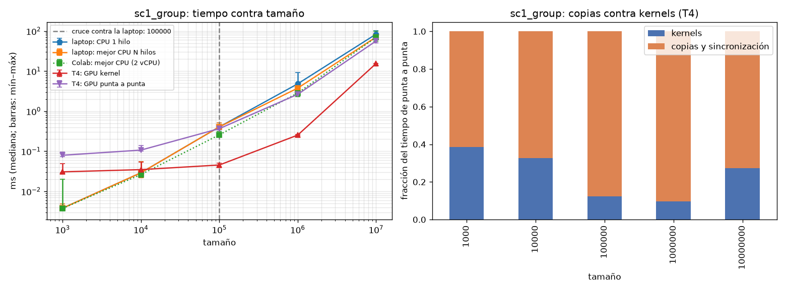

# SC1 · Los pedidos agrupados por restaurante, en la GPU

**Concepto:** scan (`ec2/09_scan`) · **primera aplicación** de ese concepto · **tipo A:** agregada (una sección
nueva de `--report`; no cambia ninguna decisión de la simulación).

**Veredicto:** **CPU para la simulación; GPU solo con volúmenes grandes, y por poco.** De punta a punta, la T4 le gana
a la mejor CPU de la laptop desde 10⁵ pedidos (1,11×) hasta 1,43× con 10⁶ y 1,25× con 10⁷. El kernel que reparte de
forma estable queda en **25 % de ocupación** y con accesos no coalescidos: la estabilidad tiene un costo. La ciudad
genera ~18 000 pedidos en 60 s, donde la CPU tarda microsegundos. Ver
[Análisis](#análisis-por-qué-la-gpu-conviene-o-no).

## La tarea y por qué es paralela de datos

El reporte agrupa los pedidos creados por restaurante, **conservando el orden de creación dentro de cada grupo**
(un counting sort estable, lo mismo que `std::stable_sort` por restaurante, en tiempo lineal). Da, por restaurante,
cuántos pedidos tuvo, dónde empieza su grupo y su primer y último pedido; y los grupos son la entrada de R2
(estadísticas por restaurante). Tres pasos:

1. **contar** los pedidos de cada restaurante (un histograma);
2. **scan exclusivo** de los conteos: dónde empieza cada grupo (`offsets`), el concepto de la carpeta 09;
3. **repartir** cada pedido a su lugar, en orden.

Para repartir **en paralelo y estable**, cada tramo de pedidos necesita saber dónde escribe cada restaurante: el scan
se hace sobre la tabla (restaurante, tramo), en ese orden. Enteros y orden estable: la CPU de 1 hilo, la de N hilos y
la GPU dan **exactamente** el mismo agrupamiento.

## Diseño

**Tres kernels (carpeta 09).**
1. `countBlocks`: cada bloque tiene un tramo contiguo de pedidos y cada hilo un sub-tramo contiguo de ese tramo;
   cada hilo cuenta lo suyo en **su columna** de una tabla `[restaurante][hilo]` en memoria compartida (sin
   atómicos) y el bloque deja sus totales por restaurante.
2. `scanCounts`: scan exclusivo **Kogge–Stone** en un bloque de 1024 hilos sobre los totales en orden (restaurante,
   bloque), por pedazos de 1024 con el acarreo del pedazo anterior: dónde empieza cada bloque en el grupo de cada
   restaurante.
3. `scatterStable`: cada bloque vuelve a contar, hace el scan de su tabla por hilos y cada hilo reparte su
   sub-tramo **en orden**. Estable: los sub-tramos son contiguos y están ordenados por hilo y por bloque.

**Por qué sub-tramos contiguos (y su costo).** La estabilidad exige que el pedido i se escriba antes que el i + 1 del
mismo restaurante. Si cada hilo tiene un sub-tramo contiguo, el orden entre hilos lo da el scan de la tabla. Con un
recorrido intercalado (el coalescido), los pedidos de un hilo quedarían salteados y habría que ordenar dentro de cada
warp. Se eligió la estabilidad simple: cada hilo lee posiciones seguidas **suyas**, así que los 32 hilos de un warp
leen direcciones separadas por el largo del sub-tramo (no coalescido).

**Grid y bloques.** 128 hilos por bloque: la tabla `[64 restaurantes][128 hilos]` de 4 B ocupa **32 KB** de memoria
compartida (el máximo de restaurantes es 64; la ciudad tiene 37). Bloques: `min(ceil(n / (128·32)), 160)`, al menos
32 pedidos por hilo; 160 = 4 por SM en la T4. El scan, un solo bloque de 1024 hilos.

**Datos.** El restaurante de cada pedido (`uint32_t`) de ida; el orden (`uint32_t` por pedido) y los offsets de
vuelta. La memoria se reserva una vez (o si llegan más pedidos).

**CPU con N hilos.** El mismo algoritmo: cada trabajo del pool cuenta su tramo contiguo en sus contadores, un scan
exclusivo sobre la tabla (restaurante, tramo) y cada trabajo reparte su tramo en orden (counting sort paralelo,
carpeta 10).

**Hilos.** Por el hilo dueño de la GPU (`GpuOwner::group`). En el reporte, después de la simulación; con más de 64
restaurantes se calcula en la CPU (`computedOn` lo dice).

## Corrección

| Prueba | Dónde | Resultado |
|---|---|---|
| `grouping_check`: 1 hilo y N hilos (1–7) = `std::stable_sort` por restaurante (orden y offsets), con restaurantes sin pedidos, un solo restaurante y sin pedidos | laptop (g++, clang, CMake 3.11.4) y TSan | OK, 0 reportes |
| `gpu_grouping_check`: GPU = CPU (mismo orden y offsets) con 1, 37 y 64 restaurantes, restaurantes vacíos, 0, 1, 4097 y 10⁶ pedidos (más de 1024 pares restaurante-bloque: varios pedazos del scan); por el hilo dueño, igual | T4 real, emulado y TSan | OK, 0 reportes |
| `report_check`: un restaurante por pedido creado (= `created` del resumen); grupos contiguos sin huecos; cada grupo con solo pedidos de su restaurante, en orden de creación; conteos = recontados | laptop y TSan | OK |
| `compute-sanitizer --tool memcheck` / `racecheck` | T4 | 0 errors / 0 hazards |
| Las 450 corridas de Colab y las 300 de la laptop, comparadas con la referencia | ambas | 0 incorrectas |
| La ciudad con `--report` en la T4: 18 215 pedidos agrupados en la GPU | T4 | salida 0 |

## Cómo se midió

```sh
./delivery_sim config/santa_cruz.json --headless --bench laptop.csv --bench-app sc1_group   # laptop, Release -O3
./delivery_sim config/santa_cruz.json --headless --bench colab.csv --bench-app sc1_group    # Colab (T4)
python3 tools/informe_ec2.py sc1_group laptop.csv colab.csv .
```

Tamaño = pedidos: 10³ a 10⁷ (cuatro órdenes de magnitud; la ciudad crea ~18 000 en 60 s). Restaurante al azar entre
los 37 de la ciudad (semilla fija). Calentamiento y 15 repeticiones con las versiones intercaladas; mediana [mín–máx].
La laptop midió el commit de SC1 (`src/` = `4ee0fc34…`) y Colab la punta de la rama (S1, `e9e7d51a…`): entre los dos
solo se agregan otras aplicaciones; `grouping.*`, `grouping_gpu.*`, `benchGrouping` y `GpuOwner::group` son idénticos.

## Resultados



**Veredicto: GPU (Colab, T4) contra la CPU de la laptop**

| tamaño | CPU 1 hilo (ms) | mejor CPU N hilos (ms) | GPU kernel (ms) | GPU punta a punta (ms) | speedup kernel | speedup punta a punta | ¿correcto? |
|---:|---:|---:|---:|---:|---:|---:|:---:|
| 10³ | 0.0038 [0.0034–0.0048] | 0.0038 (1 hilo) | 0.0307 [0.0288–0.0488] | 0.0795 [0.0745–0.0962] | 0.12× | 0.05× | sí |
| 10⁴ | 0.0291 [0.0218–0.0546] | 0.0291 (1 hilo) | 0.0348 [0.0324–0.0532] | 0.107 [0.101–0.14] | 0.84× | 0.27× | sí |
| 10⁵ | 0.4063 [0.227–0.507] | 0.4063 (1 hilo) | 0.0454 [0.0415–0.0504] | 0.3672 [0.34–0.414] | 8.95× | **1.11×** | sí |
| 10⁶ | 4.819 [3.27–9.34] | 3.765 [2.44–4.67] (N=2) | 0.2533 [0.251–0.261] | 2.638 [2.46–3.16] | 14.86× | **1.43×** | sí |
| 10⁷ | 83.73 [76.4–101] | 70.67 [64.4–88.8] (N=4) | 15.49 [13.4–15.5] | 56.53 [50.9–71.0] | 4.56× | 1.25× | sí |

Por el hilo dueño (`gpu_via_owner`): 0,11 ms con 10³, 3,07 ms con 10⁶ y 82,6 ms con 10⁷ (el vector de 40 MB viaja por
valor a la cola del hilo dueño). La misma máquina (CPU de Colab) y el barrido de hilos: [`tablas.md`](tablas.md). En
la laptop los hilos casi no ayudan (1,13–1,31× con 2 hilos, 1,24× con 4 en 10⁷): repartir escribe en posiciones
dispersas y lo limita la memoria, no el cálculo.

## Perfiles

`nsys` (`--bench-once`: calentamiento + 1 medición en cada tamaño):

| | total | por lanzamiento (mediana) |
|---|---:|---:|
| `scatterStable` | 30,6 ms (95,1 % del tiempo de kernels) | 73 µs (con 10⁷: 14,8 ms) |
| `countBlocks` | 1,34 ms (4,2 %) | 18 µs (con 10⁷: 0,55 ms) |
| `scanCounts` | 0,23 ms (0,7 %) | 9 µs |
| copias de ida (89 MB en 10) | 20,2 ms | 40 MB con 10⁷: 9,9 ms |
| copias de vuelta (89 MB en 20) | 19,7 ms | 40 MB con 10⁷: 9,7 ms |

`ncu` con 10⁷ pedidos:

| | `countBlocks` | `scanCounts` | `scatterStable` |
|---|---:|---:|---:|
| grid × bloque | 160 × 128 | 1 × 1024 | 160 × 128 |
| registros por hilo / memoria compartida | 34 / 32 KB | 16 / 4 KB | 64 / 32 KB |
| ocupación teórica / lograda | — | (1 bloque) | **25 % / 24,9 %** |
| DRAM | 47 % (150 GB/s) | 0,3 % | 39 % (124 GB/s) |
| acierto L1 / L2 | 74 % / 76 % | 0 % / 77 % | **25 %** / 43 % |
| duración | 0,55 ms | 44 µs | 15,0 ms |

## Análisis: por qué la GPU conviene o no

**Paralelismo disponible.** El scan tiene poco: 37 restaurantes × 160 bloques = 5920 valores, un solo bloque (`ncu`:
"el grid es demasiado chico"); pero es el 0,7 % del tiempo. Contar y repartir tienen un pedido por elemento, de sobra.

**Overheads.** Con 10³–10⁴ pedidos son tres lanzamientos y dos copias (~80 µs) contra 4 µs de la CPU. Con 10⁷, de
56,5 ms de punta a punta, ~20 ms son copias (40 MB de ida y 40 MB de vuelta: el orden vuelve entero) y 15,5 ms el
kernel; el resto, sincronización y la lectura de los offsets.

**Cómputo o memoria.** Los dos kernels grandes están limitados por la memoria y la latencia, no por el cálculo (1,7 %
de cómputo en `scatterStable`). `countBlocks` lee coalescido-por-tramo con buen acierto en caché (L1 74 %).
`scatterStable` es el problema: lee no coalescido (cada hilo su sub-tramo) y **escribe disperso** (cada pedido va al
lugar de su restaurante): L1 al 25 %, L2 al 43 %, DRAM al 39 % con muchas transacciones medio vacías.

**Eficiencia de ejecución.** La **ocupación teórica de `scatterStable` es 25 %**: con 32 KB de memoria compartida por
bloque entran 2 bloques por SM (`Block Limit Shared Mem = 2`), 8 warps de 32 posibles; y 64 registros por hilo. Con
pocos warps por SM no hay con qué esconder la latencia de los accesos dispersos: `ncu` estima un 61 % de mejora.
Divergencia: el bucle de cada hilo no diverge (todos sus sub-tramos tienen ±1 elemento); el scan Kogge–Stone tiene
`if (t >= offset)` en cada nivel, y en los primeros niveles casi todos los hilos trabajan. Con 10⁷ el kernel crece
mucho más que lineal (0,25 ms con 10⁶, 15,5 ms con 10⁷): con 160 bloques fijos, cada hilo pasa de 49 a 488 pedidos
seguidos y sus lecturas dejan de entrar juntas en la caché.

**Cómo mejoraría.** Una tabla con menos restaurantes por bloque (la ciudad tiene 37: `[37][128]` entraría en 19 KB y
dejaría 5 bloques por SM), o repartir por warps con `__ballot_sync`/`__popc` (estable dentro del warp, coalescido).
No se hizo: no cambia el veredicto para el tamaño de la simulación.

**Contención y sincronización.** Sin atómicos: cada hilo tiene su columna y sus posiciones de escritura son únicas
(las da el scan). Entre kernels, el orden lo da el stream.

**Corrección bajo paralelismo.** Enteros y estabilidad por construcción (sub-tramos contiguos en orden de hilo y de
bloque + scan exclusivo en orden (restaurante, bloque)): el resultado no depende del orden de ejecución.

**Veredicto.**
- *Simulación* (~18 000 pedidos en la ciudad, 217 en Equipetrol): **CPU** (0,03–0,4 ms contra 0,1–0,4 ms de la
  GPU de punta a punta, más el paso por el hilo dueño). Se calcula una vez al final: 0 % del tiempo de la simulación.
- *Volumen grande* (10⁵ a 10⁷): GPU por poco (1,1–1,4×); la copia de vuelta del orden entero y el reparto disperso con
  25 % de ocupación se comen la ventaja del kernel.

**Amenazas a la validez.** Dos máquinas distintas (en la misma máquina la GPU gana 1,08× con 10⁶ y 1,24× con 10⁷).
Colab midió el commit de la punta (código de SC1 idéntico). La dispersión de la CPU de la laptop es grande (10⁶: de 2,4
a 4,7 ms con 2 hilos). Restaurantes uniformes: con un restaurante muy dominante, los conteos se concentrarían en una
fila. `handover_check` (primera evaluación) falla a veces bajo `ctest -j8`, igual en `main` (ver T1). Nunca se midió la
emulación de `cuda_compat.h`.
