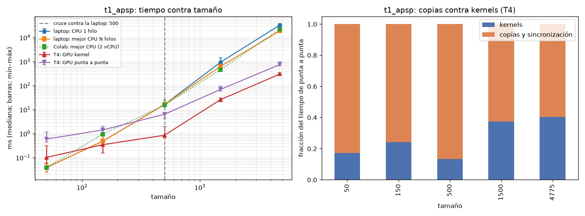

# T1 · La tabla de distancias de todos contra todos, en la GPU

**Concepto:** tiling (`ec2/03_memory_tiling`) · **primera aplicación** de ese concepto · **tipo B:** acelerada
idéntica (la alcanzabilidad que usa la simulación sale exactamente igual que la de los Dijkstra de la CPU).

**Veredicto:** como cálculo, **la GPU gana por mucho**. Con la ciudad entera (4775 nodos), Floyd–Warshall por
bloques en la T4 tarda 0,75 s de punta a punta, contra 18,9 s de la mejor CPU de la laptop (4 hilos): **25×**. El
cruce está en ~500 nodos. Pero **en la simulación no conviene**: lo único que la simulación necesita de esa tabla es
la alcanzabilidad desde los 37 restaurantes, y los 37 Dijkstra de la CPU la calculan en **14 ms** (todos contra
todos hace 4775 orígenes para usar 37; con la GPU, 787 ms al arrancar). Ver [Análisis](#análisis-por-qué-la-gpu-conviene-o-no).

## La tarea y por qué es paralela de datos

`unreachable` necesita saber, para cada pedido, si hay camino dirigido (respetando el sentido único) del
restaurante al destino. La tabla de **todos contra todos** responde eso y además da la distancia entre cualquier par
de nodos. Floyd–Warshall: para cada k, `d[i][j] = min(d[i][j], d[i][k] + d[k][j])`. Para un k fijo, los n² pares
(i, j) son independientes (un **map** sobre la tabla); entre un k y el siguiente hay que esperar a todos. Es O(n³):
con 4775 nodos, 1,1 · 10¹¹ operaciones min-plus.

**Enteros, para que la igualdad sea exacta.** Cada calle se redondea al metro (`uint32_t`). Con enteros, la suma y el
mínimo son exactos y el resultado no depende del orden de las operaciones: la CPU de 1 hilo, la de N hilos y la GPU
dan **la misma tabla, bit a bit**. La alcanzabilidad ("hay camino") no depende del redondeo, así que sale idéntica a
la de los Dijkstra en `double` de `RoadGraph` (lo compara `apsp_check`).

## Diseño

**Tiling (carpeta 03).** El clásico lee dos valores de la memoria global por cada min-plus: con 4775 nodos recorre
92 MB por cada k. Por bloques, la tabla se parte en bloques de 32 × 32 y, por cada bloque diagonal kb, hay tres fases:

1. `diagonalPhase`: el bloque (kb, kb) contra sí mismo (1 bloque de hilos);
2. `crossPhase`: los bloques de la fila kb y de la columna kb, cada uno contra el diagonal (2·(nb − 1) bloques);
3. `restPhase`: todos los demás, cada uno con su bloque de la fila kb y su bloque de la columna kb ((nb − 1)²
   bloques).

Cada bloque de hilos carga sus bloques en memoria compartida (3 × 4 KB) y cada valor cargado se reusa 32 veces: 32 ×
32 hilos leen 2 · 32 · 32 valores de la memoria global y hacen 32³ min-plus. Intensidad aritmética de la fase 3:
32³ · 2 operaciones / 12 KB ≈ **5,3 operaciones por byte**, contra 0,25 del clásico.

**Datos.** La tabla tiene `stride` = n redondeado a múltiplo de 32 (4800: 92 MB). Se reserva en la GPU una vez (en el
primer pedido o si llega una más grande) y queda ahí; por llamada viaja la tabla inicial y vuelve la resuelta.

**Grid y bloques.** Bloques de 32 × 32 = 1024 hilos: un hilo por celda del bloque de la tabla (el tamaño del bloque
de la tabla y el del bloque de hilos coinciden, así cada hilo hace su celda sin bucles). 30 registros por hilo y 12 KB
de memoria compartida: el límite es el de warps (1 bloque de 32 warps por SM, el máximo de la T4), así que la
ocupación teórica es 100 %. Fase 3 con la ciudad: 149 × 149 = 22 201 bloques. Acceso coalescido: cada warp lee una
fila de 32 valores contiguos (128 B) de la memoria global. En la memoria compartida, `fila[k]` es el mismo valor para
todo el warp (broadcast) y `columna[k][x]` son 32 valores contiguos: sin conflictos de bancos.

**Hilos.** Toda llamada a CUDA la hace el hilo dueño de la GPU (`GpuOwner::apsp`, el `ThreadPool` de 1 hilo de R1).
En la simulación se llama una vez al arrancar, antes de lanzar los hilos de la simulación; si la GPU falla, una
línea en stderr y queda la alcanzabilidad de los Dijkstra (la que ya estaba calculada). Solo con `-DUSE_CUDA=ON`.

**CPU con N hilos.** La misma idea de tiling (`floydWarshallBlocked`): bloques de 32 × 32 (4 KB, tres caben en L1);
los bloques de las fases 2 y 3 se reparten entre los hilos del pool (paralelismo de datos, carpeta 10) y se espera
a todos antes de la fase siguiente. El clásico con las filas repartidas no escala: en cada k recorre la tabla entera
y queda limitado por la memoria.

## Corrección

| Prueba | Dónde | Resultado |
|---|---|---|
| `apsp_check`: por bloques (1–4 hilos) = clásico, bit a bit; la alcanzabilidad desde la tabla = la de los Dijkstra de `RoadGraph`, con `equipetrol.json` y con una red recortada (calles quitadas y vueltas de sentido único: nodos inalcanzables de verdad); distancia entera − Dijkstra ≤ 0,5 m por calle del camino | laptop (g++, clang, CMake 3.11.4) y TSan | OK, 0 reportes |
| `gpu_apsp_check`: GPU por bloques = CPU, bit a bit, con 20, 32, 45 y 154 nodos (bordes del bloque de 32); por el hilo dueño, la misma tabla | T4 real, emulado (`cuda_compat.h`) y TSan | OK, 0 reportes |
| `compute-sanitizer --tool memcheck` / `racecheck` sobre `gpu_apsp_check` | T4 | 0 errors / 0 hazards |
| Cada una de las 150 corridas de Colab y de las 150 de la laptop se compara con la referencia (clásico de 1 hilo) | ambas | 0 incorrectas |
| `ctest` completo | T4 (41/41) y laptop | OK |
| Simulación completa de la ciudad con la alcanzabilidad de la GPU | T4 | salida 0 |

## Cómo se midió

```sh
# laptop (Release -O3, sin ventana; enchufada, modo Mejor rendimiento): ver laptop_hardware.txt
./delivery_sim config/santa_cruz.json --headless --bench laptop.csv --bench-app t1_apsp
# Colab (T4): colab/ec2_t1_apsp.ipynb, ejecutado en colab_ejecutado.ipynb (todas las salidas)
./delivery_sim config/santa_cruz.json --headless --bench colab.csv --bench-app t1_apsp
# tablas y gráfico, desde los dos CSV
python3 tools/informe_ec2.py t1_apsp laptop.csv colab.csv .
```

Tamaño = nodos: los n más cercanos a la partida de las motos, con las calles entre ellos; el último, la ciudad
entera. 50, 150, 500, 1500 y 4775: dos órdenes de magnitud. Floyd–Warshall es O(n³): con la ciudad, la CPU tarda
decenas de segundos por corrida, así que son **10 repeticiones** (las que pide el documento) y una de calentamiento,
con las versiones intercaladas. GPU kernel = eventos de CUDA alrededor de las 3·nb fases; GPU de punta a punta =
`steady_clock` desde la copia de ida hasta la vuelta. Tabla: mediana [mín–máx].

La laptop midió el commit de T1 (`src/` = `9ebde58e…`) y Colab la punta de la rama en ese momento, el commit de H1
(`src/` = `a8c5cc30…`). Entre los dos solo se agrega H1: `apsp.*`, `apsp_gpu.*`, `benchApsp` y `GpuOwner::apsp` son
idénticos (`git diff 96baf37 ff58f2f` sobre esos archivos: vacío).

## Resultados



Laptop: Intel Core i5-6300U, 2 núcleos / 4 hilos, WSL2 (Ubuntu 26.04), g++ 15.2 `-O3` · Colab: Tesla T4 (CUDA
13.0, driver 580), Xeon 2,0 GHz con 2 vCPU (1 núcleo con hyperthreading).

**Veredicto: GPU (Colab, T4) contra la CPU de la laptop**

| tamaño | CPU 1 hilo (ms) | mejor CPU N hilos (ms) | GPU kernel (ms) | GPU punta a punta (ms) | speedup kernel | speedup punta a punta | ¿correcto? |
|---:|---:|---:|---:|---:|---:|---:|:---:|
| 50 | 0.0384 [0.0243–0.0537] | 0.0384 (1 hilo) | 0.1015 [0.0587–0.302] | 0.5876 [0.442–1.16] | 0.38× | 0.07× | sí |
| 150 | 0.4808 [0.463–0.973] | 0.4808 (1 hilo) | 0.3429 [0.156–0.48] | 1.413 [0.807–1.96] | 1.40× | 0.34× | sí |
| 500 | 16.05 [15.2–19.5] | 16.05 (1 hilo) | 0.8468 [0.683–1.89] | 6.327 [4.42–7.48] | 18.96× | **2.54×** | sí |
| 1500 | 940.1 [803–1430] | 631.7 [561–930] (N=4) | 25.88 [23.9–30.7] | 69.01 [57.9–92.5] | 24.41× | 9.15× | sí |
| 4775 | 33 070 [27 700–37 100] | 18 910 [15 800–22 400] (N=4) | 300.3 [288–334] | 746 [664–953] | 62.96× | **25.35×** | sí |

La misma máquina (CPU de Colab: 29,6× con la ciudad), el barrido de hilos y las tablas completas:
[`tablas.md`](tablas.md). En la laptop, 4 hilos dan 2,11× sobre 1 hilo con la ciudad (2 núcleos físicos con
hyperthreading); en Colab, 2 hilos dan 1,12× (1 núcleo físico).

**Nota sobre "1 hilo" y "N hilos":** no son el mismo algoritmo. "1 hilo" es el clásico; "N hilos" es por bloques.
Con 1 hilo, por bloques es **más lento** que el clásico (laptop: 39,9 s contra 33,1 s; Colab: 37,4 s contra 22,1 s).
El bucle por bloques ya no espera a la memoria (los tres bloques están en L1) y pasa a estar **limitado por el
cálculo**: el compilador lo vectoriza, pero en el x86-64 base (SSE2, sin `-march`) no hay instrucción de mínimo de
enteros de 32 bits sin signo (`pminud` es de SSE4.1) y cada `min` sale como comparación + mezcla, varias
instrucciones. El clásico está cerca del límite de memoria de la laptop (~14 GB/s) y le alcanza para ganar con 1
hilo. Por bloques gana cuando hay hilos: con 4, 18,9 s, porque el cálculo sí se reparte y la memoria no. No se
cambiaron las banderas de compilación (las del proyecto) para no medir un programa distinto del que se entrega.

## Perfiles

`nsys` (`--bench-once`: calentamiento + 1 medición en cada tamaño, 220 fases × 2):

| | total | por lanzamiento (mediana) |
|---|---:|---:|
| `restPhase` | 646,6 ms (92,4 % del tiempo de kernels) | 1,91 ms |
| `crossPhase` | 45,9 ms (6,6 %) | 115 µs |
| `diagonalPhase` | 6,9 ms (1,0 %) | 12,6 µs |
| copias de ida (205 MB en 10) | 552,6 ms | 92 MB con la ciudad: 288 ms |
| copias de vuelta (205 MB en 10) | 362,8 ms | 92 MB con la ciudad: 177 ms |

`ncu` con la ciudad (`ncu` fija el reloj del SM en 600 MHz, así que sus duraciones son más largas que las del
bench):

| | `restPhase` | `crossPhase` | `diagonalPhase` |
|---|---:|---:|---:|
| grid × bloque | 22 201 × 1024 | 298 × 1024 | 1 × 1024 |
| registros por hilo | 30 | 17 | 16 |
| ocupación teórica / lograda | 100 % / **97,9 %** | 100 % / — | (1 bloque: < 1 % de la GPU) |
| cómputo (SM) / memoria | **76 % / 76 %** (L1 89 %, DRAM 20 %) | 56 % / 56 % (DRAM 3 %) | 1,5 % / 1,5 % |

## Análisis: por qué la GPU conviene o no

**Paralelismo disponible.** Para cada k hay n² celdas independientes: con la ciudad, 23 millones por paso, casi
600 veces los 40 960 hilos residentes de la T4. La fase 3 llena la GPU (97,9 % de ocupación lograda). Las fases 1 y 2
no: la 1 es un solo bloque (`ncu`: "el grid es demasiado chico para llenar el dispositivo") y la 2 son 298 bloques
para 40 SM. Pero juntas son el 7,6 % del tiempo de kernels.

**Overheads.** Con pocos nodos manda la latencia: con 50 nodos son 2 rondas de 3 lanzamientos y dos copias, ~0,6 ms
de punta a punta contra 0,04 ms de la CPU. Con la ciudad, **el 60 % del tiempo de punta a punta son copias**: 746 ms
de punta a punta, 300 ms de kernels; ida y vuelta de 92 MB cada una. `nsys` mide la ida a ~320 MB/s, muy por debajo de
lo que da el PCIe de la T4: la tabla está en memoria paginable (`std::vector`) y la copia pasa por un búfer
intermedio. Con memoria fijada (`cudaHostAlloc` o `cudaHostRegister`) bajaría mucho; no se hizo porque no cambia el
veredicto de la simulación (abajo).

**Cómputo o memoria.** `restPhase` está **balanceado** (76 % de cómputo y 76 % de memoria; `ncu`: "Compute and Memory
are well-balanced"): la memoria que manda es la **compartida/L1** (89 %), no la DRAM (20 %). Es lo que busca el
tiling: la tabla se lee de la DRAM una vez por bloque y los 32 reusos salen de la memoria compartida. Con 5,3
operaciones por byte de DRAM, el kernel está a la derecha del codo del roofline de la DRAM (la T4 tiene 320 GB/s);
el techo que lo frena es el de la memoria compartida y el de las instrucciones de enteros. El clásico, con 0,25
operaciones por byte, estaría limitado por la DRAM.

**Eficiencia de ejecución.** Divergencia: el min-plus no tiene ramas (`min(d, a + b)`; `kUnreachable` = 2³⁰ − 1,
así que la suma de dos nunca desborda y no hace falta preguntar). Los bordes de la tabla no necesitan `if`: el
`stride` es múltiplo de 32 y los nodos de relleno están aislados. `ncu` estima un 24 % de mejora en `restPhase` por
paradas de los warps (26,8 ciclos por instrucción emitida): son las esperas de `__syncthreads` entre las 32 vueltas
de k dentro del bloque.

**Contención y sincronización.** Sin atómicos: cada celda la escribe un solo hilo. Entre fases, el orden lo dan los
lanzamientos en el mismo stream (la fase 3 de kb empieza cuando terminó la 2). Con el resto del programa: una sola
llamada al arrancar, por el hilo dueño, antes de que existan los hilos de la simulación.

**Corrección bajo paralelismo.** Enteros: no hay redondeo ni orden de suma que cambie el resultado (bit a bit igual
en las 300 corridas). La alcanzabilidad que la simulación usa no depende del redondeo al metro.

**Veredicto.**
- *Como cálculo* (la tabla completa): **GPU**, desde ~500 nodos (2,5× de punta a punta) hasta 25× con la ciudad.
- *En la simulación*: **no conviene**. La simulación usa la tabla solo para la alcanzabilidad desde los 37
  restaurantes, y los Dijkstra de la CPU la dan en **14 ms** (construir el `RoadGraph` de la ciudad entero, con un
  Dijkstra por restaurante, O(E log V) cada uno: mediana de 15 en la laptop, [9,8–18,0] ms; medido con
  `steady_clock` alrededor de `RoadGraph(loadConfig("config/santa_cruz.json"))`, mismo commit, `-O3`). Con la GPU, la simulación espera **787 ms** al arrancar (`delivery_sim`
  en la T4: 305 ms de kernels; solo armar la tabla inicial en la CPU ya son 62 ms). Todos contra todos es O(n³) y
  hace ~130 veces más orígenes de los que se usan: es el algoritmo equivocado para esta pregunta, y ninguna GPU lo
  compensa (**la CPU es ~56× mejor**). Además, como `RoadGraph` hace sus Dijkstra igual (los necesita para los
  caminos), la GPU **agrega** ~0,8 s al arranque sin quitar nada. Por Amdahl, en una corrida de 60 s eso es poco
  (1,3 %), pero es tiempo perdido, no ganado. Por eso se deja en la CPU; la versión de GPU queda detrás de
  `USE_CUDA` y demuestra el patrón.
- *Dónde sí ayudaría la tabla, y por qué no se usa:* el despachador calcula un ETA con Dijkstra por cada moto
  candidata y es el cuello de botella de la ciudad (R1). Con la tabla, cada distancia sería una lectura. Pero la
  tabla está en metros enteros y los ETA en `double`: con dos motos casi empatadas, la decisión podría cambiar. Eso
  modifica la lógica de la simulación, que en EC2 no se toca (regla A/B).

**Amenazas a la validez.** Dos máquinas distintas (CPU de la laptop contra GPU de Colab; por eso también la tabla en
la misma máquina, donde la GPU gana 29,6× con la ciudad). Colab midió el commit siguiente (solo agrega H1; el código
de T1 es idéntico, ver arriba). 10 repeticiones en lugar de 15 por el costo de la CPU con la ciudad. La dispersión de
la laptop con la ciudad es grande (de 15,8 a 22,4 s con 4 hilos: WSL2 y el turbo del i5-6300U); la mediana de 10
es estable. Las copias de `nsys` con memoria paginable dependen de la máquina de Colab. Los 14 ms de los Dijkstra son
de la laptop y los 787 ms de la GPU, de Colab (máquinas distintas; la diferencia es de 56×, mucho más que lo que
puede cambiar entre máquinas). `handover_check` (una prueba de la primera evaluación) falla a veces bajo
`ctest -j8` en la laptop: 0 de 30 sola y 3 de 30 con 8 procesos de carga, **igual en `main`** (compilada desde
`0e9a515`): es una suposición de tiempos de esa prueba (con `p = 1`, si las tres motos se averían casi a la vez no
hay a quién traspasar), no un efecto de EC2. Nunca se midió la emulación de `cuda_compat.h`.
